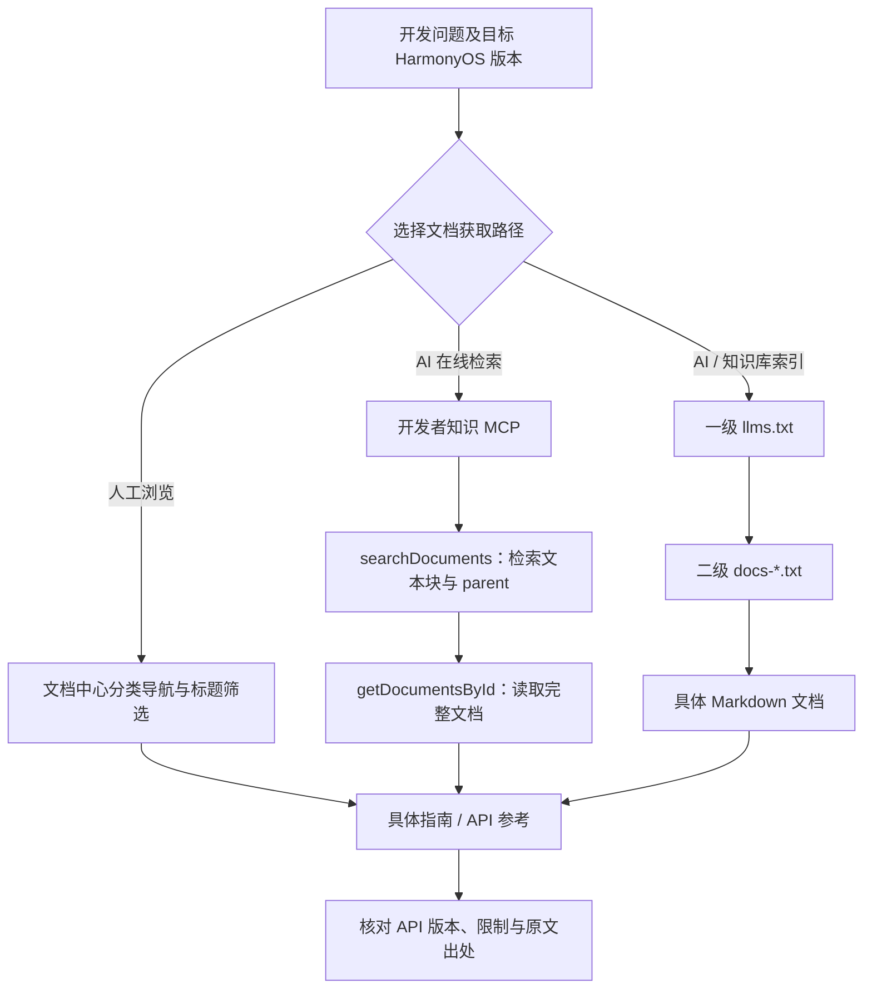

# Huawei HarmonyOS Developer Documentation Center（华为鸿蒙开发者文档中心）

## 一句话定义

**华为鸿蒙开发者文档中心（HarmonyOS Developer Documentation Center）** 是 HarmonyOS 应用开发的官方文档入口：开发者可按主题浏览指南与 API，AI 工具也可通过官方知识 MCP 或 `llms.txt` 索引定位原始文档。

## 英文缩写速查

| 缩写 | 英文全称 | 简要说明 |
|---|---|---|
| OS | Operating System | 此处指 HarmonyOS 的操作系统版本约束 |
| API | Application Programming Interface | 鸿蒙能力接口及其参数、限制和示例 |
| IDE | Integrated Development Environment | DevEco Studio 的开发、构建与调试环境 |
| MCP | Model Context Protocol | 将官方文档检索与全文获取能力接入兼容 AI 客户端 |
| LLM | Large Language Model | 可通过索引或 MCP 获得带出处的官方文档上下文 |
| RAG | Retrieval-Augmented Generation | 基于检索结果生成答案的知识库工作流 |

## 为什么重要

- **版本与出处可追溯：** 文档中心明确以 HarmonyOS **5.0 及以上**为主要范围，开发时要按目标版本查规范与 API，不能依赖记忆中的旧 SDK 行为。
- **同一资料有三条访问路径：** 人工分类导航；AI 客户端调用官方 MCP；AI 或知识库按 `llms.txt` 索引逐级读取 Markdown。
- **与机器人研究的关系需限定：** 该中心主要面向 HarmonyOS 应用和多设备生态，而非 ROS 2、运动控制或真机实时总线；对机器人团队可借鉴的是**官方文档 grounding 与可追溯检索实践**。

## 核心原理

### 文档覆盖与人工导航

官方主页将文档分为版本说明、工具（DevEco Studio/Code/CLI）、设计、指南与 API 参考、开发与测试、上架分发与运营、问题处理、最佳实践、行业解决方案等。初学者的官方推荐顺序是**应用开发导读 → 开发环境 → 第一个应用 → ArkTS**。

| 入口 | 适用问题 | 主要产物 |
|---|---|---|
| 分类目录与标题筛选 | 不确定从哪篇指南开始 | 按版本、工具或能力定位到文档 |
| 开发者知识 MCP | 需要 AI 根据当前官网资料回答 | 检索片段与完整原文 |
| `llms.txt` 两级索引 | 构建可追溯的 AI 文档阅读或 RAG 管道 | 类别索引 → 文档链接 → Markdown 正文 |

### 流程总览（官方文档访问链路）

以下是官方指南中**文档定位与获取**流程，不是 HarmonyOS 内核执行流程，也不是未经公开的 MCP 服务端实现图。

### 两种 AI 文档访问机制

**MCP：** 官方远程服务为 `https://connect-api.cloud.huawei.com/api/developerknowledge/mcp`。官方指南定义 `searchDocuments` 以及 `getDocumentsById`（一次最多 10 份文档）；后者使用前者返回的 `parent` 作为文档标识。官方称文档同步延迟不超过 30 分钟，**本次未独立测量**。

**llms.txt：** `https://developer.huawei.com/config/llms.txt` 是一级索引，指向 `docs-deveco-studio.txt`、`docs-capabilities.txt` 等类别索引，二级文件提供具体 Markdown 链接。索引在本次查阅时的文件头为 `update_time: 2026-09-17 00:00:00`；它是可变化的索引文件，不是 SDK 版本号。

## 工程实践

1. **先确认环境。** 明确目标 HarmonyOS / API 版本，按官方入门顺序安装 DevEco Studio，构建第一个 ArkTS 应用；对 HarmonyOS 3.1/4.0 及以下应改用旧版入口。
2. **人工查具体能力。** 在「指南与 API 参考」中按任务定位 Kit、权限、接口、版本支持与示例，使用「问题处理与运维」排查报错。
3. **给 AI 客户端接官方检索。** 若客户端支持远程 HTTP MCP，按[官方 MCP 指南](https://developer.huawei.com/consumer/cn/doc/start/hosknowledgemcp-0000002664603963)配置地址，然后实际检查连接状态和 `searchDocuments` 结果；不要仅因配置存在就假定已连通。
4. **需要索引入库时使用 llms.txt。** 依次获取一级索引、目标二级分类、具体 Markdown 原文；保存文档 URL 与抓取时间，并对增删改做同步。官方同时说明 `llms.txt` 尚非所有 AI 客户端原生支持的强制标准。
5. **让回答带出处。** 检索到文档后仍核对 API 签名、支持版本、权限和实际构建结果；AI 生成的代码不能代替运行与兼容性测试。

## 源码运行时序图

**不适用。** 本条目是官方开发文档与远程检索服务的导航实体；指定页面未发布可辨识的文档站或知识 MCP 服务端源码运行入口。这里的 Mermaid 图描述官方资料访问路径，不冒充服务内部调用图。官网虽有独立「示例代码库」链接，本次没有审计其源码与许可。

## 局限与风险

- **不是机器人底层控制参考。** 无法据此推断某款机器人可运行 HarmonyOS、支持 EtherCAT/CAN 实时控制或具备指定的驱动 API。
- **不能把整个文档库标为读完。** 本次通读的是文档中心主页、知识 MCP 指南、llms.txt 指南及一级索引；二级索引下的所有 API 文档没有逐篇阅读。
- **MCP 是服务接口，不等于开源服务端。** 官方公开协议接入方式，并不代表服务端源码、权限条件和可用性都能独立复现。
- **版本与时效敏感。** 旧版本文档入口不同；索引、导航及官方服务状态可能变化。使用时应核对当前页面，而非把本页当作静态接口保证。

## 关联页面

- [Agentic Coding 时代的软件工程基础](../concepts/agentic-coding-software-fundamentals.md) — AI 获取官方上下文后仍需要版本核对与工程测试
- [LLM Wiki（Karpathy 模式）](../references/llm-wiki-karpathy.md) — 将有出处的原文编译为可维护知识页
- [NVIDIA Skills](./nvidia-skills.md) — 另一种向 AI 工具提供官方工程知识的方式；Skills 与 MCP/llms.txt 不是同一种协议或内容形态

## 参考来源

- [文档中心一手资料归档](../../sources/sites/huawei-harmonyos-developer-doc-center.md)
- [华为开发者文档中心](https://developer.huawei.com/consumer/cn/doc/doccenter)
- [开发者知识 MCP 官方指南](https://developer.huawei.com/consumer/cn/doc/start/hosknowledgemcp-0000002664603963)
- [llms.txt 文档索引官方指南](https://developer.huawei.com/consumer/cn/doc/start/llms-0000002670606713)
- [实时一级 llms.txt 索引](https://developer.huawei.com/config/llms.txt)

## 推荐继续阅读

- [华为官方应用开发导读](https://developer.huawei.com/consumer/cn/doc/doccenter-getting-started/application-dev-guide) — 入门和环境准备
- [官方 DevEco Studio 文档索引](https://developer.huawei.com/consumer/cn/llms/docs-deveco-studio.txt) — IDE 的安装、构建、调试与测试
- [官方 API 文档索引](https://developer.huawei.com/consumer/cn/llms/docs-references.txt) — 接口与版本约束；使用前核实目标 API
