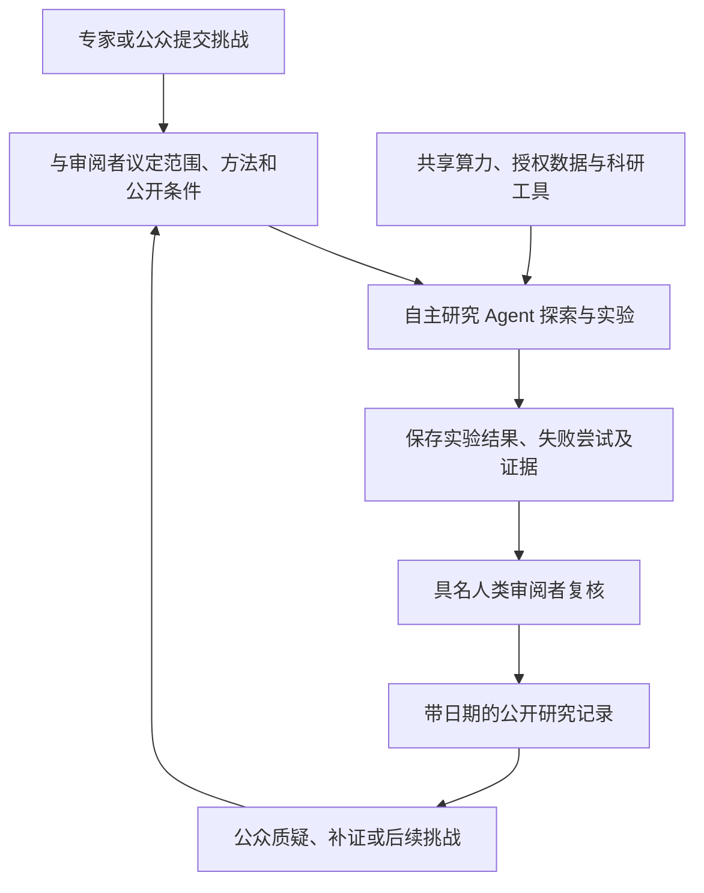

# Human Frontier Mission（HFM，人类拓界计划）

## 一句话定义

HFM 是以公开科研挑战为组织单元，将专家定义的评价标准、自主研究 Agent、共享科研资源和人类证据复核连接起来的开放科研计划；此页依据 2026-11-01 官方公开计划书，描述制度流程而非未公开的算法实现。

## 英文缩写速查

| 缩写 | 英文全称 | 简要说明 |
|---|---|---|
| HFM | Human Frontier Mission | 人类拓界计划 |
| AI | Artificial Intelligence | 参与科研探索与执行的人工智能 |
| VLM | Vision-Language Model | 公开挑战中的视觉语言模型空间推理对象 |

## 为什么重要

自动科研的难点不只是生成实验代码，还包括问题是否值得解决、指标是否可比、失败是否可追溯及结论是否能由独立研究者核验。HFM 的公开章程将这些问题纳入组织机制，可作为设计机器人自主实验平台的治理参考。

## 核心原理

| 环节 | 官方计划书规定的责任与产物 |
|---|---|
| 提案 | 提出研究问题、可合法共享的证据和预期价值 |
| 议定 | 提案人及指定审阅者明确范围、方法、公开条件和基线 |
| 自主研究 | Agent 使用共享算力、获授权数据和科研工具探索候选方法 |
| 复核 | 具名人类审阅者检查背景、方法、证据和局限 |
| 公开记录 | 日期、挑战、研究运行、指标、来源及限制；保留失败试验并区分自报与复现 |
| 延续 | 公众质疑、补充证据或提出后续挑战 |

### 流程总览

图依据章程第 2–6、9 条及公众参与四步整理；不是平台源码调用图。

## 工程实践

官网列出材料循环载荷预测、交通信号协调、工业生产调度及 VLM 相对位置推理等挑战。[空间理解挑战](https://hf-mission.com/live/discovery_live_embspatial/) 的可见页面不足以核验具体评测配置或成绩。

委员会 2026-11-21 发布公告自报 12 个领域、54 个挑战、2391 次实验及 23 项正在运行的研究；这是有时间边界的活动规模快照，不是科研成功率或独立复现统计。

对机器人研究的迁移建议（本库归纳，非 HFM 已验证的机器人实现）：

1. 专家预先定义任务、训练预算、基线和不可更改的评价口径，例如跟踪误差、跌倒率或任务成功率。
2. 让 Agent 提出并执行有限范围的仿真实验，记录配置、种子、代码版本和失败轨迹。
3. 将最优结果交给独立种子、留出场景和人工检查复核，真机试验另设安全门禁。
4. 发布证据与未解决问题，供下一轮研究复用；不能仅发布最高分。

## 与其他工作对比

| 工作 | 关注点 | 与 HFM 的差别 |
|---|---|---|
| [Karpathy autoresearch](./karpathy-autoresearch.md) | 固定预算的自动训练实验 | HFM 侧重跨领域挑战与公开记录制度 |
| [A Society of AI Scientists](./paper-society-of-ai-scientists.md) | 科研 Agent 共同体和审稿 | HFM 章程明确具名人类审阅与公共提案 |
| [Research Swarm Cheating](./paper-research-swarm-cheating-whistleblowing.md) | 自主研究群体的评估漏洞与审计 | 为 HFM 式公开证据机制提供风险对照，不代表 HFM 已解决该风险 |

## 源码运行时序图

**不适用**：截至 2026-11-24，已检查官网、计划书与任务记录的静态内容，未发现官方可运行科研 Agent 源码入口；动态工作区未完整取得，不虚构运行时调用关系。

## 局限与风险

- 公开计划书为工作草案，制度承诺不等于所有挑战已满足这些规则。
- 公开实验记录与源码、模型权重、原始数据的开放是不同层次；后者的开放范围待核实。
- 实验数量不代表独立复现、效果显著或科学新颖性；需逐挑战核对基线和证据。
- 委员会成员的所属机构不自动构成机构背书。
- 自动实验也不意味着递归自我改进；章程未证明改进机制本身被自主改进。
- 机器人迁移仍需要可重复 reset、受控执行权限及独立真机安全验证。

## 关联页面

- [AI Auto-Research](../concepts/ai-auto-research.md)
- [Karpathy autoresearch](./karpathy-autoresearch.md)
- [A Society of AI Scientists](./paper-society-of-ai-scientists.md)
- [Research Swarm Cheating](./paper-research-swarm-cheating-whistleblowing.md)

## 参考来源

- [HFM 官方计划书与官网归档](../../sources/sites/human-frontier-mission.md)

## 推荐继续阅读

- [官方计划书（2026-11-01）](https://hf-mission.com/static/frontier/programme/index.html)
- [Mission Records](https://hf-mission.com/live/records/)
