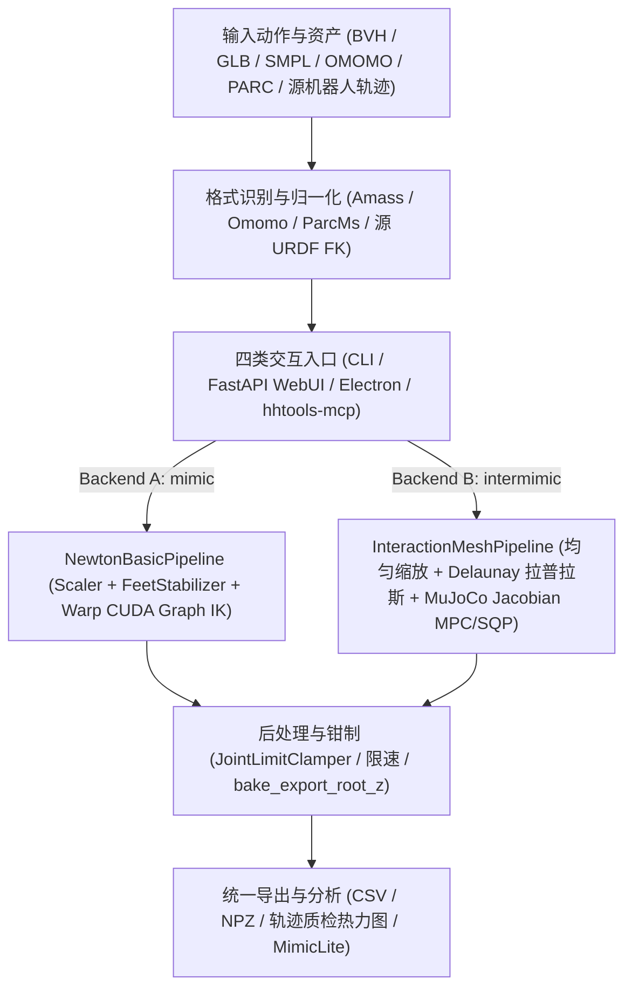
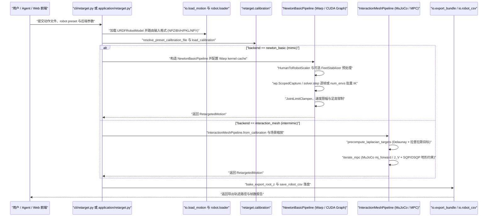

# human-humanoid-tools（hhtools）

## 一句话定义

**human-humanoid-tools**（简称 **hhtools**，包名 `hhtools`，Python `>= 3.12`，Apache-2.0）是 [Party OS](./party-os.md) 首批开源的**面向人形机器人的动作重定向、Robot-to-Robot（R2R）迁移与运动数据分析工作台**，在同一套 `Motion` 与 `URDFRobotModel` 契约下整合了 **Newton IK** 与 **Interaction-Mesh** 双求解后端以及 CLI、WebUI、桌面端和 Agent/MCP 四种运行入口。

## 英文缩写速查

| 缩写 | 英文全称 | 简要说明 |
|------|----------|----------|
| IK | Inverse Kinematics | 逆运动学；Backend A 基于 NVIDIA Newton/Warp 进行逐帧 LM 求解 |
| URDF | Unified Robot Description Format | 统一机器人描述格式；支持拖入自定义 URDF 与 Mesh 资产 |
| R2R | Robot to Robot | 机器人到机器人动作迁移，先走源 URDF FK 再重定向至目标机器人 |
| BVH | BioVision Hierarchy | 常用动捕骨骼动画格式（支持 LAFAN / SOMA / Xsens / Mixamo 方言） |
| SMPL | Skinned Multi-Person Linear Model | 参数化人体网格模型（权重需单独申请并置于本地缓存） |
| MPC / SQP | Model Predictive Control / Sequential Quadratic Programming | 模型预测控制与序列二次规划；Interaction-Mesh 后端核心求解框架 |
| MCP | Model Context Protocol | `hhtools-mcp` 暴露的 stdio 代理协议接口，供外部 AI Agent 驱动标定与批处理 |

## 为什么重要

1. **打通多数据源与多机型碎片化瓶颈：** [Motion Retargeting](../concepts/motion-retargeting.md) 常被「每套数据集重写导入脚本、每台机器人手写 IK 适配」拖慢；`hhtools` 通过适配器自动识别常见人体动作格式，并依托标准 URDF + 标定档案快速扩展至新本体。
2. **动捕高速批量与强接触交互双路径并存：** 简单自由空间动作可走 Warp GPU / CUDA Graph 并行的 Newton IK 实现批量导出；涉及人与物体/复杂地形交互（OMOMO、PARC MS、OmniContact、meshmimic）时则切换 Interaction-Mesh 保持空间拓扑与防穿透约束。
3. **跨本体资产复用（R2R）与 Agent 自动化：** 借助 `robot_to_robot.py` 的源机器人正运动学抽象与 MCP v2 接口，可将已验证动作库迁往新机型，或由自动化代理完成标定预检、批量作业调度与下游 [MimicLite](./mimiclite.md) 导出。

## 核心原理

`hhtools` 将多格式输入统一归一化为内部 `Motion` 数据结构，按任务场景路由至双重定向后端或 R2R 正运动学管线，并输出兼容仿真与真机训练的关节轨迹：

### 1. 双重定向求解后端

| 后端 | 源码位置与依赖 | 核心机制与适用场景 |
|------|------|------|
| **Backend A：`newton_basic`** | `hhtools/retarget/newton_basic/pipeline.py`（适配自 NVIDIA `SOMA-Retargeter`，依赖 Warp / [Newton Physics](./newton-physics.md)） | 先由 `HumanToRobotScaler` 按部位标定缩放，再经可选 `FeetStabilizer` 约束触地与滑步，随后用 `newton.ik`（`wp.ScopedCapture` 记录 CUDA Graph，批处理支持 `num_envs=N` 并行模型）进行逐帧 LM 迭代，最后经过 `JointLimitClamper` 与速度限制输出。适合常规全身动作的高吞吐重定向。 |
| **Backend B：`interaction_mesh`** | `hhtools/retarget/interaction_mesh/pipeline.py`（对标 `holosoma`，依赖 MuJoCo 与可选 OSQP） | 采用 `robot_height / human_height` 均匀缩放保留整体交互尺度，仅对 `ik_map` 映射关节构建 Delaunay 四面体及目标拉普拉斯坐标 $\delta^*_f = L V_f$；`iterate_mpc` 结合 MuJoCo `mj_forward` 与雅可比 `J_V` 通过信赖域 MPC/SQP（稠密 KKT / L-BFGS-B 或 OSQP 地形与物体防穿透约束）求解。适合携箱、攀爬等接触丰富（HOI / 地形）场景。 |

### 2. Any Motion 与内置资产生态

- 统一 `hhtools.io` 适配器自动识别并导入 `BVH`（自动区分 `soma`、`lafan`、`mocap`、`xsens_mocap` 等骨骼方言）、`GLB`、`NPZ/CSV`、以及 `AMASS`、`Motion-X`、`OMOMO`（`.pkl` 物体网格）、`OmniContact`（`motion_actor.bvh` 目录）、`PARC MS`（地形 `.pkl`）、`meshmimic/holosoma`（`.npy`）、`PHUMA` 等数据。
- `configs/builtin-assets.json` 内置了 `7` 款参考机器人预设：ROBOTO 01、Unitree G1、ROBOTO_ORIGIN (RPO)、AgiBot X2、Asimov 1、Fourier GR-2 与 Berkeley Humanoid Lite，同时支持拖入任意标准 URDF + Mesh 注册新机器人。

### 3. Robot → Robot（R2R）跨本体迁移

- `hhtools/retarget/robot_to_robot.py` 读取源机器人的 `csv` / `pkl` / `npz` 导出轨迹，按源 `ik_map` 运行 URDF 前向运动学恢复规范关键点 `Motion`，并将源机器人零位 FK 姿态作为参考骨架进行标定，进而复用 `NewtonBasicPipeline` 或 `InteractionMeshPipeline` 迁移到目标机型。

### 4. 四类接口与数据分析可视化

- 除命令行（`hhtools`）外，提供本地 FastAPI + HTML/three.js WebUI（`uv run hhtools web`，端口 `8009`；已取代早期的 Viser 方案）、Electron 桌面端（`hhtools-desktop`）以及基于 `RuntimeLeaseError` 互斥锁保护工作目录的 stdio MCP 服务器（`hhtools-mcp`）。内置分析面板可核查关节角轨迹、质心动态、接触点热力图并按水平速度等运动学条件筛选片段。

## 源码运行时序图

以下时序图覆盖 `hhtools` 在 `13b6dd3` 提交中的双后端执行链路：包括 CLI（`retarget run` / `retarget interaction-mesh run`）与 WebUI/Agent 共用的应用层运行时 `hhtools/application/retarget.py`。

图依据：`Roboparty/human-humanoid-tools@13b6dd3024193aeb24eb4bf7ea5c73a975a38f5b`，实读 `pyproject.toml`、`framework.md`、`hhtools/cli/main.py`、`hhtools/cli/retarget.py`、`hhtools/application/retarget.py`、`hhtools/retarget/newton_basic/pipeline.py`、`hhtools/retarget/interaction_mesh/pipeline.py`、`hhtools/web/server/factory.py` 与 `hhtools/mcp/server.py`。

## 工程实践

- **按任务特征选后端：** 批量处理无物体/无复杂地形的自由动作（如 AMASS、LAFAN 舞蹈与空翻）时选用 `newton_basic`；若动作依赖与箱子、椅子或台阶的精确几何接触（OMOMO、PARC MS、OmniContact），切换 `interaction_mesh` 并确保安装可选依赖 `osqp`。
- **CLI 与 Web/MCP 互斥锁：** 通过 `hhtools-mcp` 自动化调度时，若本地已开启 `hhtools web` 并指向同一 `--save-dir`，MCP 进程会因 `RUNTIME_ALREADY_ACTIVE`（退出码 `3`）拒绝双写，需先关闭另一方运行实例。
- **预热与权重准备：** 首次运行 Newton IK 会触发 Warp GPU 内核编译及 `prewarm_newton_ik_for_robot`；解析 SMPL/SMPL-H/SMPL-X 输入前需先获取 MPI 非商业模型权重并置于 `~/.cache/hhtools/body_models/`。
- **下游质检闭环：** 导出 CSV/NPZ 后应结合关节限位、足端高度偏移（`playback_mesh_z_lift`）和滑脚检查做筛选，再接入 [MimicLite](./mimiclite.md) 或 [模仿学习（IL）](../methods/imitation-learning.md) / RL 跟踪训练。

## 常见误区与局限

- **运动学/几何重定向不等于动力学可跟踪：** `newton_basic` 输出无显式全身动力学一致性保证，`interaction_mesh` 亦属于准静态/信赖域几何拉普拉斯规划；高动态空中或强冲击动作仍需经下游仿真 RL 策略修复（见 [Motion Retargeting](../concepts/motion-retargeting.md)）。
- **身体模型与资产许可边界：** 软件代码遵循 Apache-2.0，但 SMPL 系列权重受 MPI 非商业协议约束，且 `configs/builtin-assets.json` 中内置示例动作与部分第三方 URDF 仍各自保留原始数据许可限制。
- **交互约束与同类研究方法的取舍：** 地形求解依赖 `osqp`（缺失或不可行时会触发 `OSQP_FALLBACK_TRUST_SHRINK` 回退）；针对特定复杂手-物精密接触（HOI）场景，仍需与学界专用接触优化方法（如 [GMR 重定向](../methods/motion-retargeting-gmr.md) 等对比基线）对照评测效果与耗时。
- **自动格式识别边界：** 私有格式或未列明的骨骼命名规范可能无法自动映射 `ik_map`，需要编写自定义适配器或补充 `retarget_calibration_<ref>.yaml`。

## 关联页面

- [Party OS](./party-os.md)
- [MimicLite](./mimiclite.md) — 下游跟踪训练
- [Motion Retargeting](../concepts/motion-retargeting.md)
- [GMR（通用动作重定向）](../methods/motion-retargeting-gmr.md)
- [模仿学习（Imitation Learning）](../methods/imitation-learning.md)
- [Newton Physics](./newton-physics.md)
- [人形训练数据管线](../queries/humanoid-training-data-pipeline.md)
- [Teleoperation](../tasks/teleoperation.md)
- [RoboParty Lab / Party OS 技术地图](../overview/roboparty-lab-party-os-technology-map.md)

## 公司路线日期口径

GitHub Release：0.1.0(beta) / HHTools 0.1.0 Preview，2026-09-24 published_at；是 GUI 预览版本，不是首批工具链首发。 [日期证据](https://github.com/Roboparty/human-humanoid-tools/releases/tag/0.1.0(beta))。详见[本轮日期核查](../../sources/sites/company-roadmap-date-audit-2026-10-08.md)；版本事件与原始产品首发分别记录。

## 参考来源

- [Roboparty/human-humanoid-tools 源码与双后端管线核查（@13b6dd3）](../../sources/repos/human_humanoid_tools_reading.md)
- [公司路线日期核查](../../sources/sites/company-roadmap-date-audit-2026-10-08.md)
- [human_humanoid_tools.md](../../sources/repos/human_humanoid_tools.md)
- [wechat_roboparty_lab_party_os_3_tools.md](../../sources/blogs/wechat_roboparty_lab_party_os_3_tools.md)

## 推荐继续阅读

- [human-humanoid-tools GitHub](https://github.com/Roboparty/human-humanoid-tools)
- [Motion Retargeting 概念页](../concepts/motion-retargeting.md)
- [RoboParty Lab / Party OS 技术地图](../overview/roboparty-lab-party-os-technology-map.md)
