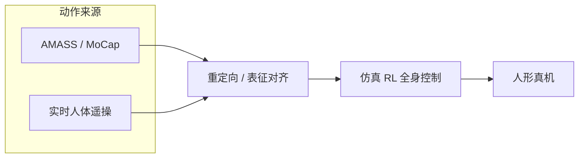
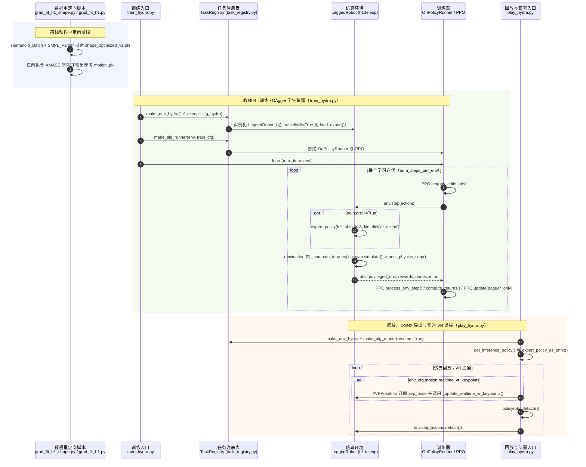

---

type: entity
tags: [repo, humanoid, teleoperation, motion-retargeting, lecar-lab, cmu]
status: complete
updated: 2026-09-22
summary: "LeCAR-Lab human2humanoid 是人形全身实时遥操作与模仿学习开源栈，README 提供 AMASS→机器人重定向脚本，同系 OmniH2O / H2O / ASAP。"
related:
  - ../concepts/motion-retargeting.md
  - ./paper-hrl-stack-07-learning-human-to-humanoid-real-time.md
  - ./paper-hrl-stack-08-omnih2o.md
  - ./paper-notebook-asap-aligning-simulation-and-real-world-physics.md
  - ./humanoidverse.md
  - ./tairan-he.md
original: ../../sources/repos/human2humanoid.md
sources:
  - ../../sources/repos/human2humanoid.md
  - ../../sources/repos/asap.md
---

# human2humanoid（LeCAR-Lab）

**human2humanoid**（<https://github.com/LeCAR-Lab/human2humanoid>）是 CMU **LECAR Lab** 的 **人形全身实时遥操作（human-to-humanoid teleoperation）** 开源代码库，配套项目页 <https://human2humanoid.com/>。除遥操接口与 RL 训练外，仓库 **README 的 Motion Retargeting** 章节提供 **AMASS 等人体运动 → 目标人形** 的转换脚本入口。

## 一句话定义

**human2humanoid**（LeCAR-Lab）是面向人形机器人全身实时遥操作与模仿学习的开源栈，提供从 AMASS 人体动作到机器人关节空间的重定向脚本与策略训练流程（同系包括 OmniH2O、H2O 与 ASAP）。

## 英文缩写速查

| 缩写 | 英文全称 | 简要说明 |
|------|----------|----------|
| MoCap | Motion Capture | AMASS 等参考动作来源 |
| RL | Reinforcement Learning | 跟踪遥操或重定向参考 |
| WBT | Whole-Body Tracking | 全身关节/根轨迹跟踪 |
| Sim2Real | Simulation to Real | 仿真策略上真机 |

## 为什么重要

- **遥操 + 重定向同仓**：现场操作者动作与离线 MoCap 库可通过同一套人形表征进入训练，减少「遥操一套、重定向另一套」的接口分裂。
- **同系扩展**：后续 [OmniH2O](https://omni.human2humanoid.com/)（鲁棒遥操）、[ASAP](https://agile.human2humanoid.com/)（敏捷运动）等共享 LECAR 工程脉络；见 [Tairan He](./tairan-he.md)。

## 流程总览

## 源码运行时序图

以下时序图基于官方仓库 `LeCAR-Lab/human2humanoid`（`main` 分支）核读的源码与运行入口梳理：`README.md`、`scripts/data_process/grad_fit_h1_shape.py`、`scripts/data_process/grad_fit_h1.py`、`legged_gym/legged_gym/envs/__init__.py`、`legged_gym/legged_gym/scripts/train_hydra.py`、`legged_gym/legged_gym/scripts/play_hydra.py`、`legged_gym/legged_gym/utils/task_registry.py`、`legged_gym/legged_gym/envs/base/legged_robot.py`、`rsl_rl/rsl_rl/runners/on_policy_runner.py` 与 `rsl_rl/rsl_rl/algorithms/ppo.py`。

- **关键复现路径**：先运行 `scripts/data_process/grad_fit_h1_shape.py` 与 `grad_fit_h1.py` 生成 H1 参考动作；再通过 `legged_gym/scripts/train_hydra.py`（`task=h1:teleop`）训练特权教师或开启 `train.distill=True` / `train.dagger.dagger_only=True` 蒸馏学生策略；最后由 `legged_gym/scripts/play_hydra.py` 导出 ONNX/JIT 或接入 `avp_pose` ROS 话题进行实时遥操回放。

## 工程实践

- **AMASS 重定向脚本**：使用仓库自带的形状优化与 IK 重定向脚本，将 SMPL 人体序列批量映射到目标人形（如 Unitree H1/G1）的关节轨迹。
- **教师–学生蒸馏**：在仿真中先训练特权信息教师策略，再蒸馏到仅依赖本体感知与遥操作指令的部署策略。

## 局限

- **依赖特定硬件与仿真栈**：早期版本主要围绕 Unitree H1 与 Isaac Gym 构建，跨机型或迁移至 Isaac Lab 需额外适配。
- **纯运动学重定向**：上游 AMASS 重定向未显式约束动力学平衡，极端动作仍需下游 RL 策略吸收误差。

## 关联页面

- [Motion Retargeting](../concepts/motion-retargeting.md)
- [Learning Human-to-Humanoid](./paper-hrl-stack-07-learning-human-to-humanoid-real-time.md)
- [OmniH2O](./paper-hrl-stack-08-omnih2o.md)
- [GMR](../methods/motion-retargeting-gmr.md)
- [Tairan He](./tairan-he.md)

## 参考来源

- [human2humanoid 仓库归档](../../sources/repos/human2humanoid.md)

## 推荐继续阅读

- GitHub：<https://github.com/LeCAR-Lab/human2humanoid#motion-retargeting>
- 项目页：<https://human2humanoid.com/>
