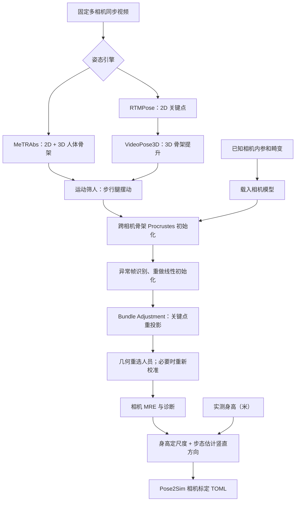
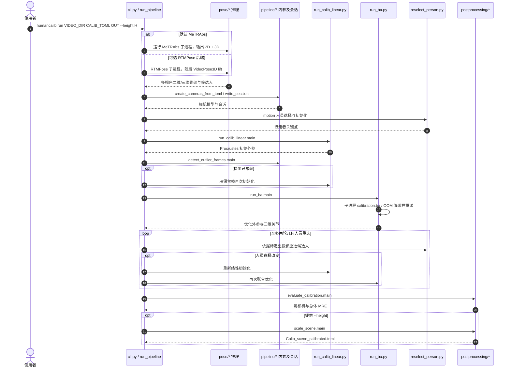

# HumanCalib：走路完成多相机外参标定 / Walking-Person Multi-Camera Extrinsic Calibration

## 一句话定义

**HumanCalib** 是利用一个人在多台固定相机的同步画面中走动，结合已知相机内参和身高，估计各相机外参、真实米制尺度与竖直方向，输出可被 Pose2Sim 使用的标定 TOML 的**无标定物外参标定工具**。

## 英文缩写速查

| 缩写 | 英文全称 | 简要说明 |
|---|---|---|
| MoCap | Motion Capture | 无标记人体动作捕捉的下游应用 |
| BA | Bundle Adjustment | 联合优化相机外参和三维关节，使二维重投影一致 |
| MRE | Mean Reprojection Error | 平均重投影误差；仅是内部一致性诊断 |
| 2D/3D | Two-/Three-Dimensional | 多视角二维关键点与单相机三维人体骨架 |
| TOML | Tom's Obvious Minimal Language | Pose2Sim 相机内参/外参配置文件格式 |

## 为什么重要

- **省去外参标定物：** 传统多相机动捕通常要布置棋盘格或标定杆；此工具改用正在步行的人体姿态作为跨视角几何约束，可适合重新布设固定摄像机的动捕场地。
- **补上米制与世界竖直方向：** 单凭相对投影几何难得到真实尺度；工具将身高与多帧步态几何结合，输出可用于下游三角化与运动学分析的坐标系。
- **衔接现有工作流：** [FreeMoCap](./freemocap.md) 是多相机动捕平台，[EasyMocap](./easymocap.md) 更偏人体拟合，HumanCalib 专门解决上游相机**外参**，并非完整的人体重建或机器人重定向器。

## 核心原理

| 阶段 | 官方机制 | 结果 |
|---|---|---|
| 输入 | 多路固定相机同步视频、每台相机已知内参/畸变、被拍者身高 | 相同时间基准的观察与尺度依据 |
| 姿态提取 | 默认 MeTRAbs 同时给 2D + 相机系 3D；可选 RTMPose 2D + VideoPose3D 提升 | 每台相机的人体骨架 |
| 目标人员 | 依据 3D 腿摆动识别走动者，初次标定后用几何重投影重选 | 降低旁观者混入风险 |
| 线性初始化 | 不同相机系骨架通过 Procrustes / Umeyama 对齐，自动选参考相机 | 各相机初始相对位姿 |
| 几何优化 | 剔除异常帧，带关键点置信度的 BA 和骨长/方向一致性约束 | 外参和三维点的联合精炼 |
| 世界系恢复 | 身高约束米制尺度；行走时头到足的稳健方向、去除前倾分量 | 带尺度、近似重力对齐的相机位姿 |
| 评估输出 | 每相机 MRE、诊断图、导出 TOML | `Calib_scene_calibrated.toml` |

### 流程总览



**注意：** 此图显示官方默认全流程的模块和可选后端；`--height` 未提供时不产生所述完整米制世界系结果。

## 源码运行时序图

依据 `flodelaplace/HumanCalib@bb5dee70` 的 `src/humancalib/cli.py::run_pipeline`，以及 `pipeline/run_calib_linear.py`、`pipeline/reselect_person.py`、`pipeline/run_ba.py`、`postprocessing/scale_scene.py`：



上述为官方代码可辨认的调用关系，并非实际运行日志或测时。默认 MeTRAbs 与 RTMPose 路径**二选一**，图中的 opt 表示可替换后端，非连续运行两个模型。

## 工程实践

官方支持安装为 Python 包、Docker 或在仓库中用 `scripts/calibrate.sh`；正常用法：

```bash
humancalib run input/my_session input/my_session/Calib_scene.toml output/my_session --height 1.84
```

| 要点 | 实操建议 |
|---|---|
| 录制 | 相机**固定**且时间同步，让一人多次穿过视场重叠的有效采集空间；不要求标定板 |
| 输入 | `Calib_scene.toml` 含 camera size、内参矩阵、畸变系数；视频基础名应与 TOML 节名一致 |
| 评估 | 检查各相机 MRE 和重投影诊断；低 MRE 不保证相对于实验室真值的外参绝对准确 |
| 复现 | 官方提供 `demo/` 四机位样例、Python `calibrate(...,height=...)` 和 GPU / Docker 环境说明 |
| 下游 | 将 `Calib_scene_calibrated.toml` 提供给 Pose2Sim 动作重建；所得动作还须经 [GMR 重定向](../methods/motion-retargeting-gmr.md) 等方法映射到机器人 |

官方 README 报告五套数据集 97 次 trial 中默认 MeTRAbs 未出现标定失败；有实验室参考的 BioCV、I-MOVE-23、OpenCap 三组相对旋转误差中位数分别为 **0.47°、0.51°、1.89°**，属于作者结果，**本次未在本地复测**。源码 MIT，但用于人体姿态估计的预训练模型存在非商业或未明示权重许可，商用前应分别核对。

## 局限与风险

- **“免标定物”不是“免内参”**：必须有可靠的内参及畸变系数；内参误差可影响外参、米制尺度，即便重投影误差看似正常。
- **步行与视角重叠条件**：默认竖直估计基于自然步行，空间覆盖和同步质量决定可观测性；静立参考可切换 `--vertical_method frame`，但不能直接套用默认精度。
- **人为尺度输入**：身高测量误差直接进入尺度；官方报告每 1 cm 身高误差约导致 0.6% 的尺度误差。
- **并非动作捕捉算法本身**：输出的是相机标定参数，不是最终 SMPL/机器人关节轨迹；后续 Pose2Sim 三角化、滤波与拟合仍需单独运行。
- **验证边界**：作者报告是特定数据集与相机布置；未证明所有强遮挡、移动机位、滚动快门或宽基线场景都能稳定标定。

## 关联页面

- [FreeMoCap](./freemocap.md) — 无标记多相机动捕平台，与该工具的外参阶段可做方案对照。
- [EasyMocap](./easymocap.md) — 多视角人体拟合，对标已标定相机输入约束。
- [Calibrex](./calibrex.md) — 机器人多传感器外参/可观测性检测的另一类工具，目标与标定信号不同。
- [运动重定向 GMR](../methods/motion-retargeting-gmr.md) — 相机标定及人体动作重建的下游。
- [Locomotion](../tasks/locomotion.md) — 人体步态与机器人行走学习的应用背景。

## 推荐继续阅读

- [官方 HOWTO：同步视频、内参与完整 CLI](https://github.com/flodelaplace/HumanCalib/blob/main/HOWTO.md)
- [官方 METHOD：初始化、BA、尺度与竖直方向技术细节](https://github.com/flodelaplace/HumanCalib/blob/main/docs/METHOD.md)
- [Pose2Sim 官方仓库](https://github.com/perfanalytics/pose2sim)

## 参考来源

- [HumanCalib 原始 README、METHOD 与关键源码核对归档](../../sources/repos/humancalib.md)
- [官方仓库 HumanCalib](https://github.com/flodelaplace/HumanCalib)
- [作者预印本（HAL，在审）](https://hal.science/hal-05855397v1)
