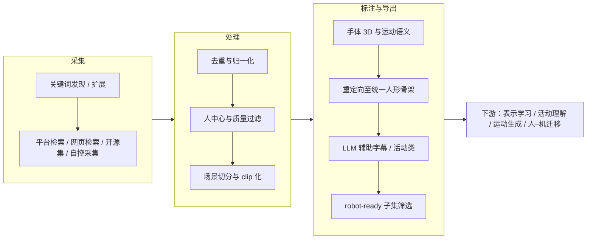

# HumanNet：百万小时人中心视频语料 / Human-Centric Video Learning at Million-Hour Scale

## 一句话定义

HumanNet 是面向具身学习的第一人称与第三人称混合人中心视频语料与策展管线，官方论文描述约一百万小时整体数据，不能将其全部视为第一人称 Ego 片段。

**HumanNet** 是一套把 **互联网级人中心视频** 加工成「可喂给大规模模型」的具身向语料：强调 **第一人称与第三人称并存**、**物理相关行为** 的策展、以及 **手体几何 + 语言描述 + 活动语义** 等多层标注；论文在固定下游设定下对比了 **egocentric 人视频小时数** 与 **真机机器人数据小时数** 作为 VLA 类模型持续预训练来源的相对价值。

## 英文缩写速查

| 缩写 | 英文全称 | 简要说明 |
|------|----------|----------|
| VLA | Vision-Language-Action | 视觉-语言-动作多模态基础策略方向 |
| Ego | Egocentric Vision | 第一人称视角感知与控制 |
| VLM | Vision-Language Model | 视觉-语言多模态理解模型，VLA 的上游 |
| Retargeting | Motion Retargeting | 将人体/动物动作映射到目标机器人骨架 |

## 为什么重要？

- **缓解机器人日志稀缺**：高质量真机演示昂贵且慢；人视频在行为多样性与环境覆盖上可补位，但前提是管线能把「泛网页视频」压成 **交互可学** 的分布。
- **视点分工明确**：ego 侧贴近执行者与手–物接触；exo 侧补充全身运动与多智能体场景上下文，和 Ego-Exo4D 等路线的动机一致，但目标更偏向 **具身预训练基础设施**。
- **可审计管线**：采集 / 处理 / 标注分阶段，便于与工业界数据飞轮、自动标注与隐私合规流程对照讨论（不等同于已解决隐私与许可问题）。

## 流程总览（论文管线抽象）

**robot-ready 子集（论文公开阈值）**：重定向误差约 **<15 mm** 且有效帧覆盖率 **>60%** 的片段被标为更适合跨本体运动监督；具体比例与字段以官方数据卡与仓库说明为准。

## 工程实践：原始 Ego 与 Open-HumanWAM 的数据边界

| 数据资产 | 官方一手证据 | 当前开放边界 |
| --- | --- | --- |
| HumanNet 整体 | 约 1,000,000 小时，含**第一与第三人称** | 官方 main README 的全量语料发布任务仍未完成 |
| 用于 Open-HumanWAM 的 HumanNet 子集 | **90,275.25 h → 40,743.58 h**（筛选前→后） | 是 **选取的 Ego 子集**，不能倒推完整 HumanNet Ego 时长 |
| Open-HumanWAM-50K | 五来源共 **104,289.41 h → 50,000 h** | HF 公开数据卡仍显示 gated、上传中（2026-11-10 快照） |
| HumanNet ModelScope 原始 Ego | 用户提及“20 万小时” | [ModelScope 路径](https://www.modelscope.cn/datasets/DAGroup-PKU/HumanNet/tree/master/data) 数据卡/文件清单尚不能读取，**规模未核实** |

**复现建议：** 优先根据[Open-HumanWAM](paper-open-humanwam.md) 已有的模型训练、推理与评测入口，使用其 [50K 数据归档](../../sources/datasets/open-humanwam-50k.md)中的 LeRobot v3 格式和 subset index；不能默认能下载 HumanNet 全量 1M 小时。数据条款与代码 Apache-2.0 不应混用。

### 源码运行时序图

**不适用（HumanNet 原始数据本体）：** 官方 main 文档仍将完整 HumanNet 数据下载及处理部署留作待发布事项，没有可核验的完整独立运行入口。上方 Mermaid 为论文管线抽象，不冒充运行源码。相关可运行训练/推理源码及其真实时序图见[Open-HumanWAM](paper-open-humanwam.md)独立分支。

## 常见误区或局限

- **「百万小时」不是「百万小时 Ego」**：原论文包括一三人称；所谓“20 万小时原始 Ego”未得到可读取的数据卡证据。
- **「百万小时」≠ 均匀覆盖**：论文强调长尾行为需要规模，但分布仍受互联网来源偏置与过滤规则影响；下游任务仍需匹配数据切片。
- **不能替代安全与物理一致**：人视频可改善视觉–语义–动作接口的先验，但接触动力学、执行器与系统延迟仍需真机或高保真仿真闭环。
- **许可与隐私**：一三人称室内场景可能涉及身份与空间隐私；工程使用需以发布方条款与本地合规审查为准。

## 与其他页面的关系

- **方法**：[VLA](../methods/vla.md) 讨论把 web/VLM 能力接到动作头；HumanNet 代表「人类视频小时」作为持续预训练来源的系统级尝试。
- **方法**：[Imitation Learning](../methods/imitation-learning.md) 把人类演示视作监督来源时，可对照互联网级人视频的策展与重定向接口。
- **概念**：[Motion Retargeting](../concepts/motion-retargeting.md) 是连接人体运动与机器人可训练监督的关键模块。
- **实体**：[人形机器人](./humanoid-robot.md) 作为典型目标形态，可与人视频–机器人数据的混合训练叙事对照阅读。

## 参考来源

- [HumanNet 论文 ingest 归档](../../sources/papers/humannet.md)
- [HumanNet Table 1 代表性语料与官方入口索引](../../sources/papers/humannet_table1_benchmark_corpora.md)
- [HumanNet 仓库与项目索引](../../sources/repos/humannet.md)
- [ModelScope 原始 Ego 目录核验](../../sources/datasets/humannet-modelscope-ego.md)
- [Open-HumanWAM 论文与配方](paper-open-humanwam.md)
- Deng et al., *HumanNet: Scaling Human-centric Video Learning to One Million Hours* (arXiv:2605.06747)
- 项目主页：<https://dagroup-pku.github.io/HumanNet/>
- 代码仓库：<https://github.com/DAGroup-PKU/HumanNet/>

## 关联页面

- [Open-HumanWAM（50K 数据与 WAM 模型）](paper-open-humanwam.md)
- [HumanNet Table 1：代表性人类视频语料对照](../comparisons/humannet-table1-human-video-corpora.md)
- [VLA](../methods/vla.md)
- [Imitation Learning](../methods/imitation-learning.md)
- [自动化标注流水线](../methods/auto-labeling-pipelines.md)
- [Motion Retargeting](../concepts/motion-retargeting.md)
- [具身规模法则](../concepts/embodied-scaling-laws.md)
- [人形机器人](./humanoid-robot.md)

## 推荐继续阅读

- [机器人论文阅读笔记：EgoDex](https://imchong.github.io/Robot_Learning_Paper_Notebooks/papers/06_Manipulation/EgoDex__Learning_Dexterous_Manipulation_from_Large-Scale_Egocentric_Video/EgoDex__Learning_Dexterous_Manipulation_from_Large-Scale_Egocentric_Video.html)
- [EgoScale](../methods/egoscale.md)（arXiv:2602.16710，NVIDIA GEAR 项目页）、[EgoVerse](./paper-egoverse.md)（联盟式 egocentric 示教 + 跨实验室共训）、Ego4D / Ego-Exo4D 等项目页与数据卡（对比视点设计与下游任务）
- [LingBot-VLA 2.0](./lingbot-vla-v2.md) — HumanNet 论文中 LingBot-VLA 架构的受控后训练对照在 2.0 中扩展为 **6 万小时** 产品与开源链
