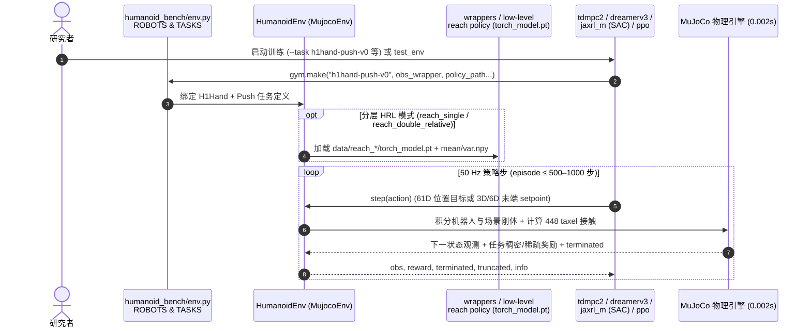

# HumanoidBench

[HumanoidBench](https://github.com/carlosferrazza/humanoid-bench) 收录于具身智能研究室 [开源项目主表](https://github.com/RealXiaoze/humanoid-motion-intelligence/blob/main/%E8%AE%BA%E6%96%87%E4%B8%8E%E9%A1%B9%E7%9B%AE/%E5%BC%80%E6%BA%90%E9%A1%B9%E7%9B%AE%E4%B8%BB%E8%A1%A8.md) 的「工程与实机部署」分组，是本库为该入口建立的独立详情节点。

## 一句话定义

在人形仿真中提供十五项全身操作与十二项运动任务，并附Dreamer、SAC、PPO和TD-MPC2等训练代码；统一MuJoCo环境适合检验算法能否同时处理高维身体控制与任务交互。

## 英文缩写速查

| 缩写 | 英文全称 | 简要说明 |
|------|----------|----------|
| H1 / G1 | Unitree H1 / Unitree G1 | 基准默认人形本体为 Unitree H1 + 双 Shadow Hand；同时提供 G1 与 Digit |
| MJX | MuJoCo XLA | 用于 GPU 大规模并行预训练底层到达策略（reaching skill） |
| HRL | Hierarchical Reinforcement Learning | 底层冻结技能（PPO@MJX）+ 高层策略（DreamerV3 / TD-MPC2） |
| CoACD | Approximate Convex Decomposition | 网格凸分解算法，用于加密全身 **448** 个 MuJoCo tactile taxel 接触采样 |

## 为什么重要

- **填补「高维灵巧手 + 全身人形协调」的基准空白**：默认 **Unitree H1（25 DoF）+ 双 Shadow Hand（50 DoF）** 共 **75 DoF / 61 维归一化位置控制动作 @ 50 Hz**（151 维本体观测），把手部自由度与双足平衡摆到同一 RL 问题里。
- **揭示扁平端到端 RL 的维度诅咒**：DreamerV3、TD-MPC2、SAC、PPO（跑 48 小时，约 2M–10M 步）在绝大多数全身操作与高难运动任务上达不到目标成功线；把 42D 手部动作置零的消融证明，高维动作空间显著拖慢探索。
- **支持分层控制与多模态拓展**：环境原生开放双目头部视觉与基于 MuJoCo touch grid 的 **448 单元全身触觉**（`h1touch-*`，约 550 FPS），并演示通过 MJX 预训练底层 reach 策略（32,768 并行环境，2B–4B 步）在 `push` 等任务上大幅超越扁平基线。

## 核心原理

### 基准规格与任务体系（arXiv:2403.10506v2）

| 维度 | 规格 |
|------|------|
| **任务套件（27 项）** | **12** 项运动（`walk`/`stand`/`run`/`reach`/`hurdle`/`crawl`/`maze`/`sit_{simple,hard}`/`balance_{simple,hard}`/`stair`/`slide`/`pole`）+ **15** 项全身操作（`push`/`cabinet`/`highbar`/`door`/`truck`/`cube`/`bookshelf_{simple,hard}`/`basketball`/`window`/`spoon`/`kitchen`/`package`/`powerlift`/`room`/`insert_{normal,small}`） |
| **仿真性能** | 单 CPU `dt=0.002s` 下默认 `h1hand` **1050 FPS**；仅足底碰撞简化版 **5100 FPS**；全身 448 触觉版 **550 FPS** |
| **多形态配置** | `h1hand` (151 obs / 61 act)、`h1` 无手 (51 / 19)、`h1`+Robotiq (55 / 23)、`g1` (87 / 37)、`digit` (221 / 65) |

### 分层 RL（HRL）与环境流水线

## 源码运行时序图

对齐 [`carlosferrazza/humanoid-bench@cb11890`](https://github.com/carlosferrazza/humanoid-bench) `humanoid_bench/env.py`、`README.md` 与四大基线训练入口：

## 工程实践

| 项 | 建议（依据 README） |
|----|---------------------|
| 多算法环境 | Python 3.11 + `jax[cuda12]==0.4.28` + `pip install -e .`，再按 `requirements_{jaxrl,dreamer,tdmpc}.txt` 或 `stable-baselines3==2.3.2` 分装 |
| 开启视觉/触觉 | `h1hand-*` 默认返回本体 + 物体特权状态；要开多模态须用 `h1touch-*` 并传 `--obs_wrapper True --sensors "proprio,image,tactile"` |
| `highbar` 夹爪力矩 | 高杠任务需用 `h1strong-highbar_hard-v0`（增大手部执行器上限才能悬垂） |
| 基线曲线对照 | `logs/` 目录已附论文全部 3-seed JSON 训练曲线（可直接画对照，不必重跑 48h 实验） |

## 局限与风险

- **纯粹仿真且默认状态驱动**：论文主要基线全在特权状态观测下训练（视觉与触觉仅作可选接口留给后续研究），且未做 H1 真机 Sim2Real 部署验证。
- **扁平 RL 基线失败面极广**：除简单 `stand`/`walk`/`crawl` 与少量单手任务外，大多数操作任务（如 `kitchen` sparse 0.0、`package`、`insert`）在 10M 步内仍未过成功线。
- **手部建模简化**：为对齐工业界窄型灵巧手趋势，作者去除了 Shadow Hand 粗壮前臂连杆并仅用位置控制（放弃更高频力矩控制），与真实 Shadow Hand 外形和惯量存在差异。

## 关联页面

- [具身大模型评测基准选型闭环](../overview/hub-embodied-eval-benchmark.md) — 评测基准知识链枢纽
- [sim2real](../concepts/sim2real.md)
- [isaac-lab](../entities/isaac-lab.md)
- [Humanoid Motion Intelligence](./humanoid-motion-intelligence.md)
- [开源主表覆盖索引](../queries/hmi-opensource-projects-coverage.md)
- [Manipulation](../tasks/manipulation.md)
- [Reinforcement Learning](../methods/reinforcement-learning.md)

## 参考来源

- [HumanoidBench 来源归档](../../sources/repos/humanoid-bench.md)
- [Humanoid Motion Intelligence 仓库归档](../../sources/repos/humanoid-motion-intelligence.md)
- [开源项目主表（上游）](https://github.com/RealXiaoze/humanoid-motion-intelligence/blob/main/%E8%AE%BA%E6%96%87%E4%B8%8E%E9%A1%B9%E7%9B%AE/%E5%BC%80%E6%BA%90%E9%A1%B9%E7%9B%AE%E4%B8%BB%E8%A1%A8.md)
- 论文：Sferrazza et al., *HumanoidBench: Simulated Humanoid Benchmark for Whole-Body Locomotion and Manipulation*, [arXiv:2403.10506](https://arxiv.org/abs/2403.10506)

## 推荐继续阅读

- [官方入口](https://github.com/carlosferrazza/humanoid-bench)
- [项目页与视频](https://sferrazza.cc/humanoidbench_site/)
- [Humanoid Motion Intelligence 知识库实体页](./humanoid-motion-intelligence.md)
