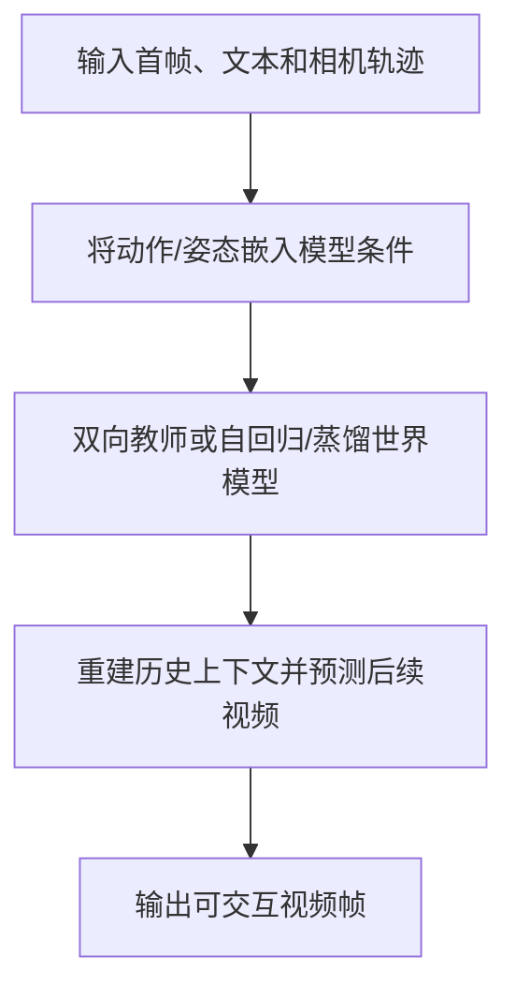
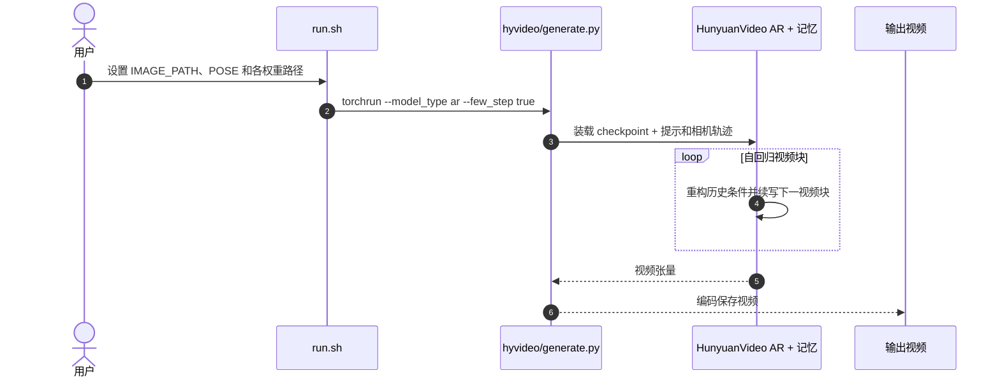

# HY-WorldPlay / HY-World 1.5｜腾讯混元：实时相机控制与可重建记忆

**核心定位：** 以重建的历史上下文支持相机可控交互视频续写；提供 HunyuanVideo 8B 与轻量 WAN 5B 双推理路径。

## 一句话定义

以重建的历史上下文支持相机可控交互视频续写；提供 HunyuanVideo 8B 与轻量 WAN 5B 双推理路径。

## 英文缩写速查

| 缩写 | 英文全称 | 简要说明 |
|---|---|---|
| WM | World Model | 由条件预测环境后续视觉或潜在状态 |
| AR | Autoregressive | 基于历史视频块续写未来 |
| DiT | Diffusion Transformer | 部分生成路径的视频扩散骨干 |
| 3D | Three-Dimensional | 空间结构或几何缓存的维度 |

## 为什么重要

- **研究角色：** 长期空间记忆和相机控制；可用于世界模型架构和工程复现的横向对照。
- **边界明确：** 相比 ABot-World-0 原生键盘接口，WorldPlay 更强调相机轨迹与上下文重构；与 HY-World 2.0 显式输出 3DGS 的目标不同。
- **资料身份：** 2025 技术报告；2026 开源组件迭代，开发团队 腾讯混元（Tencent Hunyuan）；源码/权重与报告不能一概而论。

## 核心信息

| 字段 | 内容 |
|---|---|
| 机构 | 腾讯混元（Tencent Hunyuan） |
| 技术原文 | [官方报告](https://3d-models.hunyuan.tencent.com/world/world1_5/HYWorld_1.5_Tech_Report.pdf) |
| 官方代码 | [Tencent-Hunyuan/HY-WorldPlay](https://github.com/Tencent-Hunyuan/HY-WorldPlay) |
| 发布范围 | 模型权重、推理和训练文档部分开放；个别模型变体仍待发布 |
| 控制接口 / 输出 | 480p 图像 + 文本 + `POSE` 控制轨迹；生成后续 125 帧左右（具体满足 README 帧数整除约束）。 |

## 核心原理

WorldPlay 把键盘/相机轨迹转换成姿态条件，流式预测未来视频块；通过重构历史条件（reconstituted context memory）减少返回先前区域时的遗忘。仓库区分 HunyuanVideo 8B 路径（优先控制和记忆）与 WAN 5B 轻量路径。双向模型、因果模型与四步蒸馏模型提供不同的质量—时延取舍。

### 流程总览

图的模块关系依据 [官方 README 及源码归档](../../sources/repos/hy-worldplay-1-5.md) 和 [报告/主页](https://3d-models.hunyuan.tencent.com/world/world1_5/HYWorld_1.5_Tech_Report.pdf)；无真实硬件执行验证。

## 源码运行时序图

**核对入口：** run.sh（蒸馏分支）与 hyvideo/generate.py（generate_video/main）；上图聚焦源码实际提供的推理入口，非训练系统所有内部调用；未在本地执行 GPU 推理。

## 工程实践

在 README 按 `download_models.py` 下载模型，将权重路径填入 `run.sh`，再运行 `bash run.sh`；默认蒸馏分支用 `torchrun ... hyvideo/generate.py --model_type ar --few_step true --num_inference_steps 4`。`POSE='w-31'` 代表前进方向的 latent 轨迹。

### 建议验证指标

- 对动作/相机控制：轨迹遵从、操作响应、长程回访同视角一致性。
- 对效率：将模型 FPS、首响应帧、单块时延、端到端用户可见延迟分开记录。
- 对复现：记录代码版本、checkpoint 类型、GPU/显存、图像大小与许可证。

## 实验与评测

README 公开短期/长期 PSNR、SSIM、LPIPS 与相机重建误差对比。不同 Hunyuan/WAN 路径不应混作同一性能结论。

## 与其他工作对比

相比 ABot-World-0 原生键盘接口，WorldPlay 更强调相机轨迹与上下文重构；与 HY-World 2.0 显式输出 3DGS 的目标不同。 可与 [11 项世界模型对照](../comparisons/open-source-world-models-11-2026.md)中的实时视频、3D 资产与 latent 预测分支比较。

## 局限与风险

README 的 RL+蒸馏联合权重仍列 To be released；使用者须区分仓库代码、已发布 checkpoint 与待发组件。`hyvideo/generate.py` 采用 Tencent Hunyuan Community License，不能擅自按 Apache 条款处理。项目技术报告出自 2025 年，不是 2026 年首次提出。

此外，视频视觉一致性与物理动力学准确性不是同一个指标，机器人控制仍需独立验证闭环执行和接触动力学。

## 关联页面

- [2026 年 11 项开源世界模型技术对照](../comparisons/open-source-world-models-11-2026.md)
- [Generative World Models](../methods/generative-world-models.md)
- [Video as Simulation](../concepts/video-as-simulation.md)
- [WAM 纵深学习路线](../../roadmap/depth-wam.md)

## 参考来源

- [官方代码与运行入口](../../sources/repos/hy-worldplay-1-5.md)
- [官方项目页面核对](../../sources/sites/hy-worldplay-1-5.md)
- [深蓝具身智能综述线索](../../sources/blogs/wechat_shenlan_world_models_11_2026_11_20.md)

## 推荐继续阅读

- [官方仓库 README](https://github.com/Tencent-Hunyuan/HY-WorldPlay)
- [官方技术报告](https://3d-models.hunyuan.tencent.com/world/world1_5/HYWorld_1.5_Tech_Report.pdf)
