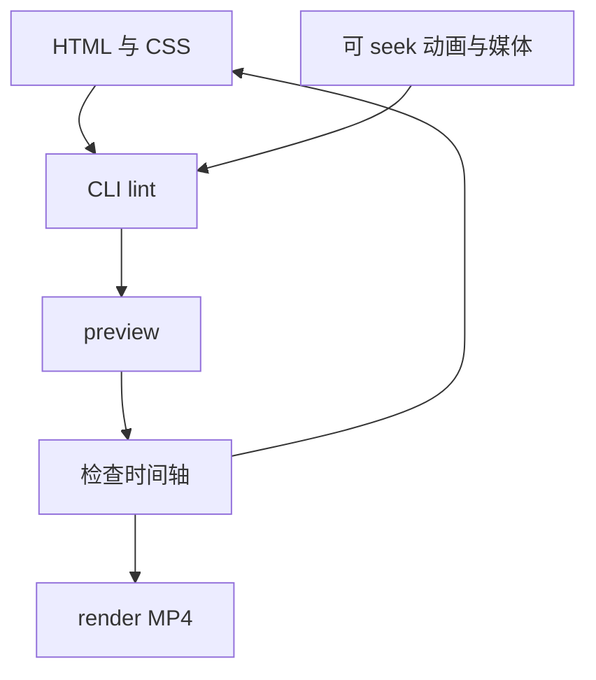
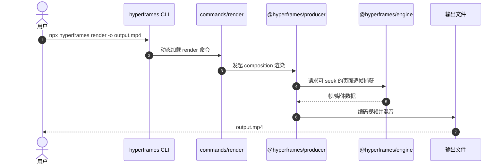

# HyperFrames

**HyperFrames**（[heygen-com/hyperframes](https://github.com/heygen-com/hyperframes)，npm `hyperframes`，Node ≥22）是 HeyGen 开源的 **Agent 向视频生产框架**：代理编写 **HTML/CSS + 可 seek 动画 + 媒体**，CLI **lint → preview → render** 成 **确定性 MP4**。

## 一句话定义

**Write HTML. Render video.** — 把视频当成 **可版本化的 Web 文档**，由 Agent skills 教会 **生产环**，而不是手工时间轴剪辑。

## 英文缩写速查

| 缩写 | 英文全称 | 简要说明 |
|------|----------|----------|
| MP4 | MPEG-4 Part 14 | 默认渲染输出容器 |
| CLI | Command-Line Interface | 本地渲染与 `hyperframes skills` 管理 |
| CSS | Cascading Style Sheets | 与 HTML 一并驱动画面 |
| API | Application Programming Interface | 可选托管 authoring（HeyGen 生态） |

## 流程总览

根据官方 README、CLI 文档以及 `packages/cli/src/cli.ts` 命令入口复核；此图表示**创作和渲染路径**，非机器人的动作规划或控制闭环。

## 源码运行时序图

根据 `packages/cli/src/cli.ts` 的 `commandLoaders`（按需载入 `commands/render.js`）、官方 CLI README 与包结构，绘制 `render` 的框架级执行路径；未将 HeyGen Pro 模型生成当成本地渲染必经环节。

对应代码：[CLI 命令入口](https://github.com/heygen-com/hyperframes/blob/main/packages/cli/src/cli.ts)、[CLI 使用说明](https://github.com/heygen-com/hyperframes/blob/main/packages/cli/README.md)；`core` 负责类型/解析/帧适配，`engine` 负责逐帧捕获，`producer` 负责合成与音频。

## 工程实践

| 阶段 | 可核验入口 |
|---|---|
| 初始化 | `npx hyperframes init my-video`；然后 `cd my-video` |
| 规范检查 | `npx hyperframes lint ./index.html --verbose`（完整展示 info 提示；目录入口以项目实际结构为准） |
| 交互预览 | `npx hyperframes preview`；预览是可选调试步骤 |
| 导出 MP4 | `npx hyperframes render -o output.mp4` |
| Agent 集成 | `npx hyperframes skills update` 安装 release-tag 匹配的核心 Skills，复杂任务再按需补装 |
| 源码开放程度 | 核心框架、CLI、skills 已公开，Apache-2.0；云端 HeyGen 增值模型和 Pro 不属于免费自托管能力 |

## 与 Remotion 对比

| 维度 | HyperFrames | [Remotion](remotion.md) |
|---|---|---|
| 输入/源真值 | HTML + CSS + 可 seek 动画 | React Composition / JSX |
| 编辑协作 | 代理直接修改 HTML 工件，Studio 也可编辑 | React 代码、Studio 预览与编程 API |
| 本地渲染 | CLI + 浏览器帧捕获 + FFmpeg | Remotion CLI + renderer + 浏览器编码 |
| 许可 | Apache-2.0（核心代码） | Remotion License（特定商业组织需授权） |

项目 README 自身提供该对比；选择时先看团队技术栈与授权条件，不应把静态视频宣传素材当作机器人 Sim2Real 验收数据。

## 核心信息

| 字段 | 内容 |
|------|------|
| 许可 | Apache-2.0 |
| Node.js / 编码 | Node.js 22+、FFmpeg |
| Skills（2026-11-19） | **9 个公开发布**：核心 6 个、按需 3 个；另有 6 个仓内技能不默认发布 |
| Studio | 本地 Studio app 免费使用；HeyGen 模型属于 Pro 服务，不等同核心框架全部免费 |

## 为什么重要（对本知识库读者）

- **Demo 与教学：** 机器人实验、policy 对比、wiki 路线 **10 秒概览片** 可由 Agent 从 HTML 模板生成，优于纯 GIF 录屏（可 diff）。
- **与 Archify 分工：** [Archify](archify.md) → **类型化 JSON → 校验静态架构 HTML**；HyperFrames → **时间轴视频**；[Manim](manim.md) → **数学动画代码**；[GSAP skills](gsap-skills.md) → **Web 动效技能**。
- **OpenMAIC / 课程导出：** [OpenMAIC](openmaic.md) 强调 MP4 导出；HyperFrames 是 **Agent-native** 的同类能力栈。

## Agent 集成要点

| 路径 | 命令 |
|------|------|
| Claude 插件 | `claude plugin marketplace add heygen-com/hyperframes` |
| 通用 skills | `npx skills add heygen-com/hyperframes`（Core Skills 组） |
| 更新 Skills | `npx hyperframes skills update`（获取与当前 CLI 匹配的 release tag；**不是**同步 main） |

## 局限与风险

- 复杂 3D 仿真视频仍宜用 **专用引擎录屏** 或 Manim；HyperFrames 擅长 **motion graphics + 合成**。
- Skills 范围会变化；截至 2026-11-19 核对公开发布集为 **9 个**，默认核心 6 个；不应沿用旧的 21 个数字或误装仓库内部 Skills。
- `render` 依赖 Node.js、Chrome/Chromium 与 FFmpeg；不同计算环境的字体、媒体依赖需在项目内固定并验收。
- 基础 Studio 免费与 Pro 内的商业生成服务是不同许可/计费边界。

## 关联页面

- [Archify](archify.md) — 静态可校验系统图
- [Remotion](remotion.md) — React 源码驱动的视频生成方案
- [Manim](manim.md) — 数学/技术动画
- [OpenMAIC](openmaic.md) — 多 Agent 课堂与视频导出

- [智能体规划与反馈执行](../methods/agent-planning-feedback.md)：了解技能被调用时的任务流程与反馈。
- [智能体技能封装](../methods/agent-skill-packaging.md)：了解任务指引、可复用资源与边界。

## 参考来源

- [HyperFrames 仓库归档](../../sources/repos/hyperframes.md)
- [heygen-com/hyperframes（GitHub）](https://github.com/heygen-com/hyperframes)

## 推荐继续阅读

- [HyperFrames Quickstart](https://hyperframes.heygen.com/quickstart)
- [Studio / Playground](https://hyperframes.studio/)
- [CLI 源码](https://github.com/heygen-com/hyperframes/blob/main/packages/cli/src/cli.ts)
