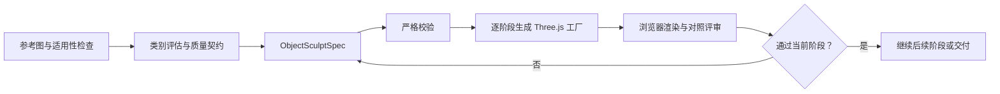

# img2threejs

**img2threejs**（[官方主仓](https://github.com/img2threejs/img2threejs)，官方演示：[img2threejs.io](https://img2threejs.io/)，当前 Skill 版本 2.0.0）是一个开源 Agent Skill：从单张参考图出发，经结构化规格、逐阶段 TypeScript 生成和渲染评审，构建可编辑的程序化 Three.js 模型。它主张 **reconstruction-by-code**，而不是摄影测量或网格提取。

## 英文缩写速查

| 缩写 | 英文全称 | 简要说明 |
|------|----------|----------|
| Three.js | Three.js | 浏览器 3D 图形库；主流程的目标运行时 |
| MCP | Model Context Protocol | 宿主可用的工具协议，常用于浏览器预览与截图 |
| PBR | Physically Based Rendering | 基于物理的渲染材质表达；材质阶段会参照图像分析 |
| GLB | GL Transmission Format Binary | 可选 `img2glb` 插件的网格交付格式，不是基础代码重建产物 |
| VLM | Vision-Language Model | 可参与图像理解与渲染评审的视觉语言模型 |

## 为什么重要

- **产物可检查、可修改：** 规格 JSON 和 TypeScript 工厂能进入常规代码审阅与版本管理，适合迭代图形资产；这与直接下载一次性黑盒网格不同。
- **把评审变成流程门：** 工具将确定性检查、阶段状态和视觉对比组合起来，避免仅凭一次生成就把模型判为完成。
- **对机器人工程的价值有边界：** 它可帮助创建仿真演示中的外观道具和浏览器可视化资产，但模型外观与物理参数必须分开验证。

## 核心原理

主流程由 Agent Skill 提供操作规约，`forge/` 中的 Python 工具负责状态推进、规格验证、构建和证据整理；agent 负责解释参考图、生成当前阶段代码并评审渲染结果。大致顺序如下：

主要输出为组件、材质、重复结构、连接点等信息组成的 `ObjectSculptSpec`，以及返回 `THREE.Group` 的 TypeScript 工厂。交付可包含渲染图和分阶段的参考图对照证据；角色路线还可构造骨架与 skinning。主仓 `SKILL.md` 将状态文件作为单次重建的进度依据，要求每轮按状态检查下一步。

v2.0 将域知识扩展成单独插件体系。基础技能、`img2` harness 和插件分开安装；如角色、CS2 等特定域的工作流由相应插件提供。README 还列出可选 `img2glb` 插件，它通过托管 TRELLIS 路径生成 GLB，不能与基础的程序化代码重建混为一谈。

## 工程实践

| 项 | 要点 |
|----|------|
| **宿主** | README 列出 Hermes、Claude Code、Codex、OpenCode；具体视觉和浏览器能力由宿主提供 |
| **前置条件** | Node.js 18+、Git、Python 3.10+；核心 `forge/` 脚本仅依赖 Python 标准库 |
| **安装** | `npx --yes img2threejs@latest install`；安装后重启 agent |
| **基础调用** | 对 agent 提供参考图，并要求使用已安装的 img2threejs skill 完成重建与质量门控 |
| **阶段** | blockout → structural → form → material → surface → lighting → interaction → optimization |
| **主仓版本 / 许可** | Skill frontmatter 为 2.0.0；Apache-2.0 |
| **机器人下游** | 导入仿真前应自行确认比例、坐标系、碰撞几何、惯量、接触参数和关节语义 |

官方在线画廊 [img2threejs.io](https://img2threejs.io/) 展示可交互的模型与源码；其入口由主仓 README 明确链接。源码开放状态核查见[仓库归档](../../sources/repos/img2threejs.md)和[官网归档](../../sources/sites/img2threejs-io.md)。

## 局限与风险

- **单张图片信息有限：** 隐藏面和内部结构不可直接观察，必须标明推断区域；生成的几何不能当作测量数据。
- **视觉质量不等于仿真质量：** `THREE.Group`、动画骨架或语义 collider 层级不自动提供机器人模型所需的质量、惯量、摩擦、接触和关节限位真值。
- **宿主能力影响结果：** 视觉理解、浏览器渲染和截图评审依赖运行它的 agent 环境；安装成功本身并不证明模型质量。
- **插件单独核实：** 插件可能有各自的许可、依赖和访问要求；尤其 `img2glb` 属于单独的托管网格输出路径。

## 关联页面

- [3D Gen Studio](./3dgenstudio.md) — 视觉资产生产工作台，面向网格生成、编辑和导出
- [Articraft](./articraft.md) — 仿真就绪、可关节 3D 资产的 agent 与 SDK 路线
- [CAD Skills](./cad-skills.md) — 面向 STEP / URDF 的制造与机器人描述工作流
- [Sim2Real](../concepts/sim2real.md) — 仿真模型与真实系统差异及验证原则
- [Character Animation vs Robotics](../concepts/character-animation-vs-robotics.md) — 动画角色与物理机器人控制的任务边界

## 参考来源

- [img2threejs 主仓归档](../../sources/repos/img2threejs.md)
- [img2threejs.io 官方演示归档](../../sources/sites/img2threejs-io.md)
- [img2threejs 旧版演示画廊归档](../../sources/sites/img2threejs-showcase.md)
- [官方 GitHub 仓库](https://github.com/img2threejs/img2threejs)

## 推荐继续阅读

- [主仓 README](https://github.com/img2threejs/img2threejs) — 安装、插件、示例与项目路线
- [架构说明](https://github.com/img2threejs/img2threejs/blob/main/docs/ARCHITECTURE.md) — 阶段工具、质量门与评审流程
- [Agent Skills 规范](https://agentskills.io/) — 可安装 agent skill 的说明格式
- [Three.js 文档](https://threejs.org/docs/) — `THREE.Group` 与网格运行时 API
