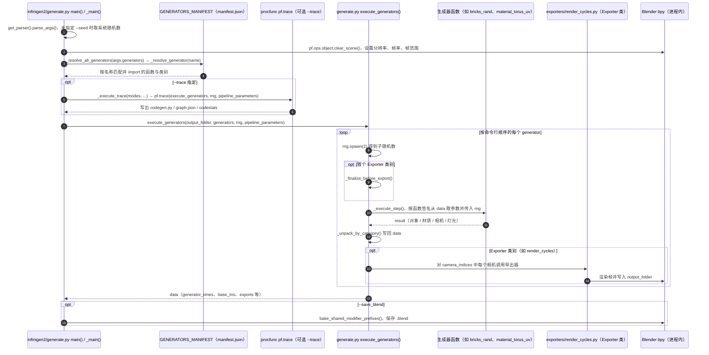

# Infinigen V2
**程序化 3D 场景生成**：Infinigen V2 是 Princeton Vision & Learning Lab 开源的 Blender/Python 工具，通过可组合的程序化生成器构造多样化场景、物体与材质，并输出可继续编辑、渲染或转换的 3D 场景。

## 英文缩写速查

| 缩写 | 英文全称 | 简要说明 |
|------|----------|----------|
| DCC | Digital Content Creation | Infinigen 以 Blender 作为 3D 场景编辑与生成宿主 |
| PBR | Physically Based Rendering | 常用于描述程序化生成的材质与渲染属性；视觉属性仍需按仿真目标校准 |
| GT | Ground Truth | 程序化场景可提供可控的场景信息，适合构造带标注的视觉数据 |
| USD | Universal Scene Description | 一种可供 3D 与仿真工具交换场景的格式；官方文档列有外部格式导出 |

## 为什么对机器人仿真重要

机器人策略训练和评测经常需要大量不同的房间布局、物体外观与光照条件。Infinigen 把这类场景变化编码为生成器和参数，而不是依赖手工搭建每个场景，因此可以为合成视觉数据、感知训练和仿真场景原型提供可复现的输入。

它的主要价值是**可组合的程序化场景与资产生成**。这与 [3D Gen Studio](./3dgenstudio.md) 依赖图像/网格生成模型编排资产的路线不同，也不同于直接提供任务与物理设置的具身仿真套件。

## 核心原理

### 生成对象

官方项目把生成内容组织为场景、自然/室内资产和材质等程序化组件。通过 Python 配置与组合生成器，用户可以对场景布局、资产选择和渲染条件施加控制，再在 Blender 工作流里继续编辑或渲染。官方 V2 文档列有 Nature、Indoors 与 Articulated 等入口；具体能力取决于所用版本和生成配置。

### 面向仿真的数据流

1. 选择官方生成入口并配置场景与种子等参数。
2. 运行 Python/Blender 生成器，得到程序化构造的场景和资产。
3. 在 Blender 中检查、调整场景，按需导出外部 3D 格式。
4. 将场景导入目标仿真器，补齐碰撞、物理参数、机器人模型与任务逻辑。
5. 通过渲染和仿真检查可见性、尺度、接触与任务可执行性，再投入数据生成或策略训练。

### 关键判断

程序化生成带来的变化与生成器、配置和随机种子有关，适合构造可控的场景多样性；它本身不意味着每个生成场景都具有经物理验证的碰撞体、质量参数或机器人可执行任务。截图中的「一分钟生成」属于社媒介绍，本次没有查到对应的官方性能基准，运行时间应以具体配置和硬件实测为准。

## 工程实践

| 项目 | 建议 |
|------|------|
| 起步 | 按官方 V2 文档选择 Nature、Indoors 或其他匹配入口，先运行一个最小示例，再调整生成参数 |
| Python 控制 | 将生成配置、随机种子和场景版本一同归档，便于复现训练/评测数据 |
| Blender 输出 | 把生成的 Blender 场景作为检查与编辑中间层，再导出仿真器支持的格式 |
| 仿真接入 | 单独校验坐标系、单位、碰撞几何、接触材质、质量/惯量和场景语义；不要从视觉逼真度推断动力学准确度 |
| 许可 | 官方代码仓许可证为 BSD-3-Clause；具体生成资产的再分发或商用条件，按项目当前说明与所用资产来源单独核查 |

## 局限与风险

- **视觉真实不等于物理真实。** 材质、光照和几何细节能改善渲染外观，但接触、摩擦、质量和惯性仍由下游仿真模型决定。
- **不是完整机器人任务基准。** 任务成功条件、控制器、机器人模型和场景交互逻辑需要另外搭建。
- **外部仿真器接入有工作量。** 场景转换后须检查单位、坐标系、实例层级和碰撞体，避免转换错误污染训练数据。
- **资源消耗依场景而变。** 本次核查未找到可普遍适用的「一分钟」官方性能承诺；应在目标硬件与质量配置上做计时和显存/内存评估。

## 关联页面

- [3D Gen Studio](./3dgenstudio.md) — 编排图像/网格生成的工作台，与 Infinigen 的程序化全场景生成方式形成对照。
- [GRAIL](./paper-grail.md) — 在人形全身移动操作数据管线中使用程序化场景作为 4D 交互合成的基础。
- [HomeWorld](./paper-homeworld-whole-home-scene-generation.md) — 面向具身任务的整屋场景生成，可对照程序化场景资产路线。
- [Blender](./blender.md) — Infinigen 的主要场景编辑与导出宿主。
- [Sim2Real](../concepts/sim2real.md) — 仿真外观和动力学差异的迁移风险。

## 源码运行时序图

入口：`uv run infinigen bricks_rand material_torus_uv render_cycles --seed 0`（Infinigen 2.0 CLI，`pyproject.toml` 的 `[project.scripts]` 指向 `infinigen2.generate:main`；文档「Infinigen 2.0」。1.x 的 `python -m infinigen_examples.generate_nature` 等入口未画入本图）

图依据：princeton-vl/infinigen@64d35e5，实际读过 `pyproject.toml`（`[project.scripts]`）、`src/infinigen2/generate.py`（`get_parser`、`_main`、`_resolve_generator`、`_execute_trace`、`_execute_step`、`execute_generators`、`main` 的调用链）、`src/infinigen2/__init__.py`（manifest 加载）、`src/infinigen2/exporters/render_cycles.py`（仅看函数列表）、`docs/source/Infinigen2.md`；生成器内部几何与 procfunc 库实现未读，未运行代码。

## 参考来源

- [Infinigen 官方项目页归档](../../sources/sites/infinigen.md)
- [princeton-vl/infinigen 仓库归档](../../sources/repos/infinigen.md)
- [Infinigen CVPR 2023 论文](https://arxiv.org/abs/2306.09310)
- [Infinigen Indoors CVPR 2024 论文](https://arxiv.org/abs/2406.11824)
- 源码核对（2026-11-02）：princeton-vl/infinigen@64d35e5，读过 pyproject.toml、src/infinigen2/generate.py、src/infinigen2/__init__.py、src/infinigen2/exporters/render_cycles.py（仅看函数列表）、docs/source/Infinigen2.md；时序图依据以上文件，未运行代码。

## 推荐继续阅读

- [Infinigen 官方 V2 文档](https://infinigen.cs.princeton.edu/docs/latest/Infinigen2.html)
- [princeton-vl/infinigen GitHub](https://github.com/princeton-vl/infinigen)
- [Infinigen Indoors 项目页](https://infinigen.org/docs/latest/InfinigenIndoors.html)
