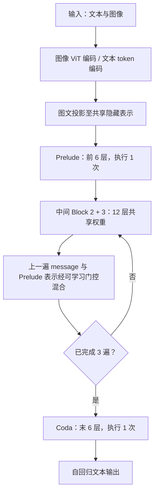
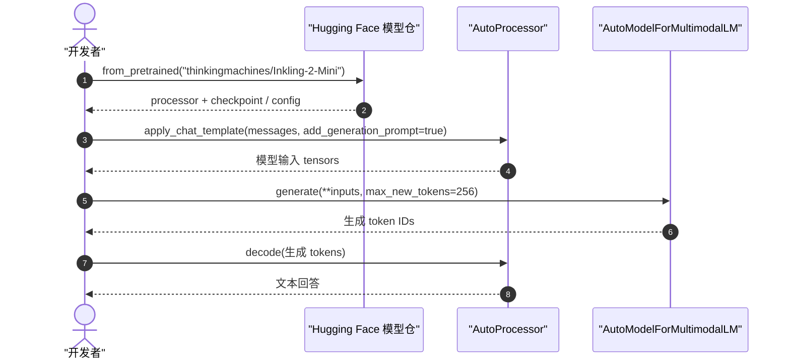

# Inkling 2 Mini：共享中间层循环的本地多模态模型（Looped Multimodal Transformer）

**Inkling 2 Mini / 循环式多模态小模型**是 Thinking Machines Lab 于 **2026-11-20** 发布的开放权重通用基础模型，面向图文问答、编程、搜索、工具调用与本地 Agent。官方模型卡、权重和技术博客均已公开，但**不等同于一套可直接生成机器人动作的 VLA / WAM 策略**。

## 一句话定义

**在 24 层参数中让中间 12 层共享权重执行三遍，以增加每 token 的内部串行计算深度，同时通过稀疏 MoE、原生 NVFP4/MXFP8 限制权重占用（约 20GB）。**

## 英文缩写速查

| 缩写 | 英文全称 | 简要说明 |
|---|---|---|
| MoE | Mixture of Experts | 稀疏专家网络，每层每 token 选择 8/128 专家 |
| CoT | Chain of Thought | 模型写出的推理文字，用于可监控性分析 |
| NVFP4 | NVIDIA Floating Point 4-bit | 官方低精度训练与部署格式，覆盖大部分层 |
| MXFP8 | Microscaling Floating Point 8-bit | 末 4 层采用的精度格式 |
| ViT | Vision Transformer | 图像编码器，生成视觉 token |
| SFT | Supervised Fine-Tuning | 监督微调阶段 |
| RL | Reinforcement Learning | 后训练中的强化学习阶段 |

## 为什么重要

- **推理深度与权重大小解耦：** 靠重复应用相同的中间层实现 48 次层应用，却只存 24 层参数；适用于研究“多算几遍 vs 多输出推理 token”的预算取舍。
- **原生低精度 + 专家剪枝：** 发布约 20GB 的混合 NVFP4/MXFP8 权重，说明本地 Agent 的容量门槛可由数据类型、稀疏结构与运行时共同决定。
- **具身智能关系：** 可作为机器人上层文本/视觉语义 Agent 的候选技术路线（推断的潜在用途），**不负责关节、力矩或动作 token 的控制输出**。机载能否用必须另测端到端延迟与安全边界。

## 核心原理

### 1. 图文输入与循环网络

| 项目 | 官方公开配置 |
|---|---|
| 机构 / 日期 | Thinking Machines Lab / 2026-11-20 |
| 模型类别 | Decoder-only multimodal autoregressive looped Transformer |
| 输入 / 输出 | 文本 + 图像输入；文本输出 |
| 参数 | 26.4B 总量；3.4B 单遍 active；循环后约 5.4B effective weight activations/token |
| 结构 | 24 层，前 6 层一次 + 中 12 层三遍 + 末 6 层一次，合计 48 次层应用 |
| 专家路由 | 每层 128 专家中选择 8 个；局部/全局混合注意力 |
| 视觉 | ViT 图像编码，图像与文本投影到共享 hidden space |
| 上下文 | 官方标称最高 1M tokens |
| 权重精度 | 20 层 NVFP4、末 4 层 MXFP8；约 20GB checkpoint |
| 许可 | Apache-2.0，另见官方 Model Acceptable Use Policy |

**注意：** 3.4B 是激活参数统计，5.4B 是循环考虑后的有效激活量，均不能直接按“总参数量”或“实际显存 GB”换算。循环增加每 token 的算力，并不增加模型可记忆的静态知识量。

官方将层分为 4 个 6 层 block：第一个 prelude 每一遍都供给信息，中间两个 block 的上一遍 message 经可学习门控与 prelude / 当前层信息融合；最后 coda 只执行一次。训练时门控初始阻断 message，再逐渐学会利用前遍信息，帮助稳定引入循环。发布的 Inkling 2 Mini **固定 3 遍**；能改变 1–5 遍的是另一个科研模型 TML-d24-varloop-research。

### 2. 训练与推理数值

- **剪枝 / 修复：** midtraining 从每层 384 专家剪到 128，随后用约 1T tokens 的较大模型蒸馏数据恢复表现。
- **后训练：** SFT 后进行了约 2.2T tokens、2,000 steps 的 RL，以及 on-policy distillation 对齐；未公开可复现整个训练的代码与数据配方。
- **低精度：** 官方描述专家层训练就采用 NVFP4，前 20 层的部署权重为 NVFP4、末 4 层为 MXFP8；不是事后把 BF16 checkpoint 一刀切压成 4-bit。

### 3. 流程总览（依据官方结构描述）

图为**架构级摘要**：循环里的 message 来源于上一遍，箭头不表示单个层内部 attention residual 的全部张量依赖。

## 实验与评测

| 基准（发布方报告） | Inkling 2 Mini | 注意口径 |
|---|---:|---|
| DeepSWE v1.1 | 48.2% | mini-swe-agent v2.4.6 |
| Vals Index v2.2 | 46.5% | 第三方指数，发布方表格 |
| BrowseComp | 79.0% | 开启 compaction |
| DeepSearchQA | 85.3% | 开启 compaction |
| MCP Atlas Public | 82.7% | 工具调用 |
| OmniDocBench v1.6 | 92.8% | 文档理解 |
| ComplexConstraints v1.1 | 33.4% | 严格约束遵循能力仍弱于部分同量级模型 |

**原文的变量循环研究模型**在 Think Fast no-CoT 50% horizon 上从 1 pass **16 s** 增至 3 passes **37 s**，3 遍后多数任务收益趋缓；在正确回答的 GPQA Diamond 题目中，1→5 pass 的平均 CoT 从 **3,703** 缩至 **1,661 tokens**。这些实验不能拿来声称固定三遍的发布模型拥有动态循环开关，也不能证明“内部推理完全可监控”。LinuxArena 的探索性评测未发现随 loop 数增加的单调恶化规律，其具体监控模型、抽样与训练配置限制详见官方博客。

**证据边界：** 没有公开机器人真机闭环、sim2real 成功率、控制频率或动作预测误差结果；上表不是 VLA/WAM 比赛成绩。跨模型的 harness/推理开关可能不同，比较需统一条件复测。

## 工程实践

1. **先评估设备：** 模型卡列出 DGX Spark、Apple Silicon >=32GB 内存；其他 GPU 建议 >=32GB VRAM。约 20GB 是 checkpoint 存储，推理还需 KV cache / runtime 预留；不可把 8GB 显卡当作可直接原生加载的硬件。
2. **最小推理：** 官方模型卡给出 Transformers 的 AutoProcessor + AutoModelForMultimodalLM；也列出 vLLM / SGLang 的服务命令。应按实时兼容性与后端版本检查实际支持的循环模型算子。
3. **真实部署测量：** 使用代表性图像、长短上下文测首 token 时延、逐 token 延迟、GPU/统一内存峰值、工具调用正确率和出错回滚，尤其不要只看参数量。
4. **机器人分层：** 仅在足够低频的语义/规划层评估接入；高频状态估计、关节跟踪与力矩闭环应保持独立控制器，并对工具执行与动作下发加确认及安全监控。

## 源码运行时序图

**依据：** [HF 模型卡](https://huggingface.co/thinkingmachines/Inkling-2-Mini) 的 Transformers 官方推理样例（明确的公开调用链）；**不是**对未公开训练代码或模型底层 kernel 的源码追踪。本次未下载约 20GB 权重，未执行推理。

这是模型卡公开接口的调用顺序；各库内部 GPU 调度、循环 attention 内核、算子实现未追读，不能解释成对实际运行栈的内部 trace。

## 局限与风险

- **不等同于机器人策略：** 当前官方模型卡只支持图文输入→文本输出，没有机器人动作输出接口或闭环验收。
- **事实与语言限制：** 发布方指出事实回忆弱于更大模型，中文有混语与截句情况，多轮对话与复杂规则跟随也有明显局限。
- **Agent 工具安全：** 官方指出可能未经确认覆盖或删除文件、误报执行结果；建议 sandbox、不可逆动作人工审批及任务回合上限。
- **推理负担：** 重复层前向并非零成本；低 reasoning effort 也不会取消固定循环，实际速度随硬件/推理引擎而变化。
- **研究边界：** loop depth 可控性的证据来自单独变量循环模型；可监控性研究对更大模型是否成立未有结论。

## 关联页面

- [Transformer](../concepts/transformer.md) — 参数共享和重复前向所在基础架构
- [位置编码](../concepts/positional-encoding.md) — 注意力中的位置处理及 Inkling 相关相对偏置背景
- [统一多模态 Token](../methods/unified-multimodal-tokens.md) — 图文共享表示与机器人动作 token 的差异
- [VLA](../methods/vla.md) — 对照具身策略需具有的动作输出、训练和闭环评测
- [具身模型实时性与泛化取舍](../concepts/embodied-fm-latency-generalization-tradeoff.md) — 机器人上机仍要验证时延预算
- [模型架构纵深路线 Stage 5](../../roadmap/depth-model-architecture.md) — 低精度、本地部署与结构效率

## 参考来源

- [Inkling 2 Mini 模型卡/权重原文归档](../../sources/models/inkling-2-mini-model-card.md)
- [Thinking Machines Lab 官方技术博客原文归档](../../sources/blogs/thinkingmachines-inkling-2-mini-20261120.md)
- [官方模型卡](https://huggingface.co/thinkingmachines/Inkling-2-Mini)（2026-11-20 发布）
- [官方博客 Introducing Inkling 2 Mini](https://thinkingmachines.ai/news/inkling-2-mini/)（2026-11-20）

## 推荐继续阅读

- [Hugging Face 权重与 README](https://huggingface.co/thinkingmachines/Inkling-2-Mini/tree/main)
- [官方架构、训练与可监控性实验](https://thinkingmachines.ai/news/inkling-2-mini/)
