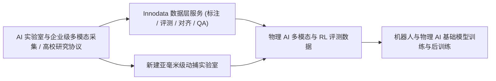

# Innodata

**Innodata**（纳斯达克：**INOD**）向 AI 实验室与企业提供 **训练数据、评测、对齐与安全** 服务。LeoInAI Substack（2026-09）将其列为「物理 AI 数据」的 **公开市场敞口** 之一：管理层披露签约高校研究协议并建设 **亚毫米级动捕实验室**，服务机器人与物理 AI 基础模型。

## 一句话定义

**传统 AI 数据标注商向「物理 AI + 动捕实验室」延伸，吃企业级多模态采集预算。**

## 英文缩写速查

| 缩写 | 英文全称 | 简要说明 |
|------|----------|----------|
| INOD | Innodata ticker | 纳斯达克上市代码 |
| RL | Reinforcement Learning | 客户提供 RL 环境与评测需求 |
| QA | Quality Assurance | 数据质检与对齐 |
| mocap | Motion Capture | 新建实验室能力 |
| YoY | Year over Year | Substack 引用约 58% 收入增长（以财报为准） |

## 核心信息（Substack 转述，以财报为准）

| 项 | 内容 |
|----|------|
| **业务** | AI 训练/后训练数据、模型评测、对齐 |
| **物理 AI** | 动捕实验室；企业级 multimodal 项目从试点扩到规模化 |
| **财务快照** | 约 **$92.1M** 季度收入（+58% YoY，Substack 引用）；**~$250M** 现金（同上） |
| **投资属性** | 非「纯物理 AI」标的；是 **数据层供应商** |

## 机制与架构图

## 关联页面

- [Appen](./appen.md)
- [Micro1](./micro1.md)
- [人形数据采集地图](../queries/humanoid-robot-data-collection-landscape.md)
- [机器人学习数据管线 · Robot Learning Data Pipelines](../methods/robot-learning-data-pipelines.md)：为物理 AI 与机器人基础模型提供多模态数据采集、标注、对齐及动捕实验室数据服务。
- [AI Model and Agent Benchmark Evaluation · AI 模型与智能体基准评测](../methods/ai-benchmark-evaluation.md)：承担大模型与强化学习系统的后训练评测、质量检验与对齐评估环节。

## 参考来源

- [LeoInAI Substack 摘录](../../sources/blogs/leoinai_humanoid_robot_datacollection_2026-09-06.md)
