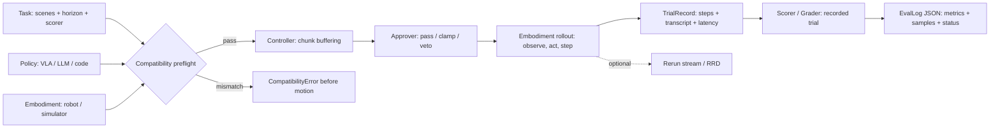
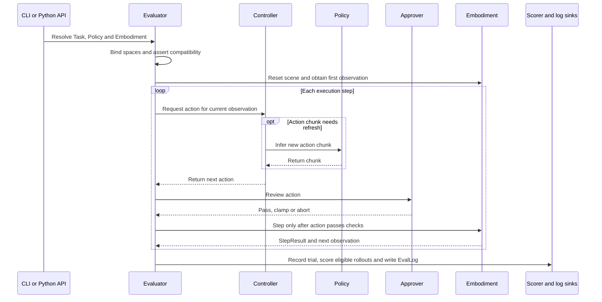
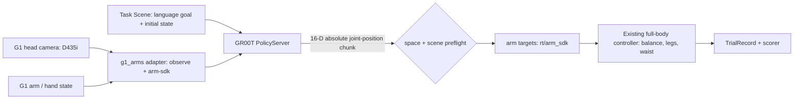

# 机器人策略评测框架（Inspect Robots）

**Inspect Robots**（[GitHub](https://github.com/robocurve/inspect-robots)，[文档](https://docs.inspectrobots.org/)，MIT）是 [Robocurve](./robocurve.md) 发布的 Physical AI 评测框架。它借鉴 Inspect AI 的任务/策略评测组织方式，将机器人评测中的任务定义、被测策略和机器人/仿真接口拆分，使同一任务能在不同**兼容**的 Policy × Embodiment 组合上执行，并保留可审计的 rollout 记录。

## 一句话定义

**Inspect Robots 是一个插件化机器人评测 harness：Task 描述要测什么，Policy 产生动作，Embodiment 连接机器人或仿真；框架先检查契约，再执行 rollout、评分与留档。**

## 英文缩写速查

| 缩写 | 英文全称 | 简要说明 |
|------|----------|----------|
| VLA | Vision-Language-Action | 根据视觉与语言目标产生机器人动作的策略类型 |
| G1 | Unitree G1 Humanoid Robot | 本条目中的适配目标为站立 G1 双臂操作 |
| GR00T | Generalist Robot 00 Technology | 通过 GR00T PolicyServer 为 G1 适配器提供策略推理 |
| DDS | Data Distribution Service | G1 适配器使用的机器人通信中间件生态 |
| EvalLog | Evaluation Log | schema 版本化的评测记录，保存配置、结果、统计和样本 |
| RRD | Rerun Recording Data | Rerun 可视化录制文件；与主要 JSON EvalLog 分工不同 |

## 核心信息

| 项目 | 内容 |
|---|---|
| 框架主仓 | [robocurve/inspect-robots](https://github.com/robocurve/inspect-robots)，MIT，Alpha |
| 本次核对 | [robodeltas/inspect-robots](https://github.com/robodeltas/inspect-robots) 默认分支 CoRL-harness-rework，提交 [f00acc1](https://github.com/robodeltas/inspect-robots/tree/f00acc1876125dd1ba072e7159ae6944e15ce7a4) |
| 仓库关系 | 两个 GitHub 仓库 ID 不同，robodeltas 未标为 fork；上次归档的 d08442a 是该分支 HEAD 的共同基点，分支相对它多 9 个提交。不等同于主仓最新版或迁仓。 |
| 文档 | [托管文档](https://docs.inspectrobots.org/) 在本次环境无法打开，核对使用 [固定版本的仓库文档](https://github.com/robodeltas/inspect-robots/tree/f00acc1876125dd1ba072e7159ae6944e15ce7a4/docs/guide) |

## 为什么重要

- **把跨模型评测从临时脚本变成显式契约。** VLA 通常带有动作维度、控制模式、坐标系、旋转表示、夹爪语义、相机和状态键等假设。Inspect Robots 把一部分假设声明到 Policy/Embodiment 空间中，在物理 rollout 前暴露维度或语义冲突。
- **把真机评测中的人机因素纳入数据模型。** 真机通常没有仿真的特权成功 oracle，重置、成功判定和墙钟频率也不同；框架提供操作者评分、故障记录和本体自有生命周期等 seam。
- **区分“跑模型”和“做 benchmark”。** 框架提供 Task/Scene/Scorer 与统一执行路径，任务集合可以由独立项目提供；装好 Inspect Robots 本身并不代表取得一组统一标准的 VLA 排名。
- **G1 示例暴露全身策略接入中的责任边界。** G1 adapter 将双臂策略接到 arm-sdk，支撑与平衡留给原 locomotion controller。理解这条边界有助于设计 safer VLA 实验，也避免把上肢 manipulation 分数误报成整机全身能力。

## 核心原理

### 1. 数据模型：测量对象、策略和本体分离

| 抽象 | 主要内容 | 跨评测的重要约束 |
|------|----------|----------------|
| **Task** | 一组 Scene、评测 horizon、epoch 数与 scorer | 定义任务和初始条件，不绑定特定本体结构 |
| **Scene** | 指令、可选 Target、初始化 seed | 同一 scene 要能被配对的本体实现 |
| **Policy** | Observation → ActionChunk；声明动作与所需观测空间 | 模型专属 resize/normalization/history 仍由 policy 负责 |
| **Embodiment** | 相机/状态观测、动作执行、控制频率、reset 与能力声明 | 负责仿真或真机接口、节奏与安全停止 |
| **Controller / Approver** | 管理 chunk 缓冲等时序策略；动作进入本体前可 pass/clamp/veto | 将 VLA 推理节奏与底层控制节奏分开 |
| **Scorer / Grader** | 从 TrialRecord/Target 计算分数；grader 可记录人或模型判断 | 评测判据应观察、可复现并明确标注来源 |

策略和本体的空间契约可包括动作 shape 与语义（控制模式、旋转表示、夹爪、坐标系）、策略必需相机/状态键及名称映射、控制频率和场景可实现性。明显不兼容可在 rollout 前以 CompatibilityError 终止。预检仍只是接口层保证，不会证明策略输出有意义或硬件安全。

### 2. 一次评测的数据流

流程关键点：

1. **先校验再运动**：检查动作与观测协议、场景、频率等声明。
2. **闭环执行**：本体产出观察；Controller 请求策略输出动作或 action chunk，Approver 再放行动作。
3. **记录后评分**：TrialRecord 保存步骤、策略 transcript、推理延迟等；Scorer 读取记录，避免评分器依赖瞬时环境状态。
4. **留下可复核产物**：EvalLog JSON 保存规范化配置、状态、样本与指标；Rerun 负责时间序列可视化。Rerun 反压时可丢帧或 step，不能替代 JSON 评测日志。

### 3. 源码运行时序（CoRL-harness-rework）

本时序来自[固定提交的评测与执行源码](../../sources/repos/robodeltas_inspect_robots.md)，不意味着每个动作都重新推理。核心循环没有独立的墙钟限速；真实控制节拍要核对具体本体适配层。此分支的 Agent 插件还在绝对动作模式区分持有的命令目标与真实状态读回：两者能比较时显示逐维差值，位移模式不展示固定目标；这只是诊断信号，不是基准评分或接触判定。

### 4. G1 + GR00T 接入示例：明确策略覆盖边界

Robocurve 的 [Unitree G1 adapter](https://github.com/robocurve/inspect-robots-unitree-g1) 是独立于核心仓的插件。README 描述的配置注册 g1_arms 本体和 gr00t policy，将策略与本体映射到 **16 维绝对关节位置**契约；G1 处于站立姿态，臂目标通过 rt/arm_sdk 发布并逐步混入已运行的全身控制器。

**适用范围读法：** 这里的“全身控制器”指机器人原有的平衡、腿和腰控制仍在运行；Inspect Robots G1 适配器暴露的是双臂 manipulation 评测接口。它并未因此接管步态或完整 humanoid locomotion。具体策略契约、checkpoint tag、动作频率与夹爪配置见[G1 adapter 来源归档](../../sources/repos/robocurve_inspect_robots_unitree_g1.md)。

### Inspect AI 的概念映射

| Inspect AI | Inspect Robots | 读法 |
|------------|----------------|------|
| Model | Policy + Embodiment | 机器人动作取决于策略与身体接口 |
| Task = dataset + solver + scorer | Task = scenes + controller + scorer | 场景承载初态与指令 |
| Sample | Scene | 每条样本对应一个初始条件 |
| eval() → EvalLog | eval() → EvalLog | 统一运行并产出可复核日志 |

## 工程实践

### G1 VLA 评测配置清单

| 阶段 | 建议记录或验证 | 原因 |
|------|----------------|------|
| **固定基线** | 核心框架/adapter/SDK/GR00T 版本、checkpoint 与 embodiment tag | 代码 seam 与动作解码会变 |
| **核对契约** | 16-D 维度、绝对/相对动作、手型/夹爪映射、相机名与状态键 | shape 通过不等于动作含义一致 |
| **核对时序** | checkpoint 帧率、policy chunk 长度、adapter 的 control_hz 与发布频率 | 推理节奏、动作保持时长和底层 stream 率是不同概念 |
| **做物理预检** | 摄像头视角、DDS 网卡、GR00T 服务、关节/工作空间、急停 | dry-run 不接触硬件与服务 |
| **先低速试动** | 从观测姿态 seed target；验证单关节与 Dex 手极性；确认 weight ramp | 错误的目标语义或切换会产生突发运动 |
| **定义评分** | 可观测的成功判据、重复次数、人工 verdict 规则与 abstention 处理 | 真机通常没有仿真 oracle；分母和人工参与要透明 |
| **发布结果** | 每任务 success、epoch/reducer、失败与中止、延迟、场景/种子、人工评分比例 | 单一平均分会掩盖场景难度与失败来源 |

### 核心框架常用能力

| 需求 | 入口 |
|------|------|
| 安装核心与 Rerun | uv pip install "inspect-robots[rerun]" |
| 选本体、策略、默认配置 | inspect-robots setup |
| 查看注册组件 | inspect-robots list |
| 建立 task / 执行多场景评测 | Python API Task、Scene、eval() 或注册后的 CLI task |
| 汇总复跑 | inspect-robots inspect LOG.json、view logs/、summarize LOG.json |
| G1 静态接口预检 | 安装独立 adapter 后执行 inspect-robots-unitree-g1-preflight --dry-run |

不要将示例命令当成完整 benchmark：可比较结果仍需固定任务、场景生成方式、成功判据、episode horizon、epoch reducer 和 checkpoint。

## 与其他工作对比

| 项目 | 核心职责 | 如何选用 |
|---|---|---|
| Inspect Robots | 在兼容的任务、策略、本体组合中执行试验并留存时序、评分与配置 | 需要比较 API 模型/VLA、不同适配层以及仿真和真机的执行证据 |
| [XPolicyLab](./xpolicylab.md) | 统一接入不同 VLA 策略服务 | 主要问题是接通接口或更换策略，不应把服务适配当成基准或评分定义 |
| [Isaac Lab-Arena](./isaac-lab-arena.md) | 在 Isaac Lab 内组织仿真任务与策略评测 | 主要问题是复用 Isaac Lab 的模拟场景；结果到真机仍需要另行验证 |

## 局限与风险

- **分数不等于所有回合的成功率**：异常或中止回合仍有记录，却不作为完整轨迹评分；弃权不纳入平均。比较策略时同时记录计划、尝试、错误、弃权与计分回合，再核对各场景的 epoch reducer。所有尝试都报错时，源码不会把空分数报告成成功。

- **Alpha API 与插件分仓**：核心仓当前标记 alpha；不同 rig、policy 服务端与底层 SDK 版本须显式锁定。
- **接口兼容性不等于语义正确**：shape、枚举和观测键检查无法识别“看似同维但绝对/相对坐标含义不同”这类错误。
- **G1 适配器不是全身 VLA 控制栈**：公开 README 将 locomotion controller 负责的 legs/balance/waist 与 G1 arm adapter 分开；其评测结果应标注为站立上肢任务。
- **预检不验证真机安全**：dry-run 不连接硬件或服务；action 相对性、手指极性、通信连通性和机械空间需单独现场核验。
- **评测质量取决于任务和评分**：框架不会自动让不同任务、rig、控制时长和 operator verdict 变得可比；任务集合通常来自独立仓。
- **日志与可视化职责不同**：EvalLog 是评分与审计主记录；Rerun 面向查看，慢连接时允许降级流数据。

## 结论

把任务、策略和本体的契约版本以及计分分母固定下来，再用统一日志横向比较。先核查内置 mock 或仿真路径；真机适配、硬件安全和成功判据仍要独立验证。

## 关联页面

- [双臂操作](../tasks/bimanual-manipulation.md) — 延伸阅读，对照双臂协调任务。
- [机器人本体（Embodiment）](../concepts/embodiment.md) — 将框架中的身体适配器与物理身体、观测动作语义和控制范围对应起来
- [Robocurve（机构）](./robocurve.md) — 独立 Physical AI 能力评测机构
- [XPolicyLab](./xpolicylab.md) — 将多种 VLA 服务接入统一策略槽位
- [Isaac Lab-Arena](./isaac-lab-arena.md) — 仿真策略评测路径
- [LeRobot](./lerobot.md) — 另一套机器人数据与评测生态
- [Unitree G1](./unitree-g1.md) — 适配目标硬件平台
- [Unitree G1 软件服务栈](./unitree-g1-software-stack.md) — SDK2、DDS 与高层接口背景
- [具身评测基准选型闭环](../overview/hub-embodied-eval-benchmark.md) — 策略评测及仿真/真机校准位置
- [仿真评测基础设施](../concepts/simulation-evaluation-infrastructure.md) — 闭环评测的仿真扩展思路
- [VLA 方法](../methods/vla.md) — 策略的输入输出与训练/推理语境
- [Sim2Real 评测 gap](../concepts/sim-vs-real-eval-gap.md) — 如何读仿真结论对真机的外推边界

## 参考来源

- [robodeltas 默认分支源码与文档归档](../../sources/repos/robodeltas_inspect_robots.md)
- [Inspect Robots 主仓归档](../../sources/repos/robocurve_inspect_robots.md)
- [Unitree G1 adapter 归档](../../sources/repos/robocurve_inspect_robots_unitree_g1.md)
- [Robocurve 站点归档](../../sources/sites/robocurve-org.md)

## 推荐继续阅读

- [Concepts：任务、策略、本体与兼容性](https://docs.inspectrobots.org/guide/concepts/)
- [Policies and embodiments：策略与机器人接口契约](https://docs.inspectrobots.org/guide/policies-and-embodiments/)
- [Writing a benchmark：Scene、Scorer 与 horizon](https://docs.inspectrobots.org/guide/writing-a-benchmark/)
- [G1 adapter README：安装、预检与真机风险](https://github.com/robocurve/inspect-robots-unitree-g1)
- [WorldEvals benchmark 仓](https://github.com/robocurve/worldevals)
