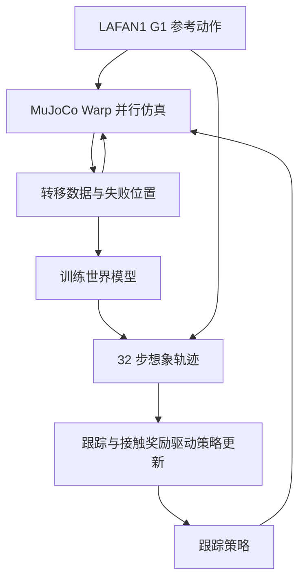

# InstantTrack：加速 G1 全身动作跟踪训练

**InstantTrack** 基于社区 [SuperMimic](./paper-supermimic.md) 复现，结合 GPU 训练优化、策略指数移动平均和足部接触奖励，训练单一 G1 全身动作跟踪策略。

## 英文缩写速查

| 缩写 | 英文全称 | 简要说明 |
|---|---|---|
| EMA | Exponential Moving Average | 对策略权重做指数移动平均 |
| WM | World Model | 根据仿真转移预测状态变化 |
| GPU | Graphics Processing Unit | 并行仿真与训练硬件 |
| MDP | Markov Decision Process | 描述任务状态、动作与奖励 |

## 流程总览

仿真数据用于拟合世界模型；策略对模型中的想象回报反向传播，critic 对短视野外回报做 bootstrap。失败位置统计引导部分重置；这不是对仿真器本身求导。

## 主要改进

- **策略 EMA：** 保存和评估平均权重；作者将加入 EMA 的社区复现作为主要对照。
- **系统吞吐：** 减少 CPU/GPU 同步、融合 Adam 和旋转计算、编译更多计算，并把世界模型隐藏层从 2048 缩小至 1024。
- **失败采样：** 30% 重置从近期失败位置之前的时间段开始。
- **接触奖励：** 在想象轨迹中匹配参考脚部接触状态，并惩罚参考脚落地时的水平速度；评估仍用原基线奖励。

## 作者报告的仿真结果

| 指标 | SuperMimic + EMA | InstantTrack | 条件 |
|---|---:|---:|---|
| 达到目标的训练时间 | 0.55 小时 | 0.25 小时 | RTX 5090、40 条 LAFAN1，三次种子均值 |
| 0.75 小时接触一致率 | 0.719 | 0.812 | 每条从首帧评测，三次种子均值 |
| 0.75 小时接触时脚滑速度 | 8.00 cm/s | 6.62 cm/s | 同上 |
| 0.75 小时根位置漂移 | 54 cm | 61 cm | 同上 |

目标定义为归一化回报至少 0.82 且 40 条动作零失败，并连续三个 checkpoint 达标。checkpoint 每三分钟保存，训练计时不含离线评估。无 EMA 的社区复现仅一粒随机种子，报告为 1.50 小时；2.2 倍对比的是同机 SuperMimic + EMA，不能当作与原论文官方实现的比较。

## 工程实践与局限

[源码](../../sources/repos/instanttrack.md) 提供训练、评估和数据下载脚本，代码为 MIT；动作数据需另行下载并遵守其许可。作者实验仅覆盖 G1 仿真和 40 条训练动作，评估无随机化、噪声或推搡，未报告真机或未见动作泛化。带接触奖励的配置在作者实验中增加了根位置漂移，体现脚部接触与轨迹精度的权衡。项目页本次无法直接访问，链接及开放状态依据 README 和仓库核查。

## 关联页面

- [SuperMimic](./paper-supermimic.md)：世界模型训练基础及独立复现。
- [基于模型的强化学习](../methods/model-based-rl.md)：模型内策略优化背景。
- [全身控制](../concepts/whole-body-control.md)：任务背景。

## 参考来源

- [InstantTrack 源码归档](../../sources/repos/instanttrack.md)
- [InstantTrack 项目页归档](../../sources/sites/instanttrack.md)

## 推荐继续阅读

- [项目 README 与实验记录](https://github.com/Huy-Quang-Dao/instantTrack)
