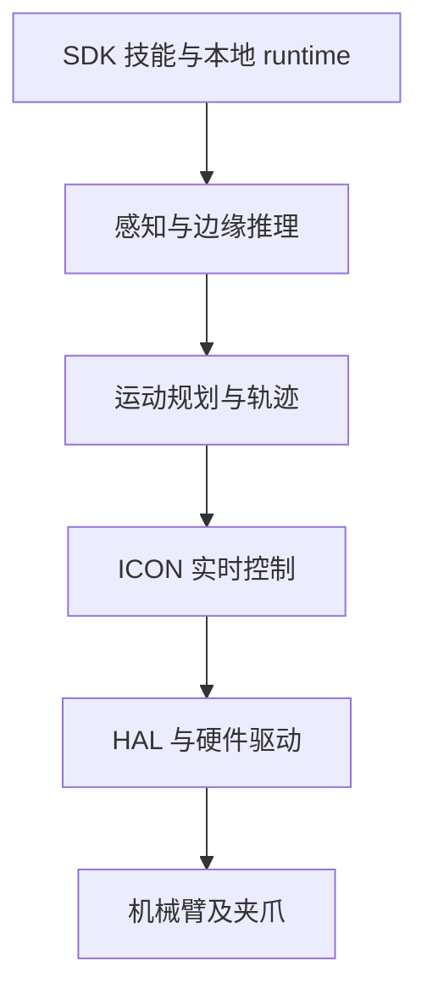
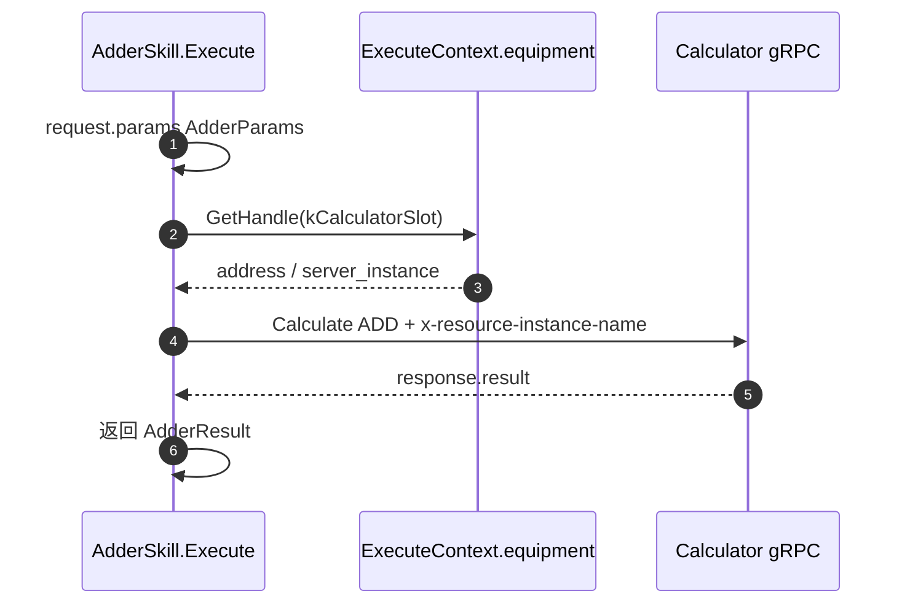

# Intrinsic Core：工业机器人本地运行时与实时控制框架（Industrial Robotics Runtime & Real-Time Control）

## 一句话定义

以本地 k3s 运行时、ICON 实时控制、硬件抽象和感知规划服务组合工业机器人应用。

## 英文缩写速查

| 缩写 | 英文全称 | 简要说明 |
|---|---|---|
| ICON | Intrinsic Control | 实时运动与硬件协调 |
| HAL | Hardware Abstraction Layer | 跨设备硬件抽象 |
| SDK | Software Development Kit | 技能、资产与执行节点接口 |
| ROS 2 | Robot Operating System 2 | 机器人生态互操作 |

## 为什么重要

本地运行时、硬件抽象和工业部署接口的工程参考。将其作为可比较的独立研究或工程入口，而不是仅记录热度。

## 核心信息

| 字段 | 内容 |
|---|---|
| 机构 | 工业机器人软件公司（Intrinsic） |
| 开放状态 | Apache-2.0；官方 README 明确为本地开放运行时及 SDK。外部依赖及设备驱动支持需逐项确认。 |

## 核心原理与流程总览

intrinsic_runtime 负责进程生命周期和应用状态；intrinsic_sdk / intrinsic_apis 为技能与资源定义接口；intrinsic_perception 与 intrinsic_inference 提供传感、6-DoF 位姿和边缘推理；intrinsic_motion_planning 负责约束路径与轨迹生成；ICON 执行实时控制并经 HAL 连接驱动器。各能力可组合，不表示每个技能都必须经过所有模块。

### 本地部署与模块边界

- README 列出 runtime、ICON、motion planning、perception、inference、SDK、API、hardware 与 kinematics 九类模块。ICON 结合轨迹插值、运动学及确定性控制循环，HAL 负责设备适配；感知模块支持 FoundationPose 6-DoF 估计，规划模块负责约束、限位与轨迹衔接。
- 官方 Getting Started 以 k3s 本地集群部署参考 OMTS 为主线：安装工具及依赖、部署运行时、用 Bazel 构建与部署参考方案、通过可视化/调试接口检查。README 标注 Ubuntu 24.04/26.04（亦支持 22.04）和 ROS 2 Lyrical Luth；实际兼容性须按发布版本确认。

以下为根据原文整理的概念流程。

## 源码运行时序图

`intrinsic/skills/examples/adder_skill.cc::AdderSkill::Execute` 是已核对的 SDK 技能调用示例，不是 ICON 实时控制循环；部署入口及构建教程已核对。

## 工程实践

Apache-2.0；官方 README 明确为本地开放运行时及 SDK。外部依赖及设备驱动支持需逐项确认。 复现入口与版本依赖见参考来源。本次未执行训练、推理或仿真复现。

## 实验与评测

官方 README 给出开源机床上下料 OMTS 参考解决方案，并声明可通过统一 HAL 更换机械臂与夹爪。未见本次读取资料给出统一可复现的周期抖动、负载下延迟或跨硬件性能数字，不编造指标。

### 工程核验与限制

- OMTS 是机床上下料参考方案，不能由参考方案推导所有设备均可免驱动适配；需要按机器人型号验证 HAL、现场总线、控制周期、故障及急停。SDK AdderSkill 例程只验证技能接口调用关系，不是实时运动循环。未进行实机或部署验证。

## 结论

以本地 k3s 运行时、ICON 实时控制、硬件抽象和感知规划服务组合工业机器人应用。 工程选型时应同时验证指标口径及使用边界。

- 先通过参考方案验证仿真到硬件的接口。
- 把 SDK 服务调用与 ICON 硬实时循环区分。
- 替换硬件时独立验证控制周期、延迟和安全链。

## 局限与风险

硬件无关接口不代表任意设备无需适配；实际现场仍要验证实时性、驱动兼容、急停和安全认证。开发者社区页面未能提取正文，ICON 底层控制实现未逐行审计。

**核对状态：** 已完成所列原文核对（官方 README 全文、Getting Started 部署教程、教程索引、AdderSkill::Execute 示例源码；不是对全部 ICON 实现的逐行审计。）；未执行训练或实机复现。

## 关联页面

- [painode-046-intrinsic](./painode-046-intrinsic.md)
- [vla](../methods/vla.md)
- [相关纵深路线](../../roadmap/depth-vla.md)

- [机器人操作任务](../tasks/manipulation.md) — 工业操作应用的任务层与执行层接口。

## 参考来源

- [sites：intrinsic-core](../../sources/sites/intrinsic-core.md)
- [repos：intrinsic-core](../../sources/repos/intrinsic-core.md)

## 推荐继续阅读

- [官方项目页](https://developer.intrinsic.ai/)
- [官方源码](https://github.com/intrinsic-ai/intrinsic-core)
- [OMTS 机床上下料参考方案](https://github.com/intrinsic-ai/intrinsic-omts)
- [Getting Started 安装教程（见官方源码归档）](../../sources/repos/intrinsic-core.md)
