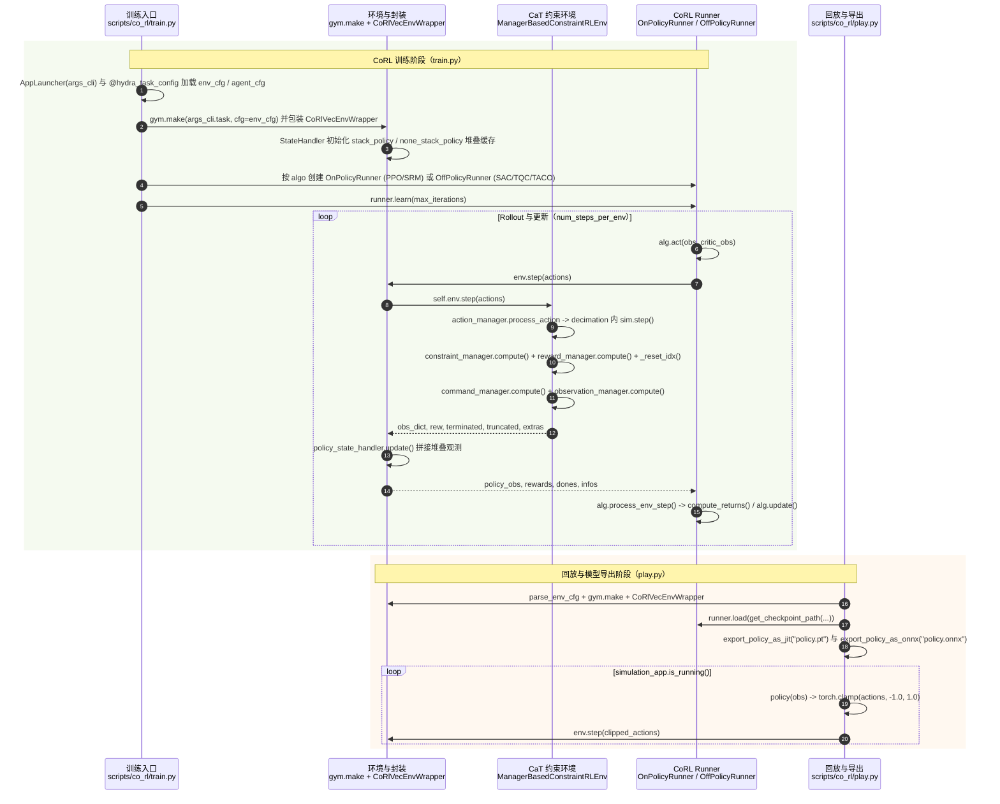

# Isaac-RL-Two-wheel-Legged-Bot（lab.flamingo）

**Isaac-RL-Two-wheel-Legged-Bot** 是 [`jaykorea/Isaac-RL-Two-wheel-Legged-Bot`](https://github.com/jaykorea/Isaac-RL-Two-wheel-Legged-Bot) 提供的 [Isaac Lab](./isaac-lab.md) 扩展，Python 包名 **`lab.flamingo`**，面向 **Flamingo 双轮足**（以及 Edu / Light / 4w4l / 人形等变体）。维护者邮箱域为 POSTECH。

## 一句话定义

在 Isaac Lab 2.0 上注册 Flamingo 速度跟踪与技能任务，用基于 [RSL-RL](./rsl-rl.md) 的 **CoRL** runner 训练 PPO（也可 SAC/TQC），并用 **Constraints as Termination** 把约束违反变成随机终止。

## 英文缩写速查

| 缩写 | 英文全称 | 简要说明 |
|------|----------|----------|
| Flamingo | Flamingo two-wheel-legged robot | 本仓主机体；另有 Edu / Light / 4w4l |
| CoRL | 仓内 RL 启动器名 | `scripts/co_rl/train.py`；on-policy + off-policy runner |
| CaT | Constraints as Termination | arXiv:2403.18765；约束违反 → 终止概率 |
| PPO | Proximal Policy Optimization | 默认 `--algo ppo` |
| SAC | Soft Actor-Critic | `Isaac-Velocity-Flat-Flamingo-v3-sac` 等 off-policy ID |

## 为什么重要

- **Isaac Lab 上可跑的双轮足扩展**：相对 [tita_rl](./tita-rl.md) 的 Gym 栈和 [DDT_Lab](./ddt-lab.md) 的厂商 Tita 任务，这是另一套开源机体 + 任务族（含 TrackZ、跳跃、后空翻）。
- **CaT 落地**：把论文里的「约束当终止」写成 `ConstraintManager` + `ManagerBasedConstraintRLEnv`，可对照 [Safe RL](../methods/safe-rl.md) 的 CMDP / 终止启发式。
- **观测 stacking**：`--num_policy_stacks` / `--num_critic_stacks` 把历史帧拼进 actor/critic，是双轮足平衡任务里常见的工程旋钮。

## 核心原理

| 层 | 说明 |
|----|------|
| 包 | `pip install -e .` → `lab.flamingo` |
| 资产 | USD 以 zip 入库，须解压到 `lab/flamingo/assets/data/Robots/Flamingo/` |
| Manager 任务 | `Isaac-Velocity-{Flat,Rough}-Flamingo-v1-ppo`；TrackZ / TrackRP / TrackYK / TrackJUMP |
| 约束任务 | `...-ppo-constraint`、`Isaac-Backflip-Flat-Flamingo-v1-ppo-constraint`；entry 指向仓内 Constraint env |
| Off-policy | SAC / TQC 的 `v3` Gym ID |
| sim2sim | README：Lab 导出 ONNX → MuJoCo，分支 `sim2sim_onnx` **迁移中** |

## 源码运行时序图

以下时序图基于官方仓库 `jaykorea/Isaac-RL-Two-wheel-Legged-Bot`（`main` 分支）核读的源码与入口梳理：`README.md`、`scripts/co_rl/train.py`、`scripts/co_rl/play.py`、`scripts/co_rl/core/wrapper/vecenv_wrapper.py`、`scripts/co_rl/core/runners/on_policy_runner.py`、`scripts/co_rl/core/runners/off_policy_runner.py` 与 `lab/flamingo/isaaclab/isaaclab/envs/manager_based_constraint_rl_env.py`。

- **关键复现路径**：以 `scripts/co_rl/train.py` 为统一训练入口，经 `CoRlVecEnvWrapper` 与 `StateHandler` 维护观测历史堆叠；约束任务（`*-constraint`）底层进入 `ManagerBasedConstraintRLEnv.step()` 触发 `constraint_manager.compute()`；训练后用 `scripts/co_rl/play.py` 加载 checkpoint 并导出 `policy.pt` / `policy.onnx`（`srmppo` 另导出 `srm.onnx`）。

## 工程实践

1. 对齐徽章：**Isaac Sim 4.5、Isaac Lab 2.0.0、Python 3.10**（比 [DDT_Lab](./ddt-lab.md) 的 Sim 5.1 / Lab 2.3 旧一截，不要混环境）。
2. clone 后在 Isaac Lab conda 中 `pip install -e .`；**先解压** 对应机型 zip，否则加载 USD 失败。
3. 训练示例：
   `python scripts/co_rl/train.py --task Isaac-Velocity-Flat-Flamingo-v1-ppo --algo ppo --num_envs 4096 --headless --num_policy_stacks 2 --num_critic_stacks 2`
4. 回放把 task 换成 `*-Play-*`，并传 `--load_run <folder>`。
5. 约束实验改用 `Isaac-Velocity-Flat-Flamingo-v1-ppo-constraint` 或 Backflip ID；确认走的是 `ManagerBasedConstraintRLEnv`。
6. `extension.toml` 里的 `jaykorea/lab.flamingo.git` 已 404，clone URL 以本仓为准。

## 局限与风险

- **开源状态：已开源**；训练脚本与任务注册可跑。许可证：GitHub SPDX 为 **MIT**，`setup.py` 写 **BSD-3-Clause**，引用时核对文件头。
- **sim2sim 分支迁移中**：不要默认 ONNX→MuJoCo 路径当前可复现。
- **零样本真机是 README 宣称**：本仓不附完整板载 bringup；部署细节需另找硬件/ROS 仓。
- **版本钉死 4.5 / 2.0**：升到 Lab 2.3+ 要自己改 extension API。

## 关联页面

- [轮腿双足](../concepts/wheel-legged-biped.md)
- [Isaac Lab](./isaac-lab.md)
- [RSL-RL](./rsl-rl.md)
- [tita_rl](./tita-rl.md)
- [DDT_Lab](./ddt-lab.md)
- [wheel_legged_genesis](./wheel-legged-genesis.md)
- [Safe RL](../methods/safe-rl.md)
- [Hybrid Locomotion](../tasks/hybrid-locomotion.md)
- [Locomotion](../tasks/locomotion.md)

## 参考来源

- [sources/repos/isaac_rl_two_wheel_legged_bot.md](../../sources/repos/isaac_rl_two_wheel_legged_bot.md)
- 上游：<https://github.com/jaykorea/Isaac-RL-Two-wheel-Legged-Bot>

## 推荐继续阅读

- Constraints as Termination（arXiv:2403.18765）：<https://arxiv.org/abs/2403.18765>
- Isaac Lab 安装：<https://isaac-sim.github.io/IsaacLab/main/source/setup/installation/binaries_installation.html>
