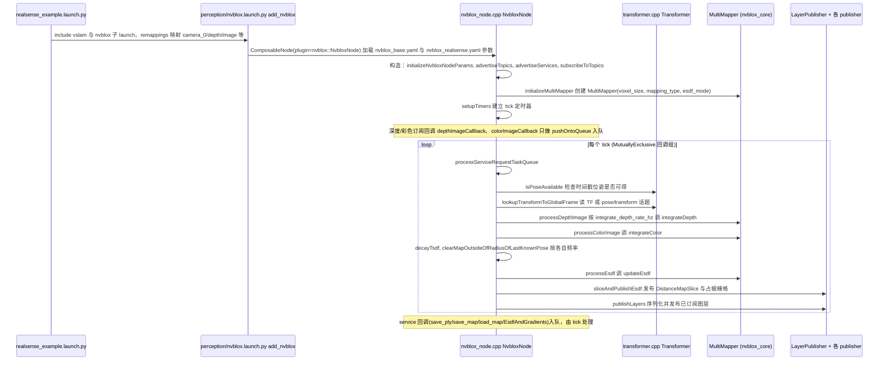

# Isaac ROS Nvblox

**isaac_ros_nvblox**（[NVIDIA-ISAAC-ROS/isaac_ros_nvblox](https://github.com/NVIDIA-ISAAC-ROS/isaac_ros_nvblox)）实现 **GPU 加速的 TSDF/ESDF 重建**，将深度/RGB-D/激光深度投影融合为 **3D 距离场**，并作为 **Nav2 局部代价地图** 的数据源之一。

## 英文缩写速查

| 缩写 | 英文全称 | 简要说明 |
|------|----------|----------|
| GPU | Graphics Processing Unit | 图形处理器，大规模并行仿真训练的算力基础 |
| RGB | Red-Green-Blue | 彩色图像通道，常与深度 (RGB-D) 配合 |
| SLAM | Simultaneous Localization and Mapping | 同步定位与建图 |
| LIO | LiDAR-Inertial Odometry | 激光-惯性里程计 |

## 为什么重要

- **3D 避障**：弥补纯 2D 激光对悬空/桌面障碍的盲区。
- **与 cuVSLAM 协同**：感知—建图—规划链在 Isaac ROS 内闭环。
- **操作 ESDF**：cuMotion 可消费 Nvblox **ESDF** 做动态避障（例：[AI Worker × cuMotion](./robotis-ai-worker-isaac-cumotion.md)）。
- 适合 **Jetson AMR**、仓储机器人等需要 **动态障碍** 更新的场景。

## 核心结构/机制

- **TSDF 融合**：多帧深度积分。
- **ESDF 导出**：供规划器查询最近障碍距离。
- **Nav2 集成**：通过 costmap 插件或桥接节点注入障碍层（以官方教程为准）。

## 常见误区或局限

- **误区：替代 SLAM** — nvblox 偏 **局部稠密地图/代价**；全局定位仍需 VSLAM/LIO 等。
- **局限**：GPU 显存与传感器同步要求高；非 NVIDIA 平台不适用。

## 源码运行时序图

入口：`nvblox_examples_bringup/launch/realsense_example.launch.py`（其它传感器有同目录 `zed_example` / `os1_example` / `isaac_sim_example` 等 launch）；建图节点本体为 `nvblox_ros` 包的 `nvblox::NvbloxNode`（`nvblox_node_main.cpp`，或由 `perception/nvblox.launch.py` 以 ComposableNode 加载）。GPU 侧 TSDF/ESDF 积分在子模块 `nvblox_ros/nvblox_core`（`MultiMapper`/`Mapper`），该子模块未随本次浅克隆取得，图中只画到 `MultiMapper` 调用边界。

图依据：NVIDIA-ISAAC-ROS/isaac_ros_nvblox@79654d2，读过 nvblox_examples/nvblox_examples_bringup/launch/{realsense_example,perception/nvblox}.launch.py、nvblox_ros/src/nvblox_node_main.cpp、nvblox_ros/src/lib/{nvblox_node,transformer}.cpp（nvblox_node.cpp 读了构造、订阅/发布/服务注册、tick、processDepthQueue、processEsdf、processDepthImage/processColorImage 相关段，未通读全部 1936 行）；nvblox_core 子模块未读。

## 参考来源

- [sources/repos/isaac_ros_nvblox.md](../../sources/repos/isaac_ros_nvblox.md)
- [NVIDIA-ISAAC-ROS/isaac_ros_nvblox](https://github.com/NVIDIA-ISAAC-ROS/isaac_ros_nvblox)
- 源码核对（2026-11-02）：NVIDIA-ISAAC-ROS/isaac_ros_nvblox@79654d2，读过 nvblox_examples_bringup 的 realsense_example.launch.py 与 perception/nvblox.launch.py，nvblox_ros 的 nvblox_node_main.cpp、nvblox_node.cpp、transformer.cpp；时序图依据以上文件，未运行代码；nvblox_core 子模块未读。

## 关联页面

- [Isaac ROS Visual SLAM](./isaac-ros-visual-slam.md)
- [Navigation2](./navigation2.md)
- [OccAnyScene](./paper-occanyscene.md) — 学习型语义占据（离线/批式）；nvblox 是在线 TSDF/ESDF

## 推荐继续阅读

- [Isaac ROS Nvblox 文档](https://nvidia-isaac-ros.github.io/repositories/isaac_ros_nvblox/index.html)
