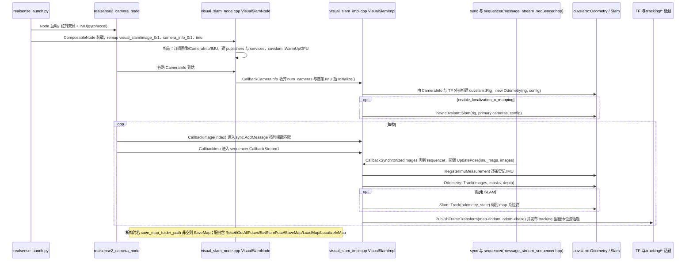

# Isaac ROS Visual SLAM

**isaac_ros_visual_slam**（[NVIDIA-ISAAC-ROS/isaac_ros_visual_slam](https://github.com/NVIDIA-ISAAC-ROS/isaac_ros_visual_slam)）封装 **cuVSLAM**，在 **CUDA** 上加速立体/多相机视觉里程计，面向 **Isaac ROS** 与 **Jetson** 部署。

## 英文缩写速查

| 缩写 | 英文全称 | 简要说明 |
|------|----------|----------|
| SLAM | Simultaneous Localization and Mapping | 同步定位与建图 |
| GPU | Graphics Processing Unit | 图形处理器，大规模并行仿真训练的算力基础 |
| ROS 2 | Robot Operating System 2 | 机器人系统集成与通信的常用中间件 |
| CUDA | Compute Unified Device Architecture | NVIDIA GPU 通用并行计算平台 |
| CPU | Central Processing Unit | 中央处理器 |
| IMU | Inertial Measurement Unit | 惯性测量单元，提供加速度与角速度 |
| VIO | Visual-Inertial Odometry | 视觉-惯性里程计，融合相机与 IMU 估计位姿 |

## 为什么重要

- **GPU 加速**：同等算力下更高帧率，适合移动机器人 **多相机** 配置。
- **ROS 2 原生**：与 [nvblox](./isaac-ros-nvblox.md)、Nav2 代价地图插件同一生态。
- 与 CPU 系 [ORB-SLAM3](https://github.com/UZ-SLAMLab/ORB_SLAM3) / [VINS-Fusion](https://github.com/HKUST-Aerial-Robotics/VINS-Fusion) 形成 **部署路径** 对比。

## 核心结构/机制

- 输入：校准后的立体或双目红外等图像流。
- 输出：里程计、位姿 TF，可与 IMU 融合（以 release 文档为准）。
- 依赖：**NVIDIA GPU**、Isaac ROS 公共依赖与容器化工作流。

## 常见误区或局限

- **误区：可脱离 NVIDIA 硬件运行** — 核心加速绑定 cuVSLAM/CUDA。
- **局限**：算法透明度与论文复现性弱于学术开源 VIO；调参需参考 NVIDIA 文档。

## 源码运行时序图

入口：`isaac_ros_cuvslam/launch/isaac_ros_visual_slam_realsense.launch.py`（启动 `realsense2_camera_node` 与装载 `nvidia::isaac_ros::visual_slam::VisualSlamNode` 的 `component_container`；也可直接运行 `visual_slam_main.cpp` 的可执行文件）。底层 `cuvslam::Odometry` / `cuvslam::Slam` 来自 `cuvslam` 子模块（本次浅克隆未取得，仅按 ROS 封装中的调用画图）。

图依据：NVIDIA-ISAAC-ROS/isaac_ros_visual_slam@9058506，读过 isaac_ros_cuvslam/launch/isaac_ros_visual_slam_realsense.launch.py、src/visual_slam_main.cpp、src/visual_slam_node.cpp、src/impl/visual_slam_impl.cpp（构造、Initialize 开头、CallbackImu/Image/CameraInfo、UpdatePose 的 Track 与 TF 发布段；未通读全部 1307 行）；cuvslam 子模块与 message_stream_sequencer.hpp 内部未读，sync/sequencer 的先后关系依据构造函数里的 RegisterCallback 推断。

## 参考来源

- [sources/repos/isaac_ros_visual_slam.md](../../sources/repos/isaac_ros_visual_slam.md)
- [sources/repos/cuvslam.md](../../sources/repos/cuvslam.md) — 底层 cuVSLAM 库
- [cuVSLAM 论文实体](./paper-cuvslam.md)
- [NVIDIA-ISAAC-ROS/isaac_ros_visual_slam](https://github.com/NVIDIA-ISAAC-ROS/isaac_ros_visual_slam)
- 源码核对（2026-11-02）：NVIDIA-ISAAC-ROS/isaac_ros_visual_slam@9058506，读过 isaac_ros_cuvslam 的 launch/isaac_ros_visual_slam_realsense.launch.py、src/visual_slam_main.cpp、src/visual_slam_node.cpp、src/impl/visual_slam_impl.cpp；时序图依据以上文件，未运行代码；cuvslam 子模块未读。

## 关联页面

- [Isaac ROS Nvblox](./isaac-ros-nvblox.md)
- [导航·SLAM·自动驾驶栈总览](../overview/navigation-slam-autonomy-stack.md)

## 推荐继续阅读

- [Isaac ROS Visual SLAM 文档](https://nvidia-isaac-ros.github.io/repositories/isaac_ros_visual_slam/index.html)
