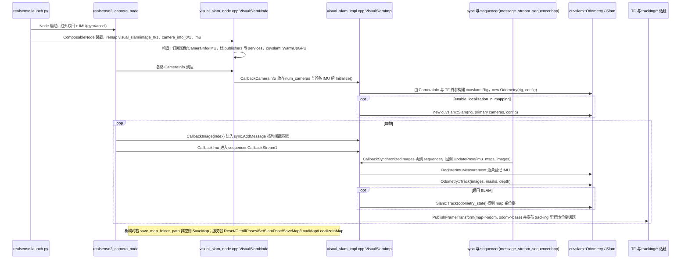

# Isaac ROS Visual SLAM

## 一句话定义

**Isaac ROS Visual SLAM（`isaac_ros_visual_slam`）** 是 NVIDIA 将 **cuVSLAM**（arXiv:2506.04359）CUDA 视觉-惯性 SLAM 核心封装为 ROS 2 `ComposableNode` 的高性能感知包，面向 Jetson 与 GPU 移动平台提供低延迟里程计、多立体 **FIG** 建图与 Nav2 定位接入。

## 英文缩写速查

| 缩写 | 英文全称 | 简要说明 |
|------|----------|----------|
| SLAM | Simultaneous Localization and Mapping | 同步定位与建图 |
| GPU | Graphics Processing Unit | 图形处理器，大规模并行仿真训练的算力基础 |
| ROS 2 | Robot Operating System 2 | 机器人系统集成与通信的常用中间件 |
| CUDA | Compute Unified Device Architecture | NVIDIA GPU 通用并行计算平台 |
| CPU | Central Processing Unit | 中央处理器 |
| IMU | Inertial Measurement Unit | 惯性测量单元，提供加速度与角速度 |
| VIO | Visual-Inertial Odometry | 视觉-惯性里程计，融合相机与 IMU 估计位姿 |

## 为什么重要

- **GPU 加速**：同等算力下更高帧率，适合移动机器人 **多相机** 配置。
- **ROS 2 原生**：与 [nvblox](./isaac-ros-nvblox.md)、Nav2 代价地图插件同一生态。
- 与 CPU 系 [ORB-SLAM3](https://github.com/UZ-SLAMLab/ORB_SLAM3) / [VINS-Fusion](https://github.com/HKUST-Aerial-Robotics/VINS-Fusion) 形成 **部署路径** 对比。

## 核心机制与 CUDA 加速栈

| 层次 | 原文指标与机制（cuVSLAM arXiv:2506.04359 & ROS2 封装） |
|------|------|
| **CUDA 前端跟踪** | 分块均匀特征筛选 + 改进 Lucas–Kanade 光流 + 跨相机三角化；Jetson Orin AGX 双目单帧耗时 **1.8 ms**（CPU 占 **5.5%**、GPU 占 **1.7%** @ 60 fps） |
| **多立体 FIG 图** | 支持最多 **32 路相机** 自动构建 **Frustum Intersection Graph（FIG）**，Carter 四双目 R2B 基准 SLAM 精度提升 **40%**，抗单一视角遮挡能力强 |
| **稀疏局部 BA + 位姿图** | 关键帧触发 CUDA 加速稀疏光束法平差（SBA）与回环闭环优化；KITTI Odometry 0.85% RTE / 0.0025 deg/m |
| **ROS 2 零拷贝封装** | `VisualSlamNode` 与 `sequencer` 时间对齐多流图像/IMU，输出 `map->odom` / `odom->base_link` TF 与 `tracking/*` 话题直连 `nvblox` 与 Nav2 |

## 工程实践

- **硬件级时间同步：** 部署多对立体相机（如 Carter 4-Stereo）时必须保证硬件触发时间戳对齐并精确标定 Rig 外参，否则 `VisualSlamImpl::CallbackImage` 同步队列丢帧或 FIG 跨相机三角化发散。
- **运动速度与帧率配置：** cuVSLAM 默认几乎免调参，但人速以上自主移动推荐 VGA+ 分辨率与 ≥30 fps、短曝光以控制运动模糊。
- **地图持久化：** 支持 `Reset` / `SaveMap` / `LoadMap` / `LocalizeInMap` ROS 2 服务，适合仓内固定路径重定位部署；实验性 `Multisensor` 任意 RGB/RGB-D 混合模式需启用 `cuNLS` 构建。

## 常见误区或局限

- **误区：可脱离 NVIDIA 硬件运行** — 核心加速绑定 cuVSLAM/CUDA。
- **局限**：算法透明度与论文复现性弱于学术开源 VIO；调参需参考 NVIDIA 文档。

## 源码运行时序图

入口：`isaac_ros_cuvslam/launch/isaac_ros_visual_slam_realsense.launch.py`（启动 `realsense2_camera_node` 与装载 `nvidia::isaac_ros::visual_slam::VisualSlamNode` 的 `component_container`；也可直接运行 `visual_slam_main.cpp` 的可执行文件）。底层 `cuvslam::Odometry` / `cuvslam::Slam` 来自 `cuvslam` 子模块（本次浅克隆未取得，仅按 ROS 封装中的调用画图）。

图依据：NVIDIA-ISAAC-ROS/isaac_ros_visual_slam@9058506，读过 isaac_ros_cuvslam/launch/isaac_ros_visual_slam_realsense.launch.py、src/visual_slam_main.cpp、src/visual_slam_node.cpp、src/impl/visual_slam_impl.cpp（构造、Initialize 开头、CallbackImu/Image/CameraInfo、UpdatePose 的 Track 与 TF 发布段；未通读全部 1307 行）；cuvslam 子模块与 message_stream_sequencer.hpp 内部未读，sync/sequencer 的先后关系依据构造函数里的 RegisterCallback 推断。

## 参考来源

- [sources/papers/cuvslam_arxiv_2506_04359.md](../../sources/papers/cuvslam_arxiv_2506_04359.md) — NVIDIA cuVSLAM 技术报告（arXiv:2506.04359）
- [sources/repos/isaac_ros_visual_slam.md](../../sources/repos/isaac_ros_visual_slam.md)
- [sources/repos/cuvslam.md](../../sources/repos/cuvslam.md) — 底层 cuVSLAM 库
- [cuVSLAM 论文实体](./paper-cuvslam.md)
- [NVIDIA-ISAAC-ROS/isaac_ros_visual_slam](https://github.com/NVIDIA-ISAAC-ROS/isaac_ros_visual_slam)
- 源码核对（2026-11-02）：NVIDIA-ISAAC-ROS/isaac_ros_visual_slam@9058506，读过 isaac_ros_cuvslam 的 launch/isaac_ros_visual_slam_realsense.launch.py、src/visual_slam_main.cpp、src/visual_slam_node.cpp、src/impl/visual_slam_impl.cpp；时序图依据以上文件，未运行代码；cuvslam 子模块未读。

## 关联页面

- [Isaac ROS Nvblox](./isaac-ros-nvblox.md)
- [导航·SLAM·自动驾驶栈总览](../overview/navigation-slam-autonomy-stack.md)

- [机器人状态估计与定位](../methods/robot-state-estimation-workflow.md)：了解传感融合、定位与漂移。
- [机器人软件系统集成](../methods/robot-software-integration.md)：对照相关方法与适用场景。

## 推荐继续阅读

- [Isaac ROS Visual SLAM 文档](https://nvidia-isaac-ros.github.io/repositories/isaac_ros_visual_slam/index.html)
