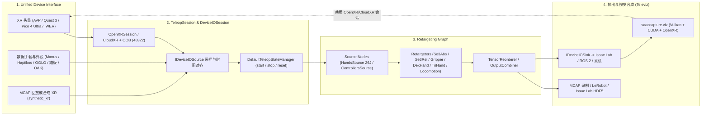
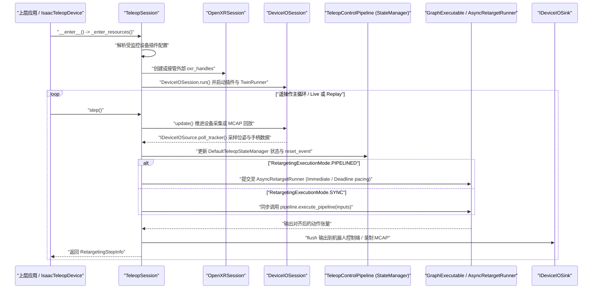

# Isaac Teleop（NVIDIA Isaac Capture）

## 一句话定义

**Isaac Teleop**（仓库及 Python 包正迁移至 **NVIDIA Isaac Capture / `isaaccapture`**，v1.6–1.8 保留 `isaacteleop` 兼容垫片）是 NVIDIA 开源的仿真与真机统一遥操作及第一人称（egocentric）数据采集框架：通过标准化 XR 与外设插件、图式重定向（retargeting）管线、GPU 视觉合成（Televiz）与 MCAP 录放，同一套采集栈可直接驱动 [Isaac Lab](./isaac-lab.md)、ROS 2 或真机控制器。

## 英文缩写速查

| 缩写 | 英文全称 | 简要说明 |
|---|---|---|
| XR | Extended Reality | 涵盖 VR/AR/MR 的统称，框架以 OpenXR 与 CloudXR 为传输基线 |
| OOB | Out-of-Band | 带外控制通道（`isaaccapture.cloudxr.service`），在头显外部协调会话连接与状态 |
| MCAP | MCAP Log Format | 面向多模态遥测与动作流的高性能容器格式，支持会话录制与确定性回放 |
| CDP | Chrome DevTools Protocol | OOB 自动脚本用于自动确认自签名证书与点击 WebXR `CONNECT` 的调试协议 |
| IWER | Immersive Web Emulation Runtime | 无真实头显时在桌面浏览器仿真 Quest 3 WebXR 运行时的测试工具 |
| EULA | End-User License Agreement | 首次运行拉取 CloudXR Web Client SDK 时需显式确认的终端用户许可协议 |

## 为什么重要

在人形全身控制与灵巧手操作采数中，工程团队往往被迫为「仿真内采数（如旧版 `isaaclab.devices.openxr`）」「真机遥操作（如独立 ROS 节点）」「第一人称无机器人采数（no-robot）」各自维护一套设备驱动与映射代码，导致动作语义、坐标系与延迟特性难以对齐。

Isaac Teleop 将**设备接入、控制状态机、运动学重定向、数据记录与 XR 视觉回传**解耦为可复用图节点：

- **取代 Isaac Lab 旧版 XR 栈：** 在 Isaac Lab 3.0+ 中，[`IsaacTeleopDevice`](https://isaac-sim.github.io/IsaacLab/main/source/features/isaac_teleop.html) 接管 XR 会话生命周期与锚点变换，同一 retargeter 图既可跑在 Isaac Lab 仿真的 `record_demos.py`（导出 HDF5 供模仿学习），也可独立跑在真机或轻量 Python 示例中。
- **跨模态采数与数据集闭环：** 通过 [MCAP](./mcap-log-format.md) 录制回放、与 [LeRobot](./lerobot.md) 数据集格式互操作，以及内置第一人称手部重建管线 **EgoHand**（`isaaccapture_egopost`，arXiv:2610.30293），打通真实人类演示到策略训练的数据流。

## 核心原理

### 开源状态与版本边界

- **核心框架已开源（Apache-2.0）：** 仓库源码（Python + C++ 插件框架）与轮子公开；v1.6–1.8 期以 `isaaccapture` 为主包名（`pyproject.toml` 声明兼容 `isaacteleop>=1!1.6.dev0,<1!1.9` 垫片，并计划在 `1.9` 移除旧名）。
- **门禁与闭源依赖：** 首次启动 CloudXR 流媒体服务需确认 CloudXR Web Client SDK EULA；第一人称手部重建模块（`src/python/isaaccapture_egopost/**`，打包时从 `sdist` 排除）及历史 Dyn-HaMR 流程依赖 MANO 学术许可与第三方模型权重。
- **尚未完全交付（Upcoming）：** 纯非 XR 主设备（常规手柄、Gello、SpaceMouse issue #276 等目前主要走上层或旧接口）、云端全托管仿真遥操作及桌面/头显双向远程相机推流仍在演进中。

### 四大架构层与硬件生态

1. **Unified Device Interface & 插件隔离：** 通过进程/C++ 插件抽象屏蔽厂商 SDK 许可证差异，原生支持 **Apple Vision Pro**（visionOS 客户端 >= v3.0.0）、**Meta Quest 2/3/3S**（CloudXR.js WebXR，默认 `Quest3` profile）、**Pico 4 Ultra / PICO Motion Tracker**、**MANUS Metagloves Pro / Haptikos / OGLO / Noitom**、**Logitech 三轴脚踏**及 **OAK 离线第一人称相机**；无物理头显时可配合 [IWER](./immersive-web-emulation-runtime.md) 或内置 `synthetic_xr` 验证链路。
2. **图式 Retargeting 管线：** 以可组合张量有向图描述映射关系。典型节点包括 `HandsSource`（左右手各 26 关节）、`ControllersSource`（握姿、扳机、摇杆）、`Se3AbsRetargeter`/`Se3RelRetargeter`、`GripperRetargeter`（扳机优先或捏合）、`DexHandRetargeter`/`DexBiManualRetargeter`（基于 `dex-retargeting` + URDF/YAML）、`TriHandMotionControllerRetargeter`（G1 三指手）、`LocomotionRootCmdRetargeter` 与 `TensorReorderer`。执行层面提供 `SYNC`（同步）与 `PIPELINED`（通过 `AsyncRetargetRunner` 解耦 Python GIL 与仿真渲染线程，支持 `ImmediatePacingConfig` 与 `DeadlinePacingConfig`）。
3. **控制状态机与 OOB Hub：** 默认通过确定性 UUID（`uuid5(NAMESPACE_DNS, "teleop_command")`）的 OpenXR opaque data channel 传输 JSON 控制指令（`start teleop` / `stop teleop` / `reset teleop`），由 `DefaultTeleopStateManager` 或 `TwoButtonTeleopStateManager` 维护启停与重置状态；`isaaccapture.cloudxr.service` 在共享 TLS 端口（默认 `48322`）暴露 OOB Hub，可结合 `adb` 与 CDP 自动拉起头显浏览器、接受自签名证书并点击 `CONNECT`，同时提供断线重连守护（默认 60 s 超时、5 s 重试）。
4. **Televiz 合成器与 EgoHand 重建：** `isaacteleop.viz` / `isaaccapture.viz` 直接读取 GPU 张量（CuPy / PyTorch / `__cuda_array_interface__`），经 Vulkan + CUDA + OpenXR 合成 `QuadLayer`、`CylinderLayer`、`EquirectLayer` 或用于神经渲染（[NuRec](./nvidia-nurec.md) / gsplat / nvblox）的 `ProjectionLayer`；与遥操作追踪共享同一 OpenXR/CloudXR 连接。后处理侧，新版 **EgoHand** 结合 RT-DETR、DINOv3 与 SOMA-X 手部骨骼绑定（可选 ViPE 世界系对齐）从单目第一人称视频重建 4D 手部轨迹。

## 源码运行时序图

以下时序对应仓库 `src/python/isaaccapture/teleop_session_manager/teleop_session.py` 与 `config.py` 中 `TeleopSession` 的真实初始化与每帧步进调用链：

## 工程实践

1. **快速验证链路（免装全套 Isaac Lab）：** 安装 `isaaccapture`（或按 1.5.x 文档 `pip install 'isaacteleop[cloudxr,retargeters]~=1.5.0'`），运行 `examples/teleop/python/isaaccapture_examples/teleop/gripper_retargeting_example_simple.py` 进行最小夹爪重定向冒烟；无物理头显时可配合 IWER 或 `examples/synthetic_xr/` 完成回归测试。
2. **OOB 自动化上线头显：** 先手动跑通一次 `adb devices` 与浏览器自签名证书信任，再开启 `python -m isaaccapture.cloudxr.service run --accept-eula --setup-oob`（若 OpenXR 应用后启动则加 `--defer-oob-connect`，就绪后调用 `GET /api/oob/v1/connect`）；在无 ADB 权限的容器或纯 Wi-Fi 场景可设 `TELEOP_OOB_HUB_ONLY=1`。
3. **帧率、码率与 GIL 调优：** Quest 3 / Pico 4 Ultra 头显刷新多为 **90 Hz**，Web 客户端默认配置为 Quest **72 FPS / 25 Mbps**、Pico **90 FPS / 100 Mbps**；在拥挤 5 GHz Wi-Fi 环境下盲目拉高码率数分钟后易引发重投影抖动。在 Isaac Lab 中接入时建议调用 `remove_camera_configs()` 避免相机渲染争用，并保持 `pipeline_builder` 为 **callable**（避免 `@configclass` 深拷贝问题）以及优先开启 `RetargetingExecutionMode.PIPELINED` 减轻 GIL 阻塞。
4. **Televiz 合层规范：** `submit()` 采用 latest-wins mailbox 且每个图层仅允许单生产者；单场 session 要么使用一个 `ProjectionLayer`，要么使用若干纹理层（`Quad`/`Cylinder`/`Equirect`），二者不能混用。非必要勿打开 `alpha_blend`，否则 CloudXR 会退化为整帧立体画面传输，显著推高带宽。

## 局限与风险

- **纯非 XR 外设覆盖缺口：** 游戏手柄（见 [xpad](./xpad.md)）、Gello 主从臂与 SpaceMouse 等目前尚非框架一等主力输入（SpaceMouse 支持仍处于 Planned 阶段），混合采数站常需额外适配层。
- **许可证与模型权重门禁：** 核心框架虽为 Apache-2.0，但真机 XR 推流依赖 CloudXR EULA，第一人称手重建（EgoHand / Dyn-HaMR）与部分手套厂商 SDK 存在独立学术或商业协议约束，不可直接当作全开放零配置资产分发。
- **包名迁移兼容窗口：** v1.6–1.8 正处于 `isaacteleop` 向 `isaaccapture` 过渡期，旧导入路径将在 v1.9 移除，新工程与配置文件应尽早切换至 `isaaccapture` 命名空间。

## 与其他页面的关联

- 核心任务与方法：[Teleoperation](../tasks/teleoperation.md)、[Imitation Learning](../methods/imitation-learning.md)、[GMR（全身运动学重定向）](../methods/motion-retargeting-gmr.md)
- 上下游仿真与策略生态：[Isaac Lab](./isaac-lab.md)、[Isaac GR00T](./isaac-gr00t.md)、[GR00T-WholeBodyControl](./gr00t-wholebodycontrol.md)、[LeRobot](./lerobot.md)、[NVIDIA NuRec](./nvidia-nurec.md)
- 协议与输入基座：[OpenXR](./openxr.md)、[Immersive Web Emulation Runtime (IWER)](./immersive-web-emulation-runtime.md)、[MCAP Log Format](./mcap-log-format.md)、[xpad](./xpad.md)

## 参考来源

- 仓库代码与源码分析：[nvidia_isaac_teleop.md](../../sources/repos/nvidia_isaac_teleop.md)（通读 `README.md`、`pyproject.toml`、`teleop_session.py`、`config.py` 与示例）
- 官方文档与指南归档：[nvidia-isaac-teleop-docs.md](../../sources/sites/nvidia-isaac-teleop-docs.md)（通读 `architecture.rst`、`teleop_session.rst`、`oob_teleop_control.rst`、`egohand.rst`、`mcap_record_replay.rst` 等）
- 上游仓库：<https://github.com/NVIDIA/IsaacTeleop>（正迁移至 `NVIDIA/IsaacCapture`）
- Isaac Lab 集成文档：<https://isaac-sim.github.io/IsaacLab/main/source/features/isaac_teleop.html>

## 推荐继续阅读

- 遥操作总览路线：[Teleoperation Depth Roadmap](../../roadmap/depth-teleoperation.md)（Stage 1 输入接口与硬件通道）
- 运动学与灵巧重定向衔接：[ssik](./ssik.md)、[SPIDER 物理知情灵巧重定向](../methods/spider-physics-informed-dexterous-retargeting.md)、[TopoRetarget 交互保持重定向](../methods/toporetarget-interaction-preserving-dexterous-retargeting.md)
