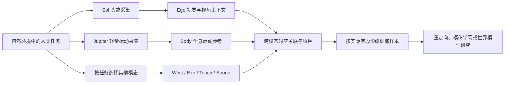

# ITW-Ego Plus：真实场景第一视角与可选物理模态（In-the-Wild Egocentric Data with Optional Modalities）

## 一句话定义

**ITW-Ego Plus** 是诺亦腾机器人（Noitom Robotics）在 CoRL 2026 介绍的真实环境人体数据产品：以 Sol 头戴第一视角观察为基础，按任务需求配置全身运动、腕部视角、第三人称、手部压力和环境音频等信号。关键思想是**补齐摄像头看不到的身体/接触监督**，而不是仅用采集小时数评价可学习性。

## 英文缩写速查

| 缩写 | 英文全称 | 简要说明 |
|---|---|---|
| ITW | In the Wild | 非受控真实环境采集 |
| Ego | Egocentric | 第一人称相机视角 |
| Exo | Exocentric | 外部第三人称视角 |
| MoCap | Motion Capture | 运动捕捉 |
| BVH | Biovision Hierarchy | 层级骨架与动作文件 |
| SMPL-X | Skinned Multi-Person Linear Model eXpressive | 人体参数化网格与姿态表示 |
| VLA | Vision-Language-Action | 视觉语言动作模型 |

## 为什么重要

头戴相机可以记录“看向哪里”，但不一定知道弯腰时全身如何协调、遮挡后手做了什么、抓握时压力有多大。要让机器人复用人类动作，通常需要联合考虑**视觉上下文、世界系动作轨迹、物体与接触信息**。这并不代表给数据加模态就必然提高成功率：采集误差、标注可用率及人机形态差距仍须单独验证。

与 [HiPHI](./paper-hiphi.md) 的高精度实验室真值不同，ITW 旨在拓展自然场景与长尾任务覆盖；两者是不同数据资源，授权条件不能互相套用。

## 官方确认的模态

| 组件 | 官方定义 | 典型监督用途 | 工程边界 |
|---|---|---|---|
| **Ego 基础** | Sol 第一视角视频（ITW-EgoVision） | 任务视觉上下文 | 遮挡时不可见的接触不会自动补齐 |
| **Body** | Jupiter 等采集的全身运动 | 躯干、腿、手臂协同的动作参考 | 需验证根坐标与目标机器人重定向 |
| **Wrist** | 腕部近距离相机 | 头戴视角盲区的物体与手部画面 | 近景画面不是直接的压力真值 |
| **Exo** | 任务与操作者的固定第三人称视角 | 观察全局场景与交互过程 | 依赖同步和相机几何标定 |
| **Touch** | 手部压力 | 接触事件与抓握压力监督 | 数据卡未见完整压力通道规格 |
| **Sound** | 环境声音 | 交互事件和任务语义线索 | 需校准事件时间并处理隐私 |

官方 2026-11-05 公告明确上述五种 **Plus 选配模态**；CoRL 展出的重点是 Body。并无公开证据表明每段录制都同时具备全部五种。更早的 ITW 技术文章曾描述部分样本的侧视 RGB-D/4D 重建，不能推广为 Plus 全量标准字段。

## 核心原理：采集与数据组织流程

流程依据官方 Sol/Jupiter 产品描述和可选模态定义组织；“时空关联与质检 → 形成样本”是**使用这些数据时需要的工程步骤**，并不声称厂家公开了完整实现或固定交付格式。Sol 和 Jupiter 可在真实环境协作采集；官方称 Jupiter 不需要传统动捕服，但具体接收器数量、时间戳/坐标系规范和误差分布须向产品方索取。

## 工程实践：按训练目标选择数据配方

| 学习任务 | 优先选择 | 首先验证 |
|---|---|---|
| **人形移动操作（Mobile Manipulation）**：靠近物体、下蹲拾取、起身搬运 | Ego + **Body** | 根轨迹连续性、支撑脚与接触时序；将人体关节映射到机器人后能否保留平衡 |
| **双臂灵巧与遮挡操作（Dexterous Manipulation）**：抽屉、橱柜、抓握 | Ego + **Wrist**；接触任务再考虑 **Touch** | 腕摄像头是否真正看到接触点；压力通道能否定位到手指/物体 |
| **具身世界模型与环境变化**：观察动作引起的场景变化 | Ego + **Exo**，可选 **Sound**；仅对实际包含 4D 重建的样本使用几何 | 多视角标定、物体状态标注、动作–状态变化的时间对应，避免把相关性误当因果真值 |

这些是**数据选型建议**，不是 ITW-Ego Plus 已发布的下游胜率实验。使用前还应核对受试任务、相机分辨率/帧率、关键点误差、丢帧、隐私与商业授权。

## 可学习性：比小时数更有用的验收指标

推荐在固定模型、数据量、计算预算和测试任务下，分别做 Ego-only、Ego+Body、Ego+Wrist、Ego+Touch 等消融，并记录：

1. **监督覆盖**：可观测接触事件比例、全身关节与物体状态缺测率、遮挡下手部重建误差。
2. **数据对齐质量**：跨相机及穿戴传感器时间偏差、世界坐标变换残差、动作重定向后的足滑/穿透。
3. **模型结果**：任务成功率、未见场景泛化、接触失败/打滑率，并给出每小时有效数据和单位成本。

对抓鸡蛋或插拔件等接触任务，**Ego-only 缺失接触观测**与“Touch 一定提高性能”是两种不同判断；后者需要公开或自测消融才能证明。

## 数据获取、证据等级与局限

| 问题 | 截至 2026-11-21 的核查 |
|---|---|
| 官方产品发布与五种选配模态 | 已由 Noitom Robotics 2026-11-05 官方公告确认 |
| HiPHI 的 617.5 小时 | 是**另一个**发布数据集的口径（含镜像增强）；不能当作 ITW-Ego Plus 数据量 |
| Plus 的小时数、样本字段、空间单位、同步精度 | 未找到可复核的公开完整数据卡或独立标定报告 |
| 4D 场景点云 / BVH / SMPL-X 的逐样本覆盖 | 报道提及；官方技术文章仅确认部分 ITW 重建，不保证 Plus 每段都具备 |
| 数据与模型许可证 | 未验证 ITW-Ego Plus 可公开下载或可商用；不可借用 HiPHI 的 MORL 许可 |
| “200 万小时网络视频不如 2000 小时手套数据”、公司估值/营收 | 属用户提供的二手报道信息，未在本次一手核对中取得可复现数据或独立财务证明 |
| 端到端策略收益 | 未见 ITW-Ego Plus 在控制变量下的独立训练消融或真实机器人成功率数字 |

**页面完成范围：** 已按可访问的一手公告和技术文章完成产品模态、工作流程与局限的知识整理；`status: complete` 仅表示该**公开资料范围内的知识页**已具备必要结构和通读溯源，不意味着 ITW-Ego Plus 数据集的样本、许可、标定或真机效果已通过验证。ModalityNet 授权后的数据目录与完整 schema 尚未读取，相关事实继续明确标注“未核验”。

## 源码运行时序图

**不适用。** 官方公告和技术文章没有提供能够逐文件核查的 ITW-Ego Plus 数据采集、训练或部署源码入口；不能凭宣传架构编造运行时序图。如后续开放源代码，应补充入口、函数调用、标定与 IO 时序。

## 关联页面

- [HiPHI（高精度人体运动与人–物交互基准）](./paper-hiphi.md)
- [人形参考运动与操作数据集选型](../comparisons/humanoid-reference-motion-datasets.md)
- [模仿学习](../methods/imitation-learning.md)
- [具身数据纵深路线：Stage 1 采集范式](../../roadmap/depth-embodied-data.md)

## 推荐继续阅读

- [ModalityNet 官方入口](https://modalitynet.com/)
- [Noitom Robotics：CoRL 2026 产品公告](https://www.globenewswire.com/news-release/2026/11/05/3396456/0/en/noitom-robotics-introduces-itw-ego-plus-at-corl-2026-in-the-wild-egocentric-data-with-full-body-motion.html)
- [Noitom Robotics：The Art of Modalities](https://huggingface.co/blog/noitomrobotics/art-of-modalities)

## 参考来源

- [ITW-Ego Plus 官方资料归档（已核对全文）](../../sources/sites/itw-ego-plus.md)
- [具身智能之心报道：可学习性与模态配方（二手资料）](../../sources/blogs/embodied_heart_itw_ego_plus_learnability_2026_11_20.md)
