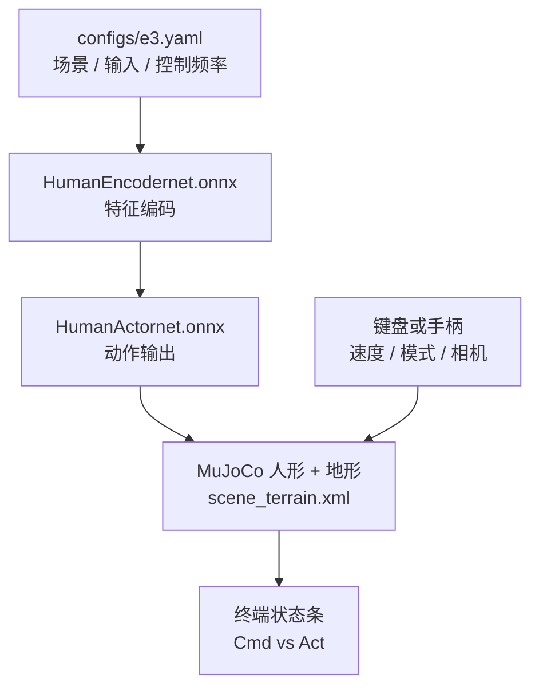
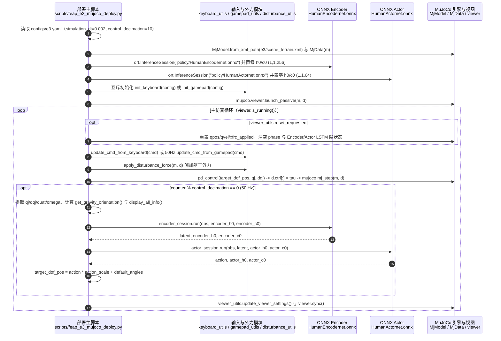

# FEAP MuJoCo 部署（E3 ONNX）

本仓库在 MuJoCo 中部署 FEAP 论文配套的双 ONNX 网络（Encoder + Actor），支持键盘或手柄速度指令与地形场景验证。

**定位**：README 声明本仓是论文 **FEAP** 的 **部署与验证框架**：把训练好的 **双 ONNX**（Encoder + Actor）放入 `policy/`，用 `scripts/feap_e3_mujoco_deploy.py` 加载 `configs/e3.yaml` 中的场景与输入设备配置，在 MuJoCo 中做 omnidirectional walking / high-speed running / 地形与扰动测试。

## 英文缩写速查

| 缩写 | 英文全称 | 简要说明 |
|------|----------|----------|
| MuJoCo | Multi-Joint dynamics with Contact | 接触丰富的刚体物理仿真引擎 |
| ONNX | Open Neural Network Exchange | 跨框架神经网络模型交换格式 |
| Locomotion | Robot Locomotion | 足式/人形等无轮移动能力的总称 |

## 核心机制（工程切片）

- **策略形态**：显式区分 `HumanEncodernet.onnx` 与 `HumanActornet.onnx`，与「单文件 PyTorch `.pt`」演示仓形成对照。
- **输入设备**：`gamepad_enabled` 与 `keyboard_enabled` **互斥**；键盘分支在终端捕获 WASD 等键位，README 给出完整键表。
- **工程配套**：`setup_conda_env.sh` 创建默认 `feap_mujoco` 环境；`utils/display_utils.py` 等在终端打印速度跟踪误差、模式与相机参数。

## 流程总览

## 源码运行时序图

以下时序图基于官方仓库 `JackHan-Sdu/Feap_Mujoco_deployment`（`main` 分支）核读的源码与配置梳理：`README.md`、`configs/e3.yaml` 与主部署脚本 `scripts/feap_e3_mujoco_deploy.py`。

- **关键复现路径**：从仓库根目录执行 `python scripts/feap_e3_mujoco_deploy.py configs/e3.yaml`；MuJoCo 以 500 Hz（`dt=0.002`）执行 `pd_control` 与 `mj_step`，每 10 步（50 Hz）串联执行 `HumanEncodernet.onnx` 与 `HumanActornet.onnx`（均维护独立 LSTM 隐状态 `h0/c0`）刷新关节目标位置。

## 常见误区或局限

- **2026-11-13 维护复核：** [官方 README（59035b8）](https://github.com/JackHan-Sdu/Feap_Mujoco_deployment/blob/59035b8d5bd3e4f3ee1c56b3ec95ade1b6d00b01/README.md) 仍明确为部署与验证框架；入口为 `python scripts/feap_e3_mujoco_deploy.py configs/e3.yaml`，模型为 Encoder + Actor 两个 ONNX，键盘和手柄配置互斥。本次核对文档，未运行策略或验证速度/地形性能。
- **训练代码不在本仓**：README 定位为 deployment/validation；复现论文训练需回到论文主仓或官方补充材料。
- **ONNX Runtime 版本**：README troubleshooting 提到固定 `onnxruntime==1.19.2` 类提示，升级需重新验证算子支持。

## 与其他页面的关系

- **[FEAP Vision 部署](./jackhan-feapvision-mujoco-deployment.md)**：同作者的「深度 + TorchScript」变体，观测栈更厚。
- **[Locomotion](../tasks/locomotion.md)**：README 强调的多地形、多风格与扰动测试直接服务 locomotion 论文复现。
- [Humanoid Locomotion (人形机器人移动)](../tasks/humanoid-locomotion.md)：对照双足人形机器人在多地形与多风格下的平衡与移动任务需求。

## 参考来源

- [Feap_Mujoco_deployment 仓库归档](../../sources/repos/jackhan-feap-mujoco-deployment.md)

## 关联页面

- [JackHan-Sdu WalkE3 / HumanoidE3 工具链生态](./jackhan-walke3-e3-ecosystem.md)
- [FEAP Vision MuJoCo 部署](./jackhan-feapvision-mujoco-deployment.md)
- [MuJoCo (物理引擎)](./mujoco.md)

## 推荐继续阅读

- 上游仓库 README：<https://github.com/JackHan-Sdu/Feap_Mujoco_deployment>
