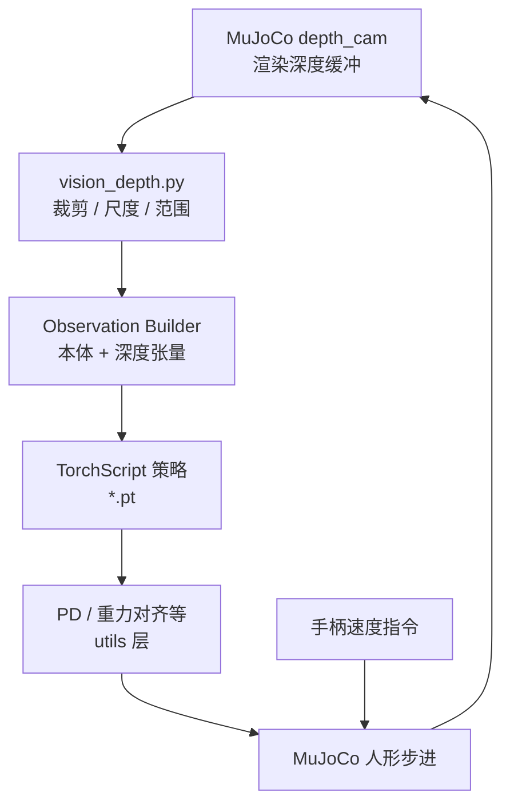
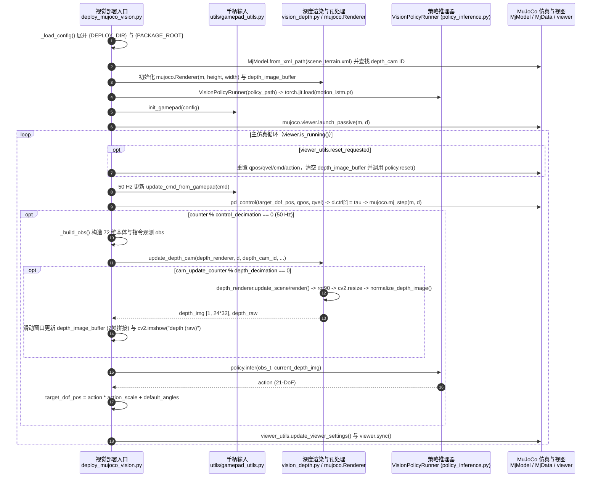

# FEAP Vision MuJoCo 部署（深度 + TorchScript）

本仓库在 MuJoCo 中渲染深度相机、拼接本体观测并加载 TorchScript 策略，经 PD 与手柄指令驱动 E3 类 21-DoF 人形。

**定位**：README 以中文描述「**本体观测 + 深度图 + 手柄速度指令**」的 **TorchScript** 部署：依赖 `mujoco`、`torch`、`opencv-python`、`pygame` 等；策略文件放在 `policy/`，配置中可用 `{DEPLOY_DIR}` / `{PACKAGE_ROOT}` 占位符展开路径。

## 英文缩写速查

| 缩写 | 英文全称 | 简要说明 |
|------|----------|----------|
| MuJoCo | Multi-Joint dynamics with Contact | 接触丰富的刚体物理仿真引擎 |
| PD | Proportional–Derivative | 关节位置/阻抗底层控制，策略输出常为其 setpoint |
| DoF | Degrees of Freedom | 自由度，人形通常 20–50+ 关节 |
| Sim2Real | Simulation to Real | 把仿真中学到的策略迁移落地真机的工程主线 |
| MJCF | MuJoCo XML Format | MuJoCo 的模型与场景描述格式 |
| ONNX | Open Neural Network Exchange | 跨框架神经网络模型交换格式 |
| GPU | Graphics Processing Unit | 图形处理器，大规模并行仿真训练的算力基础 |
| CPU | Central Processing Unit | 中央处理器 |

## 核心机制（工程切片）

- **观测链**：深度相机 → 深度预处理模块 → `Observation Builder` → `VisionPolicyRunner`（TorchScript）→ PD 控制 → MuJoCo 步进（README 系统结构图）。
- **场景约束**：要求 MJCF 中存在名为 **`depth_cam`** 的相机；默认场景指向 `e3_21dof/scene_terrain.xml` 一类资源路径（以 README 为准）。
- **推理后端**：与 FEAP ONNX 线不同，本仓强调 **TorchScript `.pt`** 与可选 GPU 版 PyTorch 安装指引。

## 流程总览

## 源码运行时序图

以下时序图基于官方仓库 `JackHan-Sdu/FeapVision_Mujoco_deployment`（`main` 分支）核读的源码与配置梳理：`deploy_mujoco/README.md`、`deploy_mujoco/configs/e3_vision.yaml`、`deploy_mujoco/deploy_mujoco_vision.py`、`deploy_mujoco/vision_deploy/vision_depth.py` 与 `deploy_mujoco/vision_deploy/policy_inference.py`。

- **关键复现路径**：执行 `python deploy_mujoco/deploy_mujoco_vision.py configs/e3_vision.yaml`；内环以 500 Hz 运行 `pd_control` 与 `mj_step`，外环以 50 Hz（`control_decimation=10`）调用 `_build_obs` 与 `VisionPolicyRunner.infer`，其中深度渲染通过 `depth_decimation=5`（10 Hz）经 `update_depth_cam` 更新两帧 `24x32` 深度缓冲。

## 常见误区或局限

- **2026-11-13 维护复核：** [官方 README（30c788c）](https://github.com/JackHan-Sdu/FeapVision_Mujoco_deployment/blob/30c788c06242480bae9f2f61085a89ee4ab58f89/README.md) 仍采用本体观测 + 深度图 + TorchScript，入口为 `deploy_mujoco_vision.py`，不含训练代码；README 末尾标明仅研究与学术用途。本次只核对文档，未运行部署。
- **README 声明**：仓库写明 **仅研究与学术用途**；与通用 OSS 许可不可混为一谈。
- **性能**：README 建议 NVIDIA GPU 以支撑高帧率深度渲染；CPU 路径需自行压测实时性。

## 与其他页面的关系

- **[FEAP MuJoCo 部署](./jackhan-feap-mujoco-deployment.md)**：同一作者的「纯本体 ONNX FEAP」对照组。
- **[Sim2Real](../concepts/sim2real.md)**：视觉策略在仿真渲染深度上闭环，对 sim2real 的感知域随机化提出更高要求。
- [Humanoid Locomotion (人形机器人移动)](../tasks/humanoid-locomotion.md)：在 MuJoCo 地形场景中验证 E3 21-DoF 人形机器人的深度视觉与本体融合移动策略。
- [Robot Simulation Integration · 机器人仿真环境集成](../methods/robot-simulation-integration.md)：将 MJCF 地形场景、depth_cam 深度渲染、TorchScript 策略与 PD 控制器集成为闭环仿真部署环境。

## 参考来源

- [FeapVision_Mujoco_deployment 仓库归档](../../sources/repos/jackhan-feapvision-mujoco-deployment.md)

## 关联页面

- [JackHan-Sdu WalkE3 / HumanoidE3 工具链生态](./jackhan-walke3-e3-ecosystem.md)
- [FEAP MuJoCo 部署（E3 ONNX）](./jackhan-feap-mujoco-deployment.md)
- [Sim2Real](../concepts/sim2real.md)

## 推荐继续阅读

- 上游仓库 README：<https://github.com/JackHan-Sdu/FeapVision_Mujoco_deployment>
