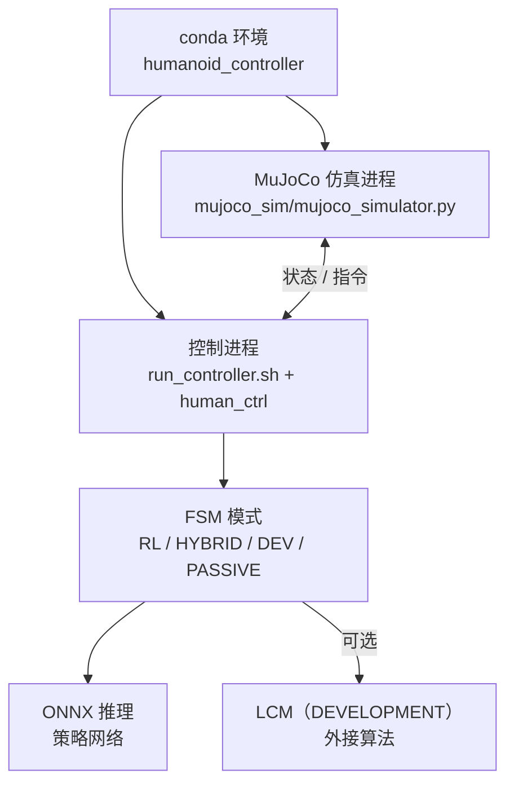
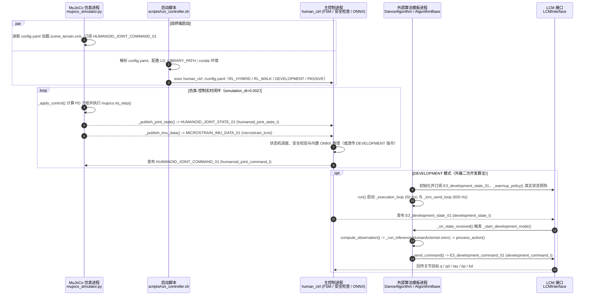

# WalkE3-Controller（人形 RL 部署与 FSM）

本仓库以双进程方式分离 MuJoCo 仿真与上层控制，支持 ONNX 策略、FSM 多模式与 Ubuntu 20.04 下的 conda 环境脚本。

**定位**：把「**仿真进程** + **控制进程**」拆开的 **人形通用部署框架**：README 强调 **Ubuntu 20.04**、conda 一键环境、MuJoCo 侧 `mujoco_simulator.py` 与 `run_controller.sh` 启动的算法侧可加载 **ONNX RL**，并用 **FSM** 组织 RL_HYBRID / RL_WALK / DEVELOPMENT / PASSIVE 等模式。

## 英文缩写速查

| 缩写 | 英文全称 | 简要说明 |
|------|----------|----------|
| RL | Reinforcement Learning | 通过与环境交互最大化长期回报来学习策略的范式 |
| Sim2Real | Simulation to Real | 把仿真中学到的策略迁移落地真机的工程主线 |
| MuJoCo | Multi-Joint dynamics with Contact | 接触丰富的刚体物理仿真引擎 |
| ONNX | Open Neural Network Exchange | 跨框架神经网络模型交换格式 |

## 核心机制（工程切片）

- **双进程 IO**：仿真发布状态、控制端消费并回写指令——结构上接近「中间件 + 控制频率」拆分，便于替换算法实现。
- **DEVELOPMENT 模式**：README 指向 `Algorithm_Template_For_Developer`，用 LCM 通道在状态机外接二次开发算法。
- **安全叙事**：README 将「多层安全检查」作为硬件保护卖点；落地时仍需结合实验室急停与关节限幅策略复核。

## 流程总览

## 源码运行时序图

以下时序图基于官方仓库 `JackHan-Sdu/WalkE3-Controller`（`main` 分支）核读的源码与配置梳理：`README.md`、`config.yaml`、`mujoco_sim/mujoco_simulator.py`、`scripts/run_controller.sh`、`Algorithm_Template_For_Developer/algorithm_base.py`、`Algorithm_Template_For_Developer/lcm_interface.py`、`Algorithm_Template_For_Developer/dance_algorithm_getup/run_algorithm.py` 与 `Algorithm_Template_For_Developer/dance_algorithm_getup/config.yaml`（仓库内 `human_ctrl` 为预编译可执行文件，图中使用其已核实进程边界与 LCM 通道名）。

- **关键复现路径**：双终端分别运行 `python mujoco_sim/mujoco_simulator.py` 与 `bash scripts/run_controller.sh ./config.yaml`，两侧通过 `HUMANOID_JOINT_STATE_01`、`MICROSTRAIN_IMU_DATA_01` 与 `HUMANOID_JOINT_COMMAND_01` 三条 LCM 通道实时闭环；切换至 `DEVELOPMENT` 模式后由 `AlgorithmBase` 经 `E3_development_state_01` / `E3_development_command_01` 接管外环 50 Hz 推理与 500 Hz 指令下发。

## 常见误区或局限

- **2026-11-13 维护复核：** [官方 README（0a4ba89）](https://github.com/JackHan-Sdu/WalkE3-Controller/blob/0a4ba898d5a48205f2a800b50345339fa3d6a173/README.md) 仍要求 Ubuntu 20.04，分终端启动 `mujoco_sim/mujoco_simulator.py` 与 `scripts/run_controller.sh ./config.yaml`；DEVELOPMENT 模式连接外部算法模板。模式序列中的 `OFF` 与模式表的 `PASSIVE` 叫法不同，实际切换须以对应源码和配置验证；本次未运行仿真或硬件。
- **强绑定发行版**：README 写明 **Ubuntu 20.04**；其他版本需自行验证 `lcm`、动态库路径与实时性。
- **「通用框架」仍有机器人假设**：关节分组、模式切换手势与 ONNX 元数据需与具体 E3 控制栈版本对齐。

## 与其他页面的关系

- **[Yobotics E3 算法模板](./jackhan-yobotics-e3-algorithm-template.md)**：实现 DEVELOPMENT 外环时的直接配套。
- **[Sim2Real](../concepts/sim2real.md)**：同一套配置切换仿真/硬件是 Sim2Real 工程化的常见切片。

## 参考来源

- [WalkE3-Controller 仓库归档](../../sources/repos/jackhan-walke3-controller.md)

## 关联页面

- [JackHan-Sdu WalkE3 / HumanoidE3 工具链生态](./jackhan-walke3-e3-ecosystem.md)
- [Yobotics E3 算法模板](./jackhan-yobotics-e3-algorithm-template.md)
- [Sim2Real](../concepts/sim2real.md)

## 推荐继续阅读

- 上游仓库 README：<https://github.com/JackHan-Sdu/WalkE3-Controller>
