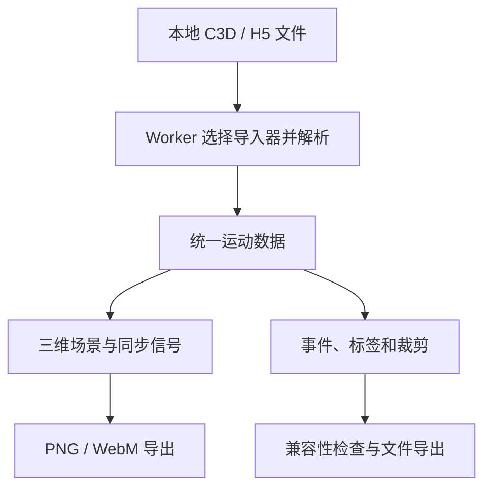

# JE Motion Lab

**JE Motion Lab** 是面向生物力学研究的浏览器动捕查看和编辑工具，可同步检查三维 marker、时间轴和信号，并导出处理后的记录。

## 英文缩写速查

| 缩写 | 英文全称 | 简要说明 |
|------|----------|----------|
| MoCap | Motion Capture | 动作捕捉 |
| GRF | Ground Reaction Force | 地面反作用力 |
| COP | Centre of Pressure | 压力中心 |
| HDF5 | Hierarchical Data Format 5 | 层级数据文件格式 |

## 工作流程

浏览器中可播放、逐帧检查 marker 和力平台信号，编辑事件及标签、删除完整 marker 轨迹或裁剪试验，再导出 C3D 或机构 H5；跨格式转换会提示变化与遗漏。连接线是显示预设，并非推断出的解剖骨架。

## 工程实践与限制

- 仓库由 GitHub 用户 [JEBbecke](https://github.com/JEBbecke/mocap-web-viewer) 维护，机构归类为独立维护者。

- 文件和测量数据在浏览器本地处理；应用加载和成功导入会发送仅含事件类型的匿名统计，网络基础设施仍可见常规请求信息。
- H5 仅支持项目规定的当前机构 schema，并非任意 HDF5；部分 C3D Rotation 扩展只支持部分导入，旋转记录会被省略并提示。
- 采样率遵循源文件元数据，不自动修正或重采样；导出前应核对单位、时钟与兼容性提示。没有通用轨迹编辑、滤波或自动步态事件检测。
- 源码公开，但采用 **PolyForm Noncommercial 1.0.0**，商业使用需另行授权；统计后端不在仓库中。Releases 可下载源码包，v0.6.0 未见额外二进制附件。

## 关联页面

- [动捕到机器人动作重定向](./mocap-retarget.md) — 检查动捕数据后，仍需单独完成机器人映射。
- [Low Cost Mocap](./low-cost-mocap.md) — 动捕采集与定位系统，可与本工具的数据检查用途区分。

## 参考来源

- [官方仓库归档](../../sources/repos/je-motion-lab.md)

## 推荐继续阅读

- [官方 README](https://github.com/JEBbecke/mocap-web-viewer)
- [在线应用](https://app.jemolab.com/)
