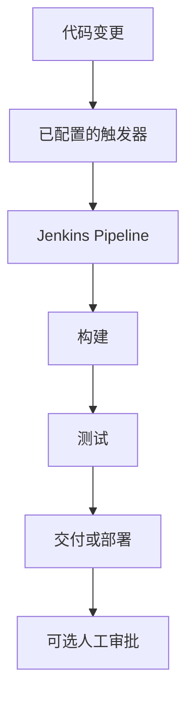
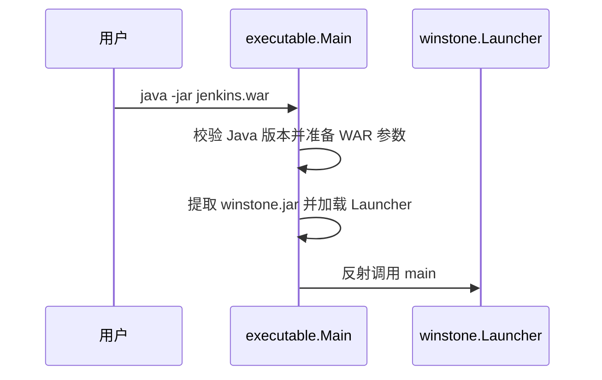

# Jenkins：持续集成与交付自动化

## 一句话定义

Jenkins 是开源自动化服务器，Pipeline 插件将构建、测试和交付过程定义为可版本管理的代码。

## 英文缩写速查

| 缩写 | 英文全称 | 简要说明 |
|------|----------|----------|
| CI | Continuous Integration | 持续集成 |
| CD | Continuous Delivery / Deployment | 持续交付 / 持续部署 |
| SCM | Source Code Management | 源代码管理 |
| DSL | Domain-Specific Language | Pipeline 领域专用语言 |

## 核心机制

Pipeline 可写入仓库中的 Jenkinsfile；支持 Declarative 与 Scripted 两种语法，stage 组织阶段，step 执行任务。插件扩展工具集成。变更触发需配置 webhook、SCM 轮询等；cron 则按计划触发。持续交付可以在生产部署前等待人工审批。

### 典型流程

上图为示意，审批的位置取决于实际流水线配置；Jenkins 不保证自动配置每个阶段。

## 源码运行时序图

以下仅覆盖已核查的独立 WAR **启动入口**，不是 Pipeline 任务执行链。源码见 [executable.Main](https://github.com/jenkinsci/jenkins/blob/master/war/src/main/java/executable/Main.java)。

## 工程应用与局限

- 可以将代码、容器和模型制品的构建与测试接入同一流水线；具体依赖所安装插件和执行环境。
- 机器人真机发布仍需单独的仿真、硬件和安全门禁；构建通过不代表真机安全。
- 官方核心代码开放；Pipeline 功能由插件提供。本文尚未核实 Pipeline 插件的源码执行链。
- **草稿：** Jenkinsfile 和语法参考全文、Pipeline 插件源码及实际运行验证尚未完成。

## 关联页面

- [容器编排与 CI/CD](../concepts/container-orchestration-cicd.md)

## 参考来源

- [Jenkins 官方文档归档](../../sources/sites/jenkins-official-docs.md)
- [Jenkins 源码归档](../../sources/repos/jenkins.md)
