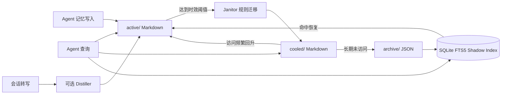
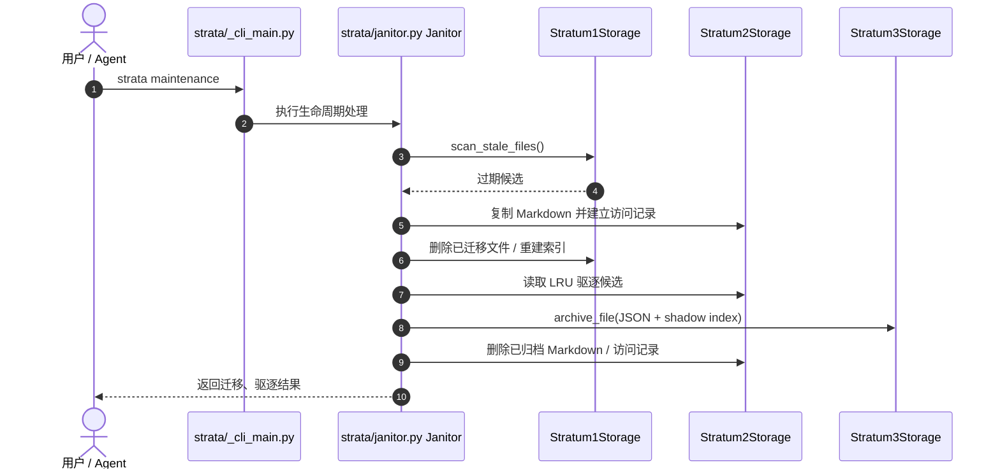

# Strata Memory：活跃、降温、归档三层记忆

作者：[Jeremy Kamber](https://jeremykamber.com/blog/strata-a-tiered-memory-system-for-effective-ai-agents)；官方实现：[jeremykamber/strata-memory](https://github.com/jeremykamber/strata-memory)。

## 一句话定义

通过文件年龄、访问频率和轻量索引，把 Agent 的即时记忆、近期知识和长期归档分配到不同存储层，而不是永久塞进同一个检索库。
## 英文缩写速查

| 缩写 | 英文全称 | 简要说明 |
|---|---|---|
| LLM | Large Language Model | 可选蒸馏器使用的语言模型 |
| FTS5 | Full-Text Search 5 | 冷归档影子索引的关键词检索 |
| LRU | Least Recently Used | 根据最近访问情况决定降级/回收 |
| JSON | JavaScript Object Notation | 冷归档序列化存储 |

## 为什么重要

长期运行的 Agent 会同时积累日常对话、项目约定和少数关键决策；若所有内容持续驻留在同一上下文或同一检索优先级，过期记录会干扰当前任务。该实现用可配置的时间与访问规则分层，突出可追溯、可恢复，而不是要求模型每次评估全部历史。

## 核心机制

| 层 | 当前代码行为 |
|---|---|
| Active | `active/` 下直接可读写的 Markdown 与 `index.md` |
| Cooled | `cooled/` 下只读检索的 Markdown，跟踪访问次数 |
| Archive | `archive/` JSON 冷存储 + SQLite FTS5 Shadow Index；命中可再水合 |
| Janitor | 按时间和访问计数移动、驱逐、回升文件，不需要模型参与迁移判断 |
| Distiller | **可选**的后台 LLM 会话事实提取；并非每次查询执行 |

README 示例默认项目 14 天、实体 60 天、任务 7 天后可能降温；访问可触发回升。阈值可配置，不应当作普适最优值。

## 流程总览

## 源码运行时序图

已核对 `strata/_cli_main.py` 注册表和 `strata/janitor.py`：

可用 `pip install git+https://github.com/jeremykamber/strata-memory.git` → `strata init` → `strata add/search/maintenance` 试用。上述运行序列按已读源码归纳，并未本次实跑。

## 工程实践

- 从 `strata init` 与 `strata add` 开始，先用 `strata search` 验证 active/cooling 记忆是否可检索。
- 执行 `strata migrate --dry-run` 预览迁移，再用 `strata maintenance` 执行 Janitor 的移动、归档与回升，必要时检查 archive/JSON 和 Shadow Index 的恢复路径。
- 关键安全流程和长期有效的系统约束不宜仅凭最后访问时间自动降级；固定阈值应随项目类别评估。LLM Distiller 是可选知识抽取，不是 Janitor 规则迁移的必要前提。

## 早期博客与当前代码区别

作者 2026-05-05 博客描述**计划中的中层**为 PostgreSQL/pgvector `agent-db`，以及迁移时 LLM 压缩；当前开源 README 和 Janitor 代码则使用 `cooled/` Markdown + 规则搬运，LLM Distiller 是可选、独立的会话提取组件。**不能把博客设计直接当成当下实际代码。**

## 局限与机器人启发

冷热规则简单且可审计，但固定时效不等于知识真伪、任务价值或危险程度；关键控制参数、安全规则不应仅因少访问而隐藏。此项目不是机器人记忆性能测评。

## 关联页面

- [Claude Code 动态工作流](../methods/claude-code-dynamic-workflows.md) — 对照当前任务编排与跨任务持久文件层的职责。
- [Coding Agent 验证闭环](../methods/coding-agent-verification-loops.md) — 归档记忆回升后，必须验证其中的版本与修复决策是否仍适用。
- [Kytheros Strata MCP](kytheros-strata-mcp-memory.md) — 侧重质量门、跨 CLI 检索。
- [STRATA 经验图](paper-strata-experience-graphs.md) — 侧重结构归纳与负迁移防护。
- [Agent 记忆与 dreaming](../concepts/agent-memory-and-dreaming.md) — 以重写/纠错对比分层迁移。

## 参考来源

- [官方 README / Janitor 源码归档](../../sources/repos/jeremykamber-strata-memory.md)
- [作者博客早期架构归档](../../sources/blogs/jeremykamber-strata-tiered-memory-2026-05-05.md)

## 推荐继续阅读

- [当前开源实现](https://github.com/jeremykamber/strata-memory) · [作者 2026-05-05 原文](https://jeremykamber.com/blog/strata-a-tiered-memory-system-for-effective-ai-agents)。
