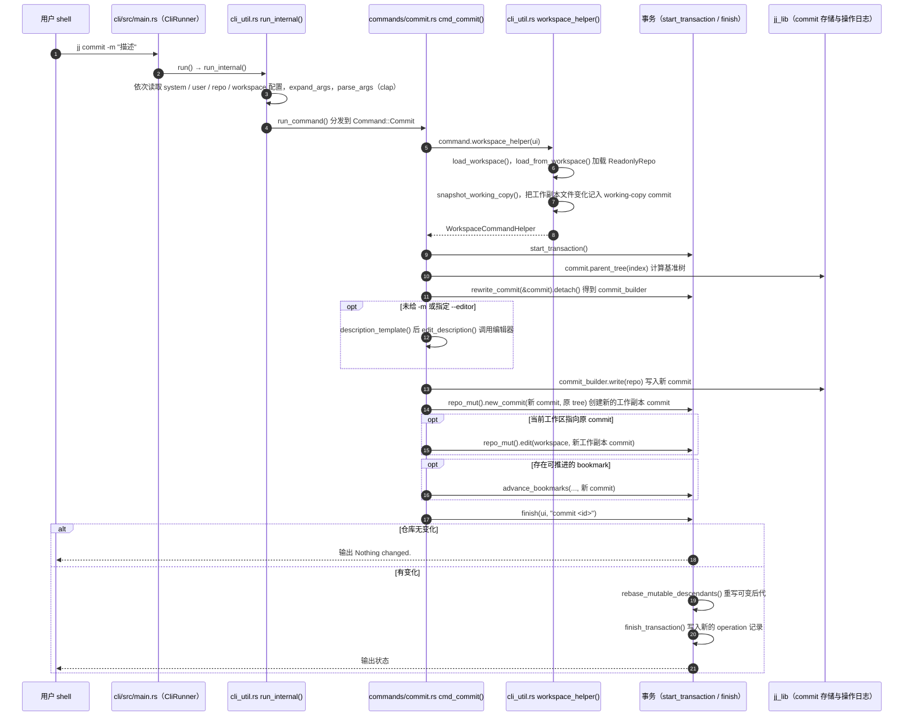

# Jujutsu（jj）

**Jujutsu**（命令名 `jj`，读作 “jujutsu”）是一个以 Git 互通为目标的版本控制系统。它把工作区、change 与可追溯操作作为主要交互模型，并可使用现有 Git 仓库作为存储后端。

## 一句话定义

**Jujutsu 是 Git 兼容的版本控制工具：它自动追踪工作区变化，以可撤销操作和无暂存区工作流减少版本管理中的手工步骤。**

## 英文缩写速查

| 缩写 | 英文全称 | 简要说明 |
|------|----------|----------|
| VCS | Version Control System | 记录文件与项目历史、支持协作的版本控制系统类别 |
| Git | Global Information Tracker | jj 可协作使用的分布式版本控制系统与存储后端 |
| CLI | Command-Line Interface | jj 的主要命令行交互入口 |
| DAG | Directed Acyclic Graph | 提交/change 历史以有向无环图组织；理解重排与合并时有用 |

## 为什么重要

- **降低暂存区操作负担。** jj 不要求先 `add` 再 `commit`；当前工作区改动会自动纳入当前 change，用户可以围绕 change 组织和演进修改。
- **让操作更容易检查和恢复。** jj 会记录操作历史，用户可查看操作前后状态并撤销近期操作。这为尝试重排、拆分或合并改动提供了更强的恢复路径。
- **保留现有 Git 生态入口。** jj 可在 Git 仓库上工作，方便渐进式试用；但这不代表所有 Git GUI、hook 和脚本都天然兼容。

## 核心原理

jj 将版本控制的交互与操作模型和底层存储分开：用户通过 jj 命令管理工作区、change 和操作记录，底层默认可由 Git 仓库保存对象并与 Git 交换历史。这样既可以尝试不同于 Git 暂存区的工作流，也无需立刻放弃 Git 仓库和托管平台。

典型工作节奏是：直接编辑文件，查看自动更新的工作区 change；按任务需要描述、拆分或重排 change；在准备好时形成可分享的提交，并通过 Git 远端与其他开发者协作。jj 的 change 与 Git commit 并非始终一一对应：change 可在提交到远端前反复修改。

## 工程实践

| 场景 | 建议 |
|------|------|
| 个人试用 | 从现有仓库副本开始，先熟悉 `jj status`、`jj log`、`jj diff` 与 `jj undo` 等基本命令 |
| Git 仓库互通 | 按官方文档初始化 Git 后端，明确何时导入/导出 Git commit，并用 `git` 与 `jj` 分别检查共享历史 |
| 机器人项目协作 | 先验证 ROS/仿真构建脚本、子模块、Git LFS、pre-commit hook、IDE 与 PR 流程，再决定是否团队推广 |
| 误操作恢复 | 先查看操作日志和受影响的 change，再撤销；涉及远端共享历史时先确认协作者状态与团队约定 |

Jujutsu 源码以 Rust 实现，仓库采用 Apache-2.0 许可。GitHub stars 与 forks 是动态数据，使用时可直接查看仓库页面。

## 局限与风险

- **概念和命令仍需适应。** 无暂存区减少了一些步骤，但 change、提交、操作历史等模型与常见 Git 心智不同；团队需要共享约定和培训。
- **互通不等于完全兼容。** 工具链可能直接调用 Git 命令或假设特定索引/暂存区行为；迁移前应以真实仓库副本验证。
- **可撤销不等于远端操作无风险。** 本地 undo 不能自动解决已推送历史被他人基于、远端权限限制或协作冲突的问题。
- **项目定位不是机器人专用。** 对机器人团队的价值主要在源码协作；它不管理数据集、模型 checkpoint 或实验指标，这些仍需专门的版本与追踪策略。

## 源码运行时序图

入口：`jj commit -m "<描述>"`（`cli/src/commands/commit.rs` 的 `cmd_commit`；命令由 `cli/src/main.rs` 的 `CliRunner::init().run()` 启动，README 中的安装与用法见官方仓库）

图依据：jj-vcs/jj@fc8cc4f，实际读过 `cli/src/main.rs`、`cli/src/cli_util.rs`（`run`、`run_internal`、`workspace_helper_with_stats`、`snapshot_working_copy`、`Transaction::finish`、`finish_transaction` 的调用链）、`cli/src/commands/commit.rs`（`cmd_commit` 主体）、`cli/src/commands/mod.rs`（`run_command` 分发）；`jj_lib` 内部的存储与 operation log 实现未读，未运行代码。

## 关联页面

- [Agentic Coding 时代的软件工程基础](../concepts/agentic-coding-software-fundamentals.md) — 源码控制与代码评审会成为高吞吐开发的重要基础设施
- [规格驱动开发（SDD）](../concepts/specification-driven-development.md) — 规格与实现的迭代也需要可审查的版本历史
- [Gitingest](./gitingest.md) — 将 Git 仓库内容整理为 LLM 上下文；与 jj 的版本管理职责不同

## 参考来源

- [Jujutsu 仓库归档](../../sources/repos/jj-vcs-jujutsu.md)
- [Jujutsu 官方文档](https://docs.jj-vcs.dev/latest/)
- 源码核对（2026-11-02）：jj-vcs/jj@fc8cc4f，读过 cli/src/main.rs、cli/src/cli_util.rs（相关函数）、cli/src/commands/commit.rs、cli/src/commands/mod.rs；时序图依据以上文件，未运行代码。

## 推荐继续阅读

- [Jujutsu 官方仓库](https://github.com/jj-vcs/jj) — README、安装说明、源码与许可证
- [Jujutsu 官方文档](https://docs.jj-vcs.dev/latest/) — 命令、Git 后端和协作工作流
