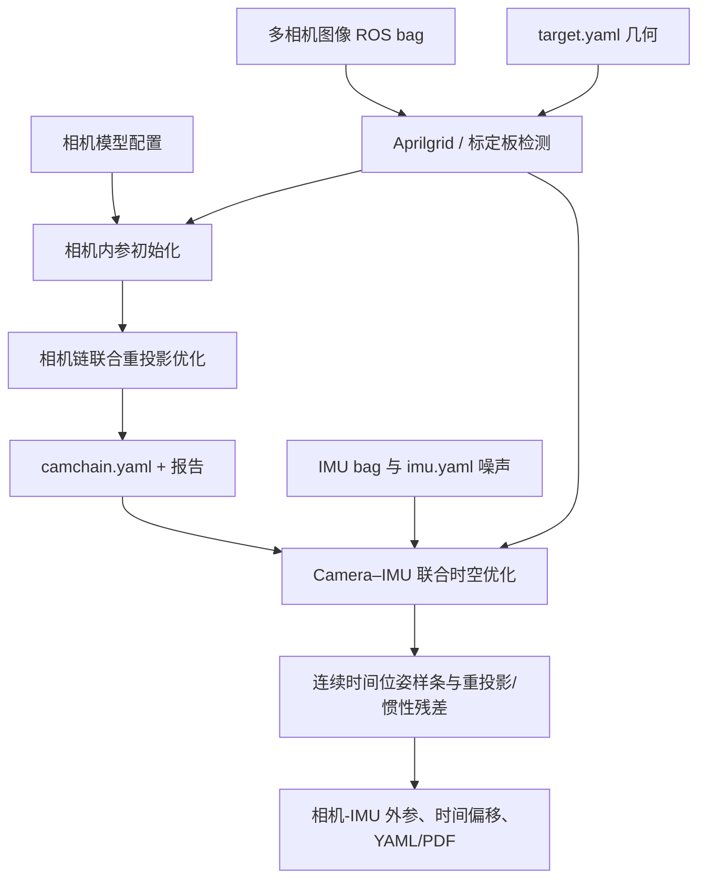
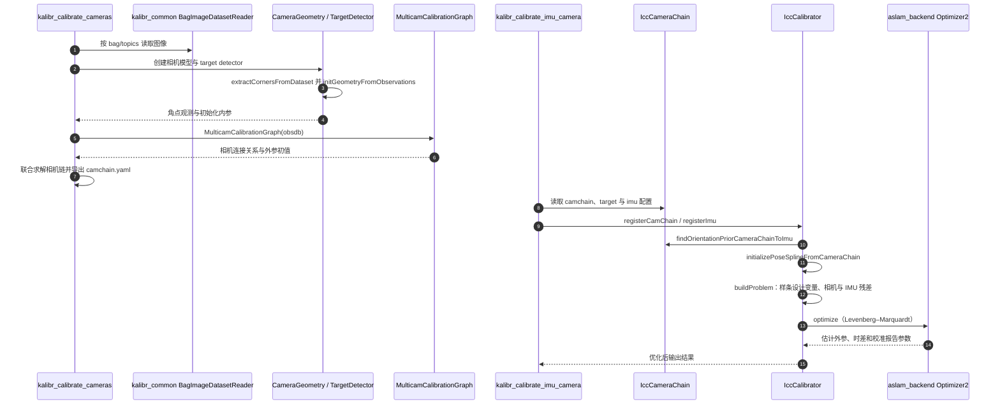

# Kalibr：多相机与相机–IMU 时空标定 / Multi-Camera & Camera–IMU Calibration

## 一句话定义

**Kalibr** 是 ETH Zurich Autonomous Systems Lab 的开源标定工具箱：从标定板图像和惯性数据估计相机投影/畸变、相机间外参以及相机—IMU 的空间外参和时间偏移，并把结果导出为相机链 YAML 和诊断报告。

## 英文缩写速查

| 缩写 | 英文全称 | 简要说明 |
|---|---|---|
| IMU | Inertial Measurement Unit | 角速度/加速度测量，需噪声与偏置模型 |
| ROS | Robot Operating System | 官方入口使用 ROS1 bag 与 rosrun/catkin |
| CAM | Camera | 多相机系统中的成像传感器 |
| YAML | YAML Ain't Markup Language | 摄像机链、IMU 噪声和目标板配置格式 |
| LM | Levenberg–Marquardt | Kalibr 标定优化器的信赖域求解 |
| Aprilgrid | AprilTag Grid | 推荐的非对称标定目标，降低姿态翻转歧义 |
| BSpline | Basis Spline | Camera–IMU 联合优化使用的时间连续位姿轨迹 |

## 为什么重要

标定外参和时间戳是 VIO/LIO/VINS 类传感器融合的前置条件。相机/IMU 的时间差会把原本正确的像素和惯性观测映射到不同时刻的姿态，造成系统性误差；不准确的外参可让优化器将标定误差吸收到运动、尺度或 IMU 偏置中。

**范围区别：** Kalibr 同时支持多相机标定、相机–IMU 时空标定、多 IMU 和 rolling-shutter 工具。本页对照官方 README 及两个主要 wiki，聚焦前两条常见工作流；不把其他分支的实验结论冒充已验证。

## 核心原理与方法

### 多相机标定

1. 录制多个相机可观测到同一个目标板的 ROS bag，定义每路相机的投影与畸变模型及目标板几何。
2. 标定板检测提取角点/Aprilgrid 标签观测，对各相机初始化内参与畸变，筛选信息量较高的观测帧。
3. 建立多相机的连接图；**相邻相机须能通过共同可见目标建立约束**，不要求所有相机具有全局共享重叠视野。
4. 通过联合重投影误差优化相机内参和外参，导出 `camchain-%BAGNAME%.yaml`、文本结果、PDF 报告。

### Camera–IMU 时空标定

1. 使用前一步的 `camchain.yaml`，另准备 IMU 噪声密度、偏置随机游走及 `target.yaml`；检查 raw bag 的时间戳来自统一时钟。
2. 固定标定板，手持相机与 IMU 组合进行 **多方向旋转+平移激励**，避免图像运动模糊、猛烈冲击和间歇式时间戳。
3. 用连续时间位姿样条拟合相机轨迹；构造标定板重投影约束与 IMU 加速度/陀螺仪约束，联合优化空间外参、惯性模型和默认开启的时间偏移。
4. 输出 `camchain-imucam-%BAGNAME%.yaml`（含相机—IMU 外参与可选时差）、文本摘要和 PDF 图表报告。

**易混淆：** 多相机标定时的采集方式是**相机固定、标定板移动**；Camera–IMU 标定时是**板固定、传感器组合运动**。这是官方文档对两种校准流程的不同建议。

## 流程总览（官方 Kalibr Wiki）



此图针对**两阶段标定数据流**；多相机单步命令与相机–IMU 联合命令是不同的 CLI，不一定每次都需要两者同时运行。

## 源码运行时序图

源码核对：`ethz-asl/kalibr@1f60227`，`aslam_offline_calibration/kalibr/python/{kalibr_calibrate_cameras,kalibr_calibrate_imu_camera}`、`kalibr_camera_calibration/CameraCalibrator.py`、`kalibr_imu_camera_calibration/IccCalibrator.py` 的真实入口与主要模块；不是通用 SLAM 时序模板。



实际内部包含连续时间重投影、bias spline、初始化与鲁棒化等细节；本图**只声称已核对的入口与调用结构**，没有执行最终优化和物理标定实验。

## 实验与验证方法

Kalibr 是工具箱而非单一 benchmark，官方 wiki 在这两种工作流中**没有给出统一 RMS 性能排名**。这里把验证条件按作者文档记录：

| 核查项 | 官方推荐 / 真实边界 |
|---|---|
| 多相机采集 | 一般可降低到约 4 Hz 以减少冗余帧，需保证邻接相机观测关联 |
| Camera–IMU 采集 | 示例采用约 20 Hz 相机、200 Hz IMU；应充分激励所有 IMU 轴 |
| 时间戳 | 统一时钟且低 jitter；IMU 队列集中发送的间歇 timestamp 会损坏结果 |
| 标定靶 | 推荐 Aprilgrid 避免对称棋盘格的目标姿态翻转 |
| 结果检查 | 查看时间偏移、重投影残差、IMU 残差和各自 PDF 报告；单凭 optimizer 正常退出不能判断正确 |

以上为**指南建议和验证步骤，不是性能实验指标**。

## 结论

**Kalibr 的工程价值在于把空间外参、时间偏移、观测几何与噪声模型整合进一条可复核的优化管线。**

1. 多相机和 Camera–IMU 分别采集，遵循不同目标板/传感器运动假设。
2. 真实同步依赖稳定硬件/驱动时间戳；Kalibr 只能估计偏移，不能修复连续丢帧或时钟抖动。
3. `imu.yaml` 中的噪声密度与随机游走必须实测或有依据，不能把默认示例值当设备真值。
4. 一次好的非线性优化结果仍需覆盖充分运动激励和各子传感器标定板可见性。
5. 正式落地 VINS/LVI-SAM 前应验证标定误差与坐标方向，而非只复制 YAML。

## 与其他工作对比

- [VINS-Fusion](./vins-fusion.md) 是运行时状态估计器，Kalibr 解决训练/部署前的相机与 IMU 时空标定。
- [LIO-SAM](./lio-sam.md) 主要融合 LiDAR 与 IMU，Kalibr 的多相机/Camera-IMU 模块不能直接替代 LiDAR–IMU 的整套标定。
- [LVI-SAM](./paper-lvi-sam.md) 依赖相机/激光/IMU 的相互变换与时间一致性，但其特有的 LiDAR–相机外参仍需另行标定。

## 工程实践

先运行多相机标定：

```bash
rosrun kalibr kalibr_calibrate_cameras \
  --bag cam_april.bag --topics /cam0/image_raw /cam1/image_raw \
  --models pinhole-radtan pinhole-radtan --target april_6x6.yaml
```

再运行 Camera–IMU：

```bash
rosrun kalibr kalibr_calibrate_imu_camera \
  --bag imu_april.bag --cam camchain.yaml \
  --imu imu.yaml --target april_6x6.yaml
```

这些命令中的文件名是**示例输入**，不是可以直接复制使用的本机路径。检查 ROS1/依赖版本、标定板尺寸与驱动时间戳语义；需参考作者 [安装指南](https://github.com/ethz-asl/kalibr/wiki/installation) 配环境。最终检查报告与外参方向（如 `T_cam_imu` 与系统实际坐标变换定义）。

## 局限与风险

- 外参和时间偏移的可观性依赖运动激励，平移或旋转模式过于单一会使估计不稳定。
- 低质量图像、过曝与运动模糊会损坏 Aprilgrid 提取；IMU 误差模型/原始时钟错位同样会影响结果。
- 非所有支持投影模型对全部快门/硬件组合有完全等价的实现；应核查相机模型配置和目标板实际量尺。
- 此处仅完成官方文档和主要源码入口审阅；**未用真实采集数据复现标定**。不能把官方建议采样率当系统性能保证。

## 关联页面

- [VINS-Fusion](./vins-fusion.md)
- [LIO-SAM](./lio-sam.md)
- [LVI-SAM](./paper-lvi-sam.md)

## 参考来源

- [Kalibr 官方仓库/README 深读归档](../../sources/repos/vision3d_kalibr_20261108.md)
- [Kalibr Camera–IMU 作者 Wiki 深读归档](../../sources/sites/vision3d_kalibr_20261108.md)
- [Kalibr 官方 README](https://github.com/ethz-asl/kalibr)
- [Kalibr 官方多相机标定教程](https://github.com/ethz-asl/kalibr/wiki/multiple-camera-calibration)
- [Kalibr 官方相机-IMU 标定教程](https://github.com/ethz-asl/kalibr/wiki/Camera-IMU-calibration)

## 推荐继续阅读

- [Kalibr 参数格式](https://github.com/ethz-asl/kalibr/wiki/yaml-formats)
- [Kalibr IMU 噪声模型](https://github.com/ethz-asl/kalibr/wiki/IMU-Noise-Model)
- [Kalibr 官方安装与 Docker](https://github.com/ethz-asl/kalibr/wiki/installation)
