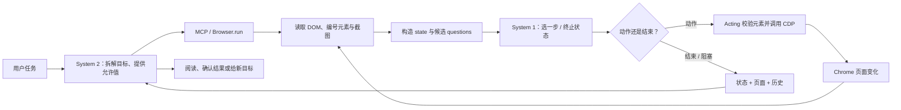
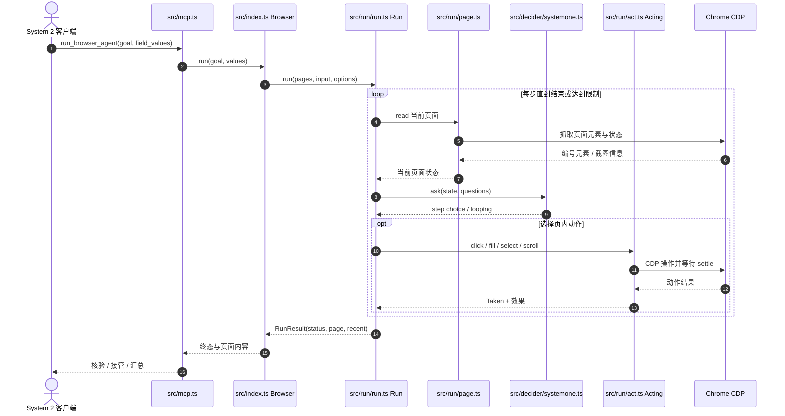

# karpo-browser：System 1 快速选动作 × System 2 高层规划

## 一句话定义

**karpo-browser** 把浏览器 Agent 分为两层：System 2 提供目标和允许填写的数据、阅读并复核结果；System 1 在网页现有可操作元素中逐步做概率选择，由浏览器驱动器执行真实 CDP 动作。

## 英文缩写速查

| 缩写 | 英文全称 | 简要说明 |
|---|---|---|
| MCP | Model Context Protocol | 向外部 Agent 暴露浏览器工具 |
| CDP | Chrome DevTools Protocol | 操作 Chrome、读取 DOM/可访问性树 |
| DOM | Document Object Model | 给网页元素建立编号动作候选 |
| S1 | System 1 | 单步候选动作决策模型 |
| S2 | System 2 | 规划、阅读、复核的通用 Agent 模型 |
| SDK | Software Development Kit | `Browser.launch/connect/run` 的 TypeScript 接口 |

## 为什么重要

- **细粒度执行成本分层：** 不必让通用语言模型为每个点击生成长文本；候选动作交给决策模型，复杂判断仍交给 System 2。
- **可复用给其他 Agent：** MCP 工具支持 Claude Code、Codex 等客户端；`karpo-browser` 也能作为 TypeScript 库或命令行调用。
- **安全边界更清楚：** 有专门的 `needs_approval` / `needs_from_person` / `blocked` 终止类型，但实际不可逆操作仍需要宿主执行审批策略，不能把模型判断当安全锁。
- **与机器人类比时要保留边界：** 可参考“高层任务规划 + 低层离散技能选择”的工程分工，但它不是机器人连续轨迹或实时伺服控制器。

## 核心原理

### 角色与动作空间

| 组件 | 输入 | 输出 |
|---|---|---|
| System 2 | 用户最终任务、浏览器当前页面、历史信息 | 目标与字段值、是否继续、最终答案 |
| System 1 | 子目标、网页编号元素与截图、允许填写的值、近期动作效果 | `CLICK/FILL/SELECT/SCROLL/WAIT` 等选项概率和终止原因 |
| 浏览器执行器 | 决策选项与当前元素绑定 | 实际 CDP 动作、页面变化、新页面状态 |

System 1 在 `run_browser_agent` 中循环：读取页面 → 形成 `state + questions` → 模型回答选项 → `Acting` 校验目标元素仍有效 → CDP 操作 → 等待页面稳定。System 2 在外层核验 `done` 是否真正达到目标，或人工接管失败步骤。

### 流程总览

## 源码运行时序图

按上游 `src/mcp.ts`、`src/index.ts`、`src/run/run.ts`、`src/run/act.ts` 可见调用链归纳，非实际运行 trace。

## 工程实践

- 要求 **Node.js ≥22.18**、Chrome/Chromium 或已有 CDP WebSocket。
- 安装 `npm install -g karpo-browser`；用 `karpo-browser run --url ... --goal ... --value name=text` 启动单个目标，或通过 `npx -y karpo-browser mcp` 向 Agent 暴露工具。
- `SYSTEM1_MODEL`、`SYSTEM1_URL`、`SYSTEM1_API_KEY` 选择符合 System One 协议的决策服务；`SYSTEM1_URL` 默认 OpenRouter 的决策 API，并非任何推理服务器都直接兼容。
- `Browser.launch`、`Browser.open`、`Browser.run`、`Browser.read` 和 `Browser.close` 提供库接口；`npm run check` / `npm test` / `npm run build` 可核对项目实现。
- 处理敏感值时使用 `--secret` / `secrets`，源码设计为秘密不进入模型请求且后续遮蔽输入框。生产环境仍须自行管理凭据、站点权限和可逆性。

## 局限与风险

1. **27B Act 集成兼容性：** 专用模型卡明确开源推理服务器 `/v1/systemone` 和当前浏览器客户端请求路径不一致，不能未经适配直接连接。
2. **批准不是强制安全控制：** 是否停在 `NEEDS_APPROVAL` 仍由模型选择；需要应用层操作权限与确认门。
3. **外层决策不省略：** System 1 不能完成长篇阅读、比较和最终回答；`done` 必须由 System 2 检查真实页面。
4. **测试范围：** 源仓有运行入口与测试，本仓尚未在真实浏览器中复跑或验证所有网站兼容性。

## 关联页面

- [Claude Code 动态工作流](../methods/claude-code-dynamic-workflows.md) — 对照外层 System 2 任务分解与工具编排，非浏览器实现本身。
- [Coding Agent 验证闭环](../methods/coding-agent-verification-loops.md) — 对照页面操作后复核终态、保留执行证据的必要性。

- [Karpo Decision 通用模型家族](./karpo-decision.md)
- [Karpo Decision 27B Act 专用权重](./karpo-decision-27b-act.md)
- [Karpo BrowserBench 离线评测](./karpo-browserbench.md)
- [AI Agent 评测](../concepts/ai-agent-evaluation.md)
- [LLM 机器人控制接口](../concepts/llm-robotics-control-interfaces.md)

## 参考来源

- [官方浏览器源码/README 归档](../../sources/repos/karpo-browser.md)
- [专用决策模型卡归档](../../sources/models/karpo-decision-27b-act.md)

## 推荐继续阅读

- [官方 GitHub README](https://github.com/machinepulse-ai/karpo-browser)
- [运行循环源码](https://github.com/machinepulse-ai/karpo-browser/blob/main/src/run/run.ts)
- [MCP 工具源码](https://github.com/machinepulse-ai/karpo-browser/blob/main/src/mcp.ts)

