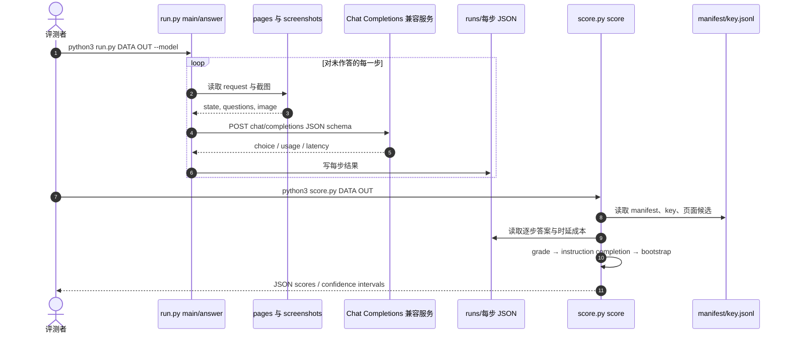

# Karpo BrowserBench（KBB）：真实网页离线动作决策评测

## 一句话定义

**Karpo BrowserBench（KBB）** 在**固定真实网站录制轨迹**上，将每一步浏览器操作变成有限选项决策问题，以“是否每一步都选对”衡量指令完成，另考察时延、成本与越权结束行为。

## 英文缩写速查

| 缩写 | 英文全称 | 简要说明 |
|---|---|---|
| KBB | Karpo BrowserBench | Karpo 浏览器决策基准 |
| DOM | Document Object Model | 编号网页元素、构造行动候选 |
| A11y | Accessibility | 从可访问性树读取元素状态 |
| API | Application Programming Interface | `run.py` 调用 Chat Completions 兼容接口 |
| P50 | 50th Percentile | 决策服务中位响应时延 |
| CI | Confidence Interval | 按网站家族 bootstrap 得到的 95% 区间 |

## 为什么重要

- 真实网页录制的**可复现单步对照**避免不同模型走进不同页面后无法逐步比较。
- 除下一步选择，还考核 `DONE`、`NEEDS_FROM_PERSON`、`NEEDS_APPROVAL` 等停机与审批边界。
- 完成率、延迟和调用成本共同决定实用价值，比只展示“动作选择正确率”更接近浏览器 Agent 部署需求。

## 核心原理

| 维度 | KBB 1.0 已核对信息 |
|---|---|
| 数据规模 | 584 个真实消费网站；3,026 条指令；23,075 个步骤 |
| 数据形态 | 编号元素树、可选截图、允许填写的值、已执行动作、标准候选 |
| 轨迹模式 | 每一步离线评估；下一页永远为录制的页面，不沿错误动作继续 |
| 分区 | 网站家族拆分，35% public / 65% private；private 才参与榜单排名 |
| 公开文件 | 7,557 步 / 1,017 指令（隐私审查后）；获取需接受评测许可 |
| 主分 | completion × cost factor × latency factor；超出预算才折扣 |

其中 `completion` 要求整条指令**全部有效步骤**都选中接受的动作（最后一步也算）；`stepAccuracy` 是已计分步骤中选择正确的比例。错误类型另统计过早/过晚结束、漏问和越权动作。v1.0 预算：**$0.0063/指令，P50 444ms/步**。

### 流程总览

```mermaid
flowchart LR
  REC["真实网站录制任务"] --> DATA["固定轨迹的页面、截图与候选"]
  DATA --> SPLIT["按网站家族分 public / private"]
  SPLIT --> STEP["对每步读取 state + choices"]
  STEP --> MODEL["待测模型：输出一个候选"]
  MODEL --> SAVE["按步骤存储答案、时延、成本"]
  SAVE --> GRADE["对照 accepted / overstep 等人工标注"]
  GRADE --> METRICS["completion / step accuracy / 错误率"]
  METRICS --> SCORE["成本与延迟折扣后的主分"]
```

## 源码运行时序图

依据官方 `run.py` / `score.py` 的真实入口；未运行需要授权的完整数据。

## 工程实践

1. 在 Hugging Face 接受 public dataset **仅限评测**许可，下载到 `kbb-public`；**不可用其训练、蒸馏或制作检索示例**。
2. `python3 run.py kbb-public runs/example --model <model-id> --limit 20` 先做小规模管线连通性检查；需要 Python ≥3.9，标准库即可运行脚本。
3. `python3 score.py kbb-public runs/example --usd-per-step 0.00028` 输出分数；需为完整步骤提供回答，成本或时延缺失时主分为空。
4. 在报告中同时给出版本号、public/private、completion、step accuracy、延迟、成本及样本数；不要将模型自身报告等同于第三方榜单。

## 局限与风险

- **非闭环浏览器 benchmark：** 没有从错误动作实际执行后的页面继续，因此不能衡量多步失败恢复，也不等于端到端任务完成率。
- **数据限制：** 公共集需同意许可；不公开可抓取的页面、截图或答案行；private split 不可自行下载。
- **网站泛化边界：** 分区按网站家族隔离，但不是对所有未见域名、所有语言或机器人任务的普适证明。
- **评测脚本局限：** `run.py` 提供通用聊天兼容接口；不同决策模型需按其 API 输出格式适配成每步答案文件。

## 关联页面

- [karpo-browser 系统](./karpo-browser.md)
- [Karpo Decision 27B Act](./karpo-decision-27b-act.md)
- [Karpo Decision 模型家族](./karpo-decision.md)
- [AI Agent 评测方法](../concepts/ai-agent-evaluation.md)

## 参考来源

- [官方评测代码与方法归档](../../sources/repos/karpo-browserbench.md)
- [官方方法与榜单](https://karpo.ai/benchmarks/browserbench)
- [public 数据集许可](https://huggingface.co/datasets/MachinePulseAI/karpo-browserbench)

## 推荐继续阅读

- [官方 README 与复现步骤](https://github.com/machinepulse-ai/karpo-browserbench)
- [评分函数源码](https://github.com/machinepulse-ai/karpo-browserbench/blob/main/score.py)

