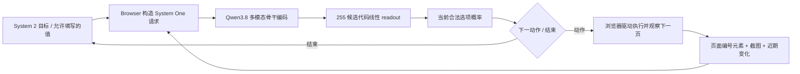
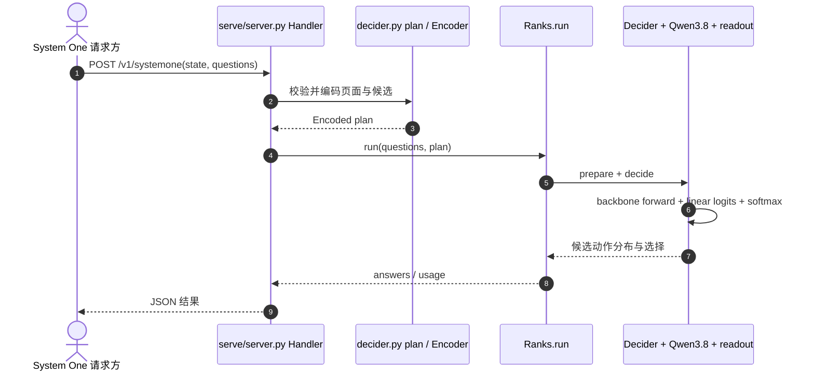

# Karpo Decision 27B Act：网页动作专用 System 1 决策模型

## 一句话定义

**Karpo Decision 27B Act** 是从 Qwen3.8-27B 分支训练出的**网页操作专用多模态选择模型**：基于 DOM 编号元素、截图、目标及动作历史，单次前向为下一步合法动作给出概率，并不生成自由文本。

## 英文缩写速查

| 缩写 | 英文全称 | 简要说明 |
|---|---|---|
| S1 | System 1 | 模型在当前页面上选择一步动作 |
| S2 | System 2 | 通用 Agent 拆解任务、提供值、读结果 |
| DOM | Document Object Model | 形成 `CLICK n` 等编号操作 |
| BF16 | Brain Floating Point 16 | 主干参数精度 |
| FP32 | 32-bit Floating Point | 线性 readout 参数精度 |
| KBB | Karpo BrowserBench | 离线下一步决策评测 |

## 为什么重要

- 与通用 [Karpo Decision 31B](./karpo-decision.md) 一样，采用**候选代码线性读出 + 概率归一化**，但专注真实浏览器页面操作。
- 在 [karpo-browser](./karpo-browser.md) 中，System 1 负责页内动作；System 2 才能做上层任务拆解、输入值提供、阅读与核验。
- 它说明了“模型只选择有限候选动作”在浏览器任务中可能降低每步推理复杂度，但尚不能据此推断机器人运动控制延迟或安全性。

## 核心原理

- **底座：** Qwen3.8-27B → 未单独公开的通用 Karpo Decision 27B → 网页动作微调；模型卡列 **26.1B BF16** 与 **255×5,120 FP32** 线性读出参数。
- **输入：** 目标、System 2 允许填写的值、当前网页元素编号列表、可选截图、前几步动作和变化摘要。
- **输出：** 在 `CLICK n`、`FILL n`、`SELECT n`、`SCROLL_DOWN n` 等页内选项及 `DONE`、`NEEDS_APPROVAL` 等七类结束状态中选一个；另用 `noul` 检测循环。填写与选择还可能触发补充候选问题。
- **算法边界：** 不具备自由文本输出、坐标点击或自主 URL 打开能力；必须结合外部浏览器工具。

### 流程总览

## 实验与评测

| 口径 | 发布方报告 | 读数边界 |
|---|---|---|
| BrowserBench v1.0 private | completion **35.5%**；step accuracy **78.5%** | 发布方自测，不是榜单成绩 |
| BrowserBench v1.0 全部已计分 | completion **35.3%**；step accuracy **78.3%** | 离线记录路径；不能测错误后恢复 |
| Browserbase Benchmark v2 | System 1 + DeepSeek V4.1 Flash System 2，38 core tasks 成功率 **84%**（8 次均值） | 发布方端到端自测；218 s / $0.096 每任务 |
| BrowserBench 单请求延迟 | 中位 **931 ms** | 无额外推理加速、逐次推理；非真机实时周期 |

以上数字未在本仓复测；Browserbase 和 KBB 的任务集、运行模式与成功口径**不相同**。

## 源码运行时序图

对应已公开 `karpo-decision` 的 `Decider` / HTTP serve 入口；**当前不直接等同** `karpo-browser` 端到端可连通系统，模型卡提示 API 路径不一致。

## 工程实践

- 官方模型权重位于 [Hugging Face](https://huggingface.co/MachinePulseAI/karpo-decision-27B-act)；推理仓 `karpo-decision` 公开 Python API 与 `POST /v1/systemone`。
- 模型卡使用 `snapshot_download("MachinePulseAI/karpo-decision-27B-act")` 下载 checkpoint，再以 `torchrun -m karpo_decision.serve.server --checkpoint ... --port 18440` 启动；`--fp8`、`--graphs` 仅为可选加速。
- **重要：** 专用模型卡明确 `karpo-browser` 当前客户端 POST 路径与此 HTTP server 不一致，不能仅设置 `SYSTEM1_URL` 就保证可用。先适配并做端到端连通性测试。
- 开源范围为**权重 + 推理代码**；完整训练数据与生产可靠性不能据此推断已开放。

## 局限与风险

- 必须由 System 2 给出合理目标与允许填入的文本，不能自由完成浏览器通用推理。
- `NEEDS_APPROVAL` 是模型预测，不是强制交易批准机制；购买、发送、取消等必须由宿主施加硬审批。
- 官方 KBB 录制网站家族与训练数据存在交集，不能由报告直接推出未见站点泛化；离线轨迹不能测错误后恢复。
- 模型卡标明 **27B Act 权重 Apache-2.0**；需与通用 31B 的权重授权逐型号区分。
- 没有机械动力学与控制闭环，不应称为机器人低层动作模型。

## 关联页面

- [Claude Code 动态工作流](../methods/claude-code-dynamic-workflows.md) — 对照任务级 Agent harness 与外层规划分工，不等同于模型训练方法。
- [Agentic Manipulation Policies](../methods/agentic-manipulation-policies.md) — 仅对照上层任务决策与下层执行器分离的架构思想；该机器人方法与浏览器动作模型属于不同执行域。

- [Karpo Decision 通用模型家族](./karpo-decision.md)
- [karpo-browser](./karpo-browser.md)
- [Karpo BrowserBench](./karpo-browserbench.md)
- [AI Agent 评测](../concepts/ai-agent-evaluation.md)

## 参考来源

- [27B Act 模型卡原文归档](../../sources/models/karpo-decision-27b-act.md)
- [通用推理入口与代码核对](../../sources/repos/karpo-decision.md)
- [官方模型权重](https://huggingface.co/MachinePulseAI/karpo-decision-27B-act)

## 推荐继续阅读

- [官方模型卡：Action space / Limitations](https://huggingface.co/MachinePulseAI/karpo-decision-27B-act)
- [官方推理代码](https://github.com/machinepulse-ai/karpo-decision)

