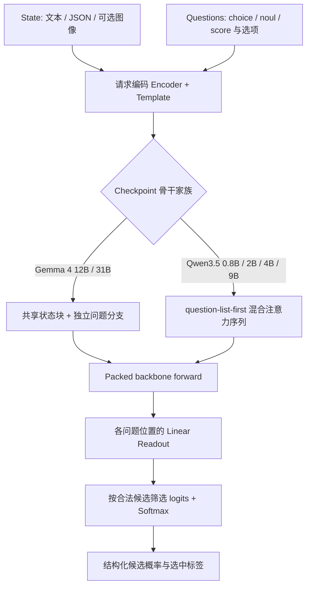
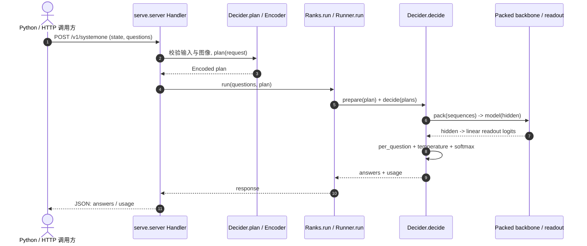

# Karpo Decision：0.8B–31B 全尺寸多模态决策模型家族（Multimodal Decision Model Family）

## 一句话定义

**Karpo Decision** 是 MachinePulse 发布的六款多模态**结构化决策模型**：读入状态和多个有限候选问题，一次前向计算给出各候选的概率，而非生成一段自然语言。它适合上层 agent 的分类/路由/评分接口，不等于机器人连续动作策略。

## 英文缩写速查

| 缩写 | 英文全称 | 简要说明 |
|---|---|---|
| LLM | Large Language Model | Qwen3.5 / Gemma 4 主干的来源 |
| VLM | Vision-Language Model | 结合文本状态、可选截图的多模态输入 |
| API | Application Programming Interface | Python Decider 和 HTTP System One 的调用接口 |
| BF16 | Brain Floating Point 16 | 官方权重的半精度表示 |
| FP8 | 8-bit Floating Point | 推理服务可选的投影加速路径 |
| GPU | Graphics Processing Unit | 模型加载和推理需要的计算设备 |

## 为什么重要

- **固定 schema 替代自由生成：** `choice`、`noul`、`score` 直接返回合法选项及概率，便于接下游决策逻辑。
- **一次请求可评多个问题：** 复用状态上下文，减少逐问题单独调用开销；超长输入需要按问题拆分，此时不是严格单次前向。
- **尺寸跨度完整：** Qwen3.5 的 0.8B、2B、4B、9B 与 Gemma 4 的 12B、31B 提供不同内存/延迟预算选项。
- **机器人相关性要分层：** 可研究上层任务候选筛选、工具路由或状态判断，但官方 Decision Index 并非机器人真机安全或控制性能验证。

## 核心原理

### 六个公开 checkpoint

| 型号 | 底座 | 参数量（官方模型卡） | 权重入口 |
|---|---|---:|---|
| 0.8B | Qwen3.5 | 0.85B | [karpo-decision-0.8B](https://huggingface.co/MachinePulseAI/karpo-decision-0.8B) |
| 2B | Qwen3.5 | 2.2B | [karpo-decision-2B](https://huggingface.co/MachinePulseAI/karpo-decision-2B) |
| 4B | Qwen3.5 | 4.5B | [karpo-decision-4B](https://huggingface.co/MachinePulseAI/karpo-decision-4B) |
| 9B | Qwen3.5 | 8.4B | [karpo-decision-9B](https://huggingface.co/MachinePulseAI/karpo-decision-9B) |
| 12B | Gemma 4 | 12.0B | [karpo-decision-12B](https://huggingface.co/MachinePulseAI/karpo-decision-12B) |
| 31B | Gemma 4 | 31.3B | [karpo-decision-31B](https://huggingface.co/MachinePulseAI/karpo-decision-31B) |

发布方：MachinePulse（MachinePulse Pte. Ltd.）。源代码和权重**分别**托管；需分开核对授权。

### 状态、问题与读出

1. **输入：** 一个 state（文本/JSON，可带图片）、问题映射及合法选项；`choice` 最多 255 个选项，`noul` 为布尔，`score` 为等级评分。
2. **编码与共享计算：** 状态与问题以模型家族对应模板编码。**Gemma** 为共享问题/状态块及独立问题分支，分支不读其他分支；**Qwen3.5** 的模型卡描述 question-list-first 混合注意力，不能等同于 Gemma 分支策略。
3. **选择读出：** 每个问题的 readout 位置，经训练后的线性层计算 255 个选项代码 logits，再针对当前合法候选取 softmax。
4. **输出：** 每题返回结构化答案和各候选概率；代码中的 `usage.output_tokens=0`，不是聊天文本生成。

### 流程总览（依官方模型卡及推理实现）



## 实验与评测

| 官方报告（2026-11-12） | 31B | 适用说明 |
|---|---:|---|
| Decision Index 0.4.1 私有 Full | **73.9** | 300 个榜单条目中最高；与 GLiDE 27B（73.4）按榜单 0.9 分容差并列 #1 |
| Private same-skills | 70.7 | 私有测试中同类技能部分 |
| Private new-domains | 78.6 | 私有测试中新领域部分 |
| Public Index（项目自跑） | 75.0 | 140,178 条有效计分请求，按该公开套件定义 |
| Median latency | 94 ms | 榜单单 GPU、单请求测量口径；并非任何硬件的通用指标 |

这些结果来自模型发布者/榜单报告，尚未在本仓复跑；不能将 Decision Index 分数视作机器人任务成功率、运动控制时延或真实世界安全性保证。

## 官方体验与网页动作专用分支

### Ten Appetites, One Menu

- [官方交互页](https://karpo.ai/models/decision/ten-appetites) 使用两组相同的 **10 位虚构顾客**和 **8 道菜**，根据预算、过敏硬约束和口味偏好选择菜单；不同房间同时开始计时。
- 演示向 Karpo Decision 一次发送完整 **state（菜单和顾客）**与每位顾客一个 `choice` 问题，包含售罄及不合适菜品在内的所有候选均不预过滤。模型输出逐候选概率，不生成解释；第二轮售罄事件只调整受影响顾客订单。
- 计时在浏览器完成，包括网络等待、不包括上菜动画。该互动不应被当作真实餐厅安全决策或 GPU 纯推理计时。[原文归档](../../sources/sites/karpo-ten-appetites.md)。

### Karpo Decision 27B Act 与浏览器 Agent

- [Karpo Decision 27B Act](./karpo-decision-27b-act.md) 是独立的 **Qwen3.8-27B 衍生网页动作 checkpoint**（26.1B BF16），不应加入上表六款通用模型的尺寸表。它读取编号网页动作、截图与任务状态，预测 `CLICK/FILL/SELECT` 等候选概率。
- [karpo-browser](./karpo-browser.md) 由 System 1 选每步操作，System 2 提供目标、字段值并核验终态；[Karpo BrowserBench](./karpo-browserbench.md) 则固定真实网页录制轨迹，离线考核每一步是否选择合理候选。
- 官方给出的 Browserbase Benchmark v2 **84%** 是发布者自测端到端任务成功率，而 KBB 单步准确率与 Decision Index 属于不同评测。官方模型卡还注明浏览器客户端 POST 路径与开源推理服务的 `/v1/systemone` 不直接兼容，需要适配测试。

## 源码运行时序图

根据 `src/karpo_decision/decider.py` 的 `Decider` / `logits` 及 `src/karpo_decision/serve/server.py` 的 `Handler.do_POST` / `Ranks.run` / `Runner.run` 绘制，表示源码可见调用关系，**不是实测 trace**。



Python 直接调用时可绕过 HTTP 层，使用 `Decider.from_pretrained(...).decide(...)`；模型仓未提供聊天模型式的等价结果保证。

## 工程实践

```bash
pip install "karpo-decision @ git+https://github.com/machinepulse-ai/karpo-decision"
# 对 Qwen3.5 checkpoint，按 README 安装 [qwen] 额外依赖
# 下载所选模型权重后：
torchrun --standalone --nproc_per_node 1 -m karpo_decision.serve.server --checkpoint <checkpoint-dir> --port 18440
```

- **接口：** HTTP `POST /v1/systemone`、`GET /healthz`；或者 Python `Decider.from_pretrained(snapshot_download(...), device="cuda")`。
- **运行环境：** 官方 `pyproject.toml` 要求 Python >=3.12、PyTorch >=2.14、Transformers >=5.17，权重和 GPU 显存随尺寸显著增长（31B BF16 权重约 62.5GB，不包含推理缓存）。
- **性能权衡：** `--fp8`、`--graphs`、`--triton-attention` 为有条件可选项；应对真实输入分布测端到端延迟、候选校准、拒绝率与内存，不能把小样本官方性能表当作上机保证。
- **代码公开：** 源仓含推理、服务、Decision Index 适配器及测试；未据此确认发布了完整训练数据与端到端训练流程。
- **纵深路线：** 已对照 [纵深路线总览](../../roadmap/README.md)。本模型为通用结构化决策接口，暂无直接机器人控制或具身测评结果，故不强行挂入 VLA、WAM 或运控 Stage。

## 局限与风险

- **不输出连续动作：** 只能从给定候选中选择。用于机器人上层任务路由时须由外部控制器、可行性约束及安全策略执行或否决。
- **输入并非无限长：** 默认单序列最多 32,768 tokens；超限按问题拆分，单问题无法容纳则报错，不静默截断。
- **视觉评测边界：** 小模型官方卡说明图像输入虽然有视觉塔，所列评测并未验证图像能力；不能从接口存在推断视觉可靠性。
- **部署安全：** 官方 HTTP server 默认回环监听，**没有内置 TLS / 身份认证**；暴露公网需独立加固。
- **权重许可存在版本差异：** 本仓 2026-11-17 原文归档曾记录 31B 社区许可证描述，而 2026-11-21 再读取的 Hugging Face 页面又标注 Apache-2.0；不能在未对照权重文件内 LICENSE、历史 revision 和获取时间前断言某个 checkpoint 的当前可用条款。推理代码仓则为 Apache-2.0。

## 与其他工作对比

| 模型 | 决策读出 | 相同点 / 区别 |
|---|---|---|
| [Intern-Decision](./paper-intern-decision.md) | JSON 骨架中 masked autoregressive `<decision>` 位置的合法 token 概率 | 同为多问题结构化决策；Karpo 采用独立线性 readout 与家族特定编码 |
| [Jev / TypeSafe](./typesafe-jev.md) | System One 风格的类型化候选概率接口 | Karpo 提供兼容格式的自部署实现；兼容接口不意味着服务等同或评测口径一致 |
| [Valen](./valen.md) | 候选概率输出 | 对照读出/校准设计需在同一题集、硬件与协议下复现 |
| [VLA](../methods/vla.md) | 动作 token、action chunk 或连续控制量 | Karpo 只完成有限候选的高层决策，不接替运动控制策略 |

## 关联页面

- [Karpo Decision 27B Act](./karpo-decision-27b-act.md) — 网页专用决策权重。
- [karpo-browser](./karpo-browser.md) — 双系统浏览器 Agent。
- [Karpo BrowserBench](./karpo-browserbench.md) — 离线逐步决策评测。

- [AI Agent 评测](../concepts/ai-agent-evaluation.md) — 把候选概率与实际任务终态分开评测。
- [Intern-Decision](./paper-intern-decision.md) — 多问题一次前向的另一种技术路线。
- [TypeSafe Jev](./typesafe-jev.md) — System One 接口与服务生态。
- [Valen](./valen.md) — 结构化概率决策对照对象。
- [VLA](../methods/vla.md) — 与执行连续机器人动作的策略区别。

## 参考来源

- [Ten Appetites 交互体验官方说明归档](../../sources/sites/karpo-ten-appetites.md)

- [官方全系列模型卡与权重原文归档](../../sources/models/karpo-decision-weights.md)
- [官方推理仓源码核对归档](../../sources/repos/karpo-decision.md)
- [Karpo Decision 官方 6 款权重集合](https://huggingface.co/collections/MachinePulseAI/karpo-decision)
- [31B 模型卡 / 评测与许可](https://huggingface.co/MachinePulseAI/karpo-decision-31B)
- [推理代码 / README](https://github.com/machinepulse-ai/karpo-decision)

## 推荐继续阅读

- [官方 README：Use、Serving、Decision Index、Layout](https://github.com/machinepulse-ai/karpo-decision/blob/main/README.md)
- [Decider 源码：plan、pack、logits、softmax](https://github.com/machinepulse-ai/karpo-decision/blob/main/src/karpo_decision/decider.py)
- [Decision Index 公开评测套件](https://github.com/apolinario/decision-index)
