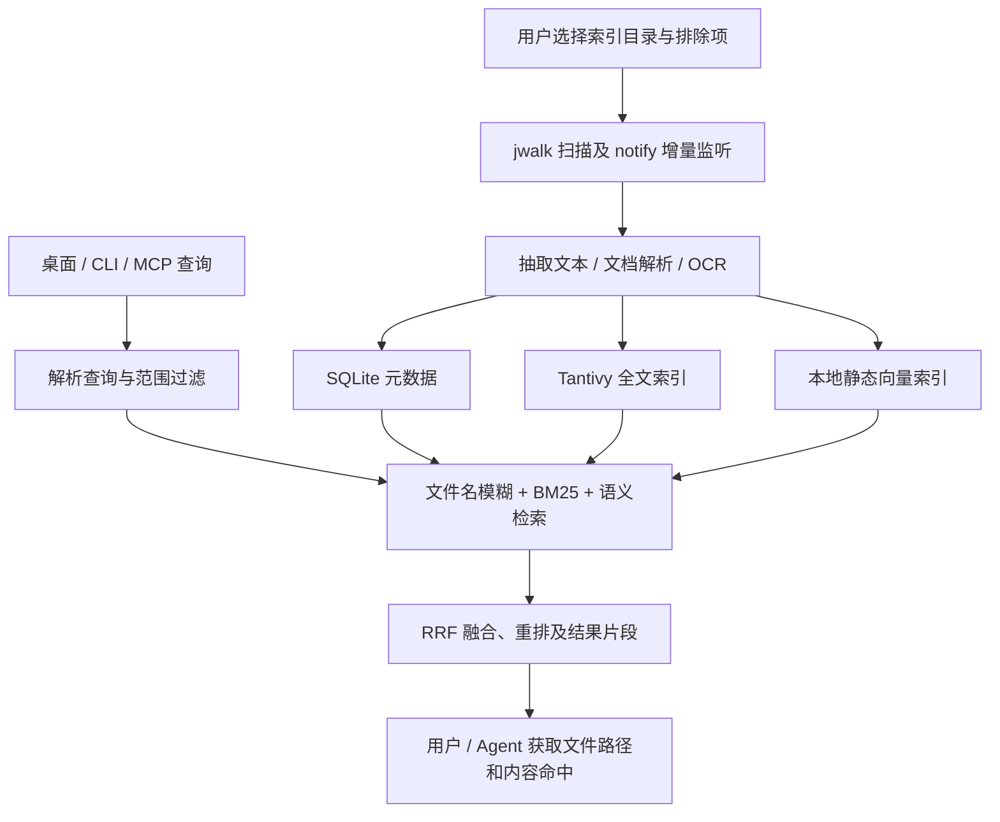
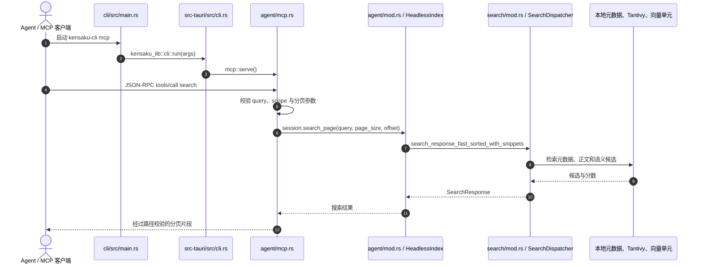

# Kensaku（検索）：本地文件检索与 Agent MCP 搜索

## 一句话定义

**Kensaku** 是一个开源、本地优先的桌面文件搜索引擎：它先为文件名、文档正文、图片中的文字与语义片段建索引，再通过跨平台桌面窗口、CLI 或 MCP 把可定位的文件结果交给人或 Agent。官方仓库为 [yjid/kensaku](https://github.com/yjid/kensaku)，许可证为 MIT。

## 英文缩写速查

| 缩写 | 英文全称 | 简要说明 |
|---|---|---|
| MCP | Model Context Protocol | 允许 Claude、Cursor 等 Agent 查询本机索引的工具接口 |
| OCR | Optical Character Recognition | 从截图、图片及扫描 PDF 中提取可搜索文字 |
| BM25 | Best Matching 25 | Tantivy 全文检索的相关性排序方法 |
| RRF | Reciprocal Rank Fusion | 融合文件名、内容和语义等候选结果的排名 |
| CLI | Command-Line Interface | `kensaku-cli` 查询、查看索引及开启 MCP 服务 |

## 为什么重要

机器人研发的知识常散在 ROS 2 工作区、实验记录、部署日志、机械图纸、标定 PDF、截图和代码目录中。文件名检索经常无法回答「哪个截图包含这个 CUDA 错误」「哪份文档描述了此电机参数」。Kensaku 将文本抽取、CJK 分词、OCR、按意义检索放进本地索引，对离线调试与敏感研发资料更容易实施访问控制。以上是**应用建议**，不代表项目提供了机器人领域的专项基准。

## 核心原理

| 模块 | 项目实际机制 |
|---|---|
| 本地元数据 | `jwalk` 扫描目录、忽略规则和 `notify` 变更监控；SQLite WAL + 内存 arena 持久化与加速文件元信息 |
| 文件名检索 | `nucleo-matcher` 模糊匹配，字符 bloom 预过滤并保留路径加权 |
| 全文检索 | 文本与代码、PDF/Office/EPUB 抽取后进入 Tantivy；BM25 与子串/拼写容错层进行检索 |
| OCR | 默认 PP-OCRv6，支持可选 Indra/Tesseract；扫描 PDF 和截图主要搜索其**抽出的文本** |
| 语义检索 | 默认量化静态嵌入表，分块后向量比对；常规查询无需 GPU，也不调用云端 LLM |
| 查询规划 | 解析 `type:` / `ext:` / `in:` / `modified:` 等过滤器，结合文件名、正文与语义候选，以 RRF 融合并重排 |
| 三种客户端 | Tauri 2 + React 桌面、`kensaku-cli`、MCP；Unix 常用 daemon 复用索引，缺失时 CLI/MCP 可只读回退 |

### 流程总览



官方 [ARCHITECTURE.md](https://github.com/yjid/kensaku/blob/master/docs/ARCHITECTURE.md) 明确，文件内容抽取为一次读入并供全文与向量索引使用；增量变更由 watcher 触发处理。图是该技术路径的归纳，不代表每次查询都会运行全部检索层。

## 源码运行时序图

以下根据官方入口 `cli/src/main.rs`、`src-tauri/src/cli.rs`、`src-tauri/src/agent/mcp.rs`、`src-tauri/src/agent/mod.rs` 与 `src-tauri/src/search/mod.rs` 核对，展示**索引已经由桌面端建立后**的 MCP 搜索主路径（未实际运行源码）。



`kensaku-cli mcp` 由 CLI 入口调用 `mcp::serve`；实际检索优先复用已运行 daemon，daemon 不可用时以只读方式打开索引。MCP 侧还有结果范围检查和输出预算限制，因此图不代表可读取任意磁盘文件。

## 性能与证据

官方 [BENCHMARKS.md](https://github.com/yjid/kensaku/blob/master/docs/BENCHMARKS.md) 报告了以下**自测**数据，不能将其当作本次实测或跨平台普适保证：

| 场景 | 官方数据 | 解读边界 |
|---|---|---|
| Windows 11 / 100,201 个合成文件名 / 默认 16 线程 | 文件名模糊搜索平均 17.2–18.8 ms | 是基准工具的热路径，不包含 GUI/MCP 端到端延迟 |
| 同一 Windows 数据 / 4 线程 | 平均 3.1 ms | 线程调度会显著影响这类轻量预过滤检索 |
| Linux / 约 10 万条 / warm SSD | 历史基准平均约 1.3 ms | 硬件、系统与版本条件不同 |
| 100,201 条 `FileEntry` | 约 12.2 MB | **仅内存元数据，不是整个程序内存** |

## 工程实践

**安装：** 到 [Releases](https://github.com/yjid/kensaku/releases) 下载适合 Windows、macOS 或 Linux 的安装包；首次运行选择索引文件夹、排除项并完成初始扫描。开发者也可按官方 README 用 Rust stable + Bun 1.1+ 构建。

```bash
kensaku-cli search "CUDA out of memory" --json
kensaku-cli search "calibration" --ext pdf --since 30d
kensaku-cli state
kensaku-cli mcp
```

在支持 MCP 的客户端配置（`kensaku-cli` 须已安装且位于 PATH）：

```json
{
  "mcpServers": {
    "kensaku": {
      "command": "kensaku-cli",
      "args": ["mcp"]
    }
  }
}
```

**机器人研发应用示例：** 用 OCR 找调试截图里的报错字串，用 `ext:pdf` 找标定报告，用 `in:` 限定一个 ROS 2 工作区，再由 Agent 通过 MCP 的 `search` 和 `read_snippet` 获取相关片段。Agent 只负责检索上下文，不应把检索结果自动当作可信指令。

## 局限与风险

- **检索不等于理解与执行：** 本地语义层是静态向量表；Kensaku 不内置 LLM、问答推理或自动修改文件的 Agent。
- **视觉检索尚未正式接入：** 已发布 OCR 可检索图片文字，但图像相似度、文字搜相似图片功能不属于当前生产搜索路径；`similar_images` 在未启用真实视觉编码器时隐藏。
- **资源与格式边界：** 默认 100 MB 文件大小、4 MB 提取文本、48 个语义块；部分 JPEG 2000 等扫描格式暂不支持。过大文件仍可按文件名搜索。
- **索引含敏感资料：** 本地索引保存文件路径和抽取正文。共享电脑、企业终端和机器人实验数据应独立设置索引目录、排除项与 `agent_scoped_roots`；不要随意同步数据库。
- **外部抽取器不是沙箱：** 用户启用的提取器以当前用户权限运行；仅配置可信程序。HTTP MCP 只监听 loopback 并需 bearer token。
- **签名与覆盖：** 官方说明当前 Windows/macOS 包未代码签名，Windows 实测覆盖更充分；macOS/Linux 的稳定性仍需目标环境验证。

## 关联页面

- [CodeGraph](./codegraph.md) — 侧重 Tree-sitter/静态关系图、函数调用与变更影响；Kensaku 则侧重跨格式文件及正文定位。
- [Graphify](./graphify.md) — 将资料组织成可遍历知识图，与 Kensaku 的搜索结果列表互补。
- [Agentic Coding 的软件工程基础](../concepts/agentic-coding-software-fundamentals.md) — 使用 Agent 检索及修改真实项目时的验证边界。

## 参考来源

- [Kensaku 官方资料与源码核对归档](../../sources/repos/yjid-kensaku.md)
- [官方 GitHub / README](https://github.com/yjid/kensaku)
- [官方架构文档](https://github.com/yjid/kensaku/blob/master/docs/ARCHITECTURE.md)
- [官方 Agent/MCP 文档](https://github.com/yjid/kensaku/blob/master/docs/AGENTS.md)
- [官方基准文档](https://github.com/yjid/kensaku/blob/master/docs/BENCHMARKS.md)

## 推荐继续阅读

- [Kensaku 安装说明](https://github.com/yjid/kensaku/blob/master/docs/INSTALL.md) — 平台依赖、首次运行和签名限制。
- [Kensaku 语言支持](https://github.com/yjid/kensaku/blob/master/docs/LANGUAGES.md) — CJK 分词及内容格式说明。
- [Kensaku 外部抽取器说明](https://github.com/yjid/kensaku/blob/master/docs/EXTRACTORS.md) — 为特殊格式（如 ASCII STL）接入受限文本抽取。
