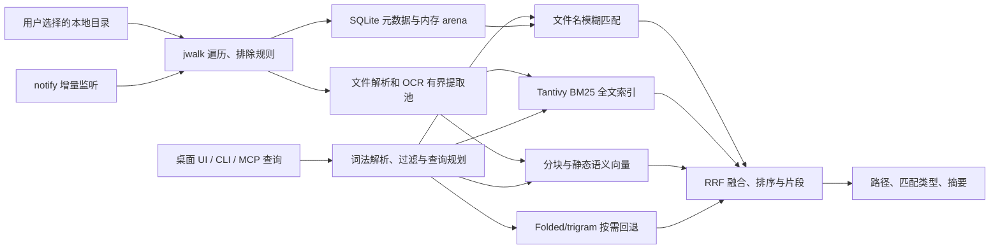
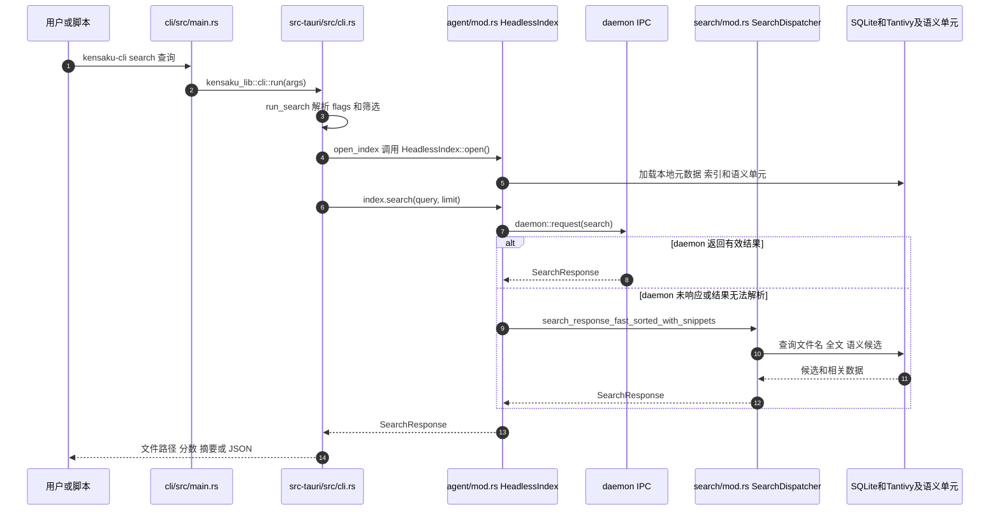

# Kensaku（検索）：本地文件、全文与语义搜索 / Local Search

## 一句话定义

**Kensaku** 是 [yjid/kensaku](https://github.com/yjid/kensaku) 开源的本地检索工具（MIT）：在 Windows、macOS、Linux 上索引**文件名、代码、Office/PDF 文本、图片 OCR 文字**，以桌面启动器、CLI 和 MCP 向用户或 AI 代理提供文件定位及证据片段，不依赖云端搜索服务。

## 英文缩写速查

| 缩写 | 英文全称 | 简要说明 |
|---|---|---|
| OCR | Optical Character Recognition | 识别截图与扫描文档中的文字 |
| BM25 | Best Matching 25 | Tantivy 全文内容相关性排序 |
| MCP | Model Context Protocol | 让外部 Agent 搜索本机索引的工具协议 |
| CLI | Command-Line Interface | `kensaku-cli` 提供脚本化本地搜索 |
| RRF | Reciprocal Rank Fusion | 融合多个检索层候选结果的排序方法 |

## 为什么重要

- **机器人研发资料可找回**：例如 CUDA 报错截图、训练日志、版本混乱的论文 PDF 或 C++/Python 函数定义，可按内容而不只按文件名搜索。
- **Agent 检索接口**：外部编码助手可通过 MCP/CLI 检索授权的本地文件，不必把全盘文件上传到云端；与 [Hermes Agent](hermes-agent.md) 这类代理运行时正交互补。
- **跨语言与可控性**：自定义 CJK unigram/bigram tokenizer 用于中日韩及混合脚本；用户选择扫描根目录、忽略规则和深度，索引保存在本机。

## 核心信息

| 维度 | 官方实现与边界 |
|---|---|
| 开发者 / 许可 | yjid；MIT；[官方 GitHub](https://github.com/yjid/kensaku) |
| 客户端 | Tauri 2 + React 19 + TypeScript；托盘启动器 / 普通桌面窗口；Windows、macOS、Linux |
| 检索内核 | Rust：`jwalk` 文件遍历、SQLite WAL 元数据 + 内存 arena、Tantivy 全文 BM25、本地静态语义向量 |
| 文件内容 | PDF、Office、EPUB、代码、文本、邮件和图片 OCR；CJK-aware 分词；增量 watcher |
| 代理入口 | `kensaku-cli search`、`kensaku-cli mcp`（stdio）、`kensaku-cli serve`（loopback HTTP + bearer token） |
| 开源状态 | **已开源**：桌面端、CLI、索引、Agent 接口、测试与基准源码可查；可选模型包另行下载 |
| 核对基线 | 上游 `master` @ `9585797888e8b7260daf9d1334ea1c8282dee2f3`（2026-11-10）；README/Architecture 标注 v1.0.16 |

## 核心原理

**索引阶段**：从指定目录按过滤规则 `jwalk` 遍历；文本、Office 与 PDF 用对应解析器读取，扫描页面和图片交给选定 OCR 引擎；有界 worker 单次提取后写入全文/语义索引与元数据。`notify` 监控变更、重命名及删除，避免全量重复扫描。

**查询阶段**：解析输入为查询语法和过滤条件（`type:`、`ext:`、`in:`、`modified:`、`size:` 等）。候选先从文件名模糊匹配产生，再由 Tantivy 的 BM25 全文检索、静态语义向量扫描补充，最后在必要时通过 folded/trigram 回退查找 OCR 混淆字符；结果以 RRF 等规则融合并输出路径、摘要片段与匹配类型。

**语义不等于聊天模型**：默认表为量化的静态 embedding（约 7.3 MiB），通过 token lookup、加权平均和归一化生成向量；不运行本地对话 LLM。截图**文字 OCR**已支持，但官方明确指出**视觉相似图搜索**尚未接入正式搜索路径。

### 流程总览



图依据官方 `docs/ARCHITECTURE.md` 的索引、四层检索与 Query pipeline；箭头描述读取/查询关系，不表示四层始终全量执行（后级可短路）。

### 实测表现与条件

| 官方基准 | 结果 | 不可外推的边界 |
|---|---|---|
| Windows 11，100,201 个空文本文件，默认 16 线程，release | 文件名模糊查询平均 **17.2–18.8 ms** | AMD Ryzen 7 7435HS、NTFS、实时杀软开启；属于 filename 热路径 |
| 同一 Windows 语料、4 个 Rayon 线程 | 平均 **3.1 ms** | 调度成本不同；不是跨平台统一性能 |
| Linux 8 vCPU/本地 SSD，历史热缓存参考 | 平均约 **1.3 ms** | 与 Windows 不是同一台机器，不能直接对比 |
| Windows 100,201 条元数据 | **12.2 MB** | 仅 `FileEntry` 元数据，**不包含** SQLite/Tantivy/语义模型/桌面 WebView |

以上均为**作者在官方 Benchmarks 中披露的结果，本站未独立复测**。详见[基准原文](https://github.com/yjid/kensaku/blob/master/docs/BENCHMARKS.md)。

## 源码运行时序图

以下为官方 `kensaku-cli search "docker error"` 的真实调用主干；映射 `cli/src/main.rs`、`src-tauri/src/cli.rs`、`src-tauri/src/agent/mod.rs`、`src-tauri/src/search/mod.rs`。不把 GUI、MCP 与 CLI 错画成同一条直接调用链。



MCP 的独立入口是 `kensaku-cli mcp` → `src-tauri/src/agent/mcp.rs::serve` → `handle_request_session` → AgentSession daemon/本地只读查询；`serve` 的 HTTP 模式入口在 `agent/http.rs`。代码仅做静态阅读，未执行。

## 工程实践

最小复现与接入步骤（依官方 README）：

```bash
git clone https://github.com/yjid/kensaku
cd kensaku
bun install
bun run tauri build

# 安装发行版后，GUI 首次选择索引目录并完成扫描，再调用：
kensaku-cli search "cuda error" --json
kensaku-cli state
kensaku-cli mcp
```

MCP 客户端配置示例：`{"mcpServers":{"kensaku":{"command":"kensaku-cli","args":["mcp"]}}}`；HTTP 模式使用 `kensaku-cli serve --port 8765`，只监听本地回环并要求 bearer token。开发需 Rust stable、Bun ≥1.1 与平台 WebView 依赖，发行包请参见[安装说明](https://github.com/yjid/kensaku/blob/master/docs/INSTALL.md)。

实际用于机器人项目可将 `*.log`、`*.md`、`*.py`、`*.cpp`、论文 PDF 与截图所在目录设为索引根；筛选 `ext:py`、`in:"~/Robotics"` 与 `modified:7d`。文件较大时适当调整内容深度，超出提取上限的文件仍可通过名称/元数据查找。

## 局限与风险

- **非云同步/RAG 问答平台**：不内置 LLM、聊天或跨设备索引；它给 Agent **返回检索结果**，后续生成由代理宿主完成。可与 [RAG](../concepts/retrieval-augmented-generation.md) 的检索器作工程对照。
- **视觉搜索未正式启用**：截图 OCR 文字和「以图片找相似图片」是两件事；`similar_images` 在无可用视觉编码器的正式构建中不会暴露。
- **索引含敏感文本**：`agent_scoped_roots` 和凭据扩展名默认拒绝有帮助，但索引数据库本身仍应按敏感文件保护；远程 MCP 使用前应检查访问边界。
- **有联网但不是云检索**：官方说明存在更新检查和可选 OCR/模型下载；“完全零网络请求”并非准确表述。
- **平台和基准限制**：跨 OS 测试覆盖不均，Windows/macOS 发布包尚未签名；100k 文件名查询速度不能等同全文、OCR 或端到端 MCP 延迟。

## 关联页面

- [Hermes Agent](hermes-agent.md) — 代理宿主/工具环；Kensaku 是可独立使用的本机只读检索服务
- [Agent Reach](agent-reach.md) — 外网资料读取与渠道安装，与 Kensaku 的本机数据检索互补
- [Model Context Protocol（MCP）](../concepts/model-context-protocol.md) — Kensaku 工具暴露采用的互操作协议
- [Retrieval-Augmented Generation（RAG）](../concepts/retrieval-augmented-generation.md) — Kensaku 只提供检索层，不替代理宿主执行生成
- [机器人视觉感知栈选型闭环](../queries/robot-perception-stack-selection-loop.md) — 对照用：Kensaku 的「语义」指文件文本的静态 embedding 检索、OCR 只读截图文字，不属于机器人语义建图/视觉感知栈

## 参考来源

- [Kensaku 官方仓库与核心文档通读归档](../../sources/repos/yjid-kensaku.md)
- [官方 README](https://github.com/yjid/kensaku/blob/9585797888e8b7260daf9d1334ea1c8282dee2f3/README.md)
- [官方 Architecture](https://github.com/yjid/kensaku/blob/9585797888e8b7260daf9d1334ea1c8282dee2f3/docs/ARCHITECTURE.md)
- [官方 Benchmarks](https://github.com/yjid/kensaku/blob/9585797888e8b7260daf9d1334ea1c8282dee2f3/docs/BENCHMARKS.md)
- [MCP 源码入口](https://github.com/yjid/kensaku/blob/9585797888e8b7260daf9d1334ea1c8282dee2f3/src-tauri/src/agent/mcp.rs)
- [CLI 源码入口](https://github.com/yjid/kensaku/blob/9585797888e8b7260daf9d1334ea1c8282dee2f3/src-tauri/src/cli.rs)

## 推荐继续阅读

- [Kensaku Agent 接入与安全边界](https://github.com/yjid/kensaku/blob/master/docs/AGENTS.md) — stdio/HTTP、访问范围、只读工具
- [Kensaku 搜索语法](https://github.com/yjid/kensaku/blob/master/docs/USAGE.md) — 筛选、时间、符号与正则查询
- [Kensaku 多语言支持](https://github.com/yjid/kensaku/blob/master/docs/LANGUAGES.md) — CJK 分词与混合脚本检索
