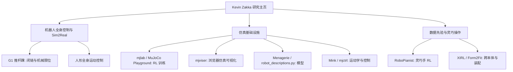

# Kevin Zakka｜人形 Sim2Real 研究与 MuJoCo 开源生态

## 一句话定义

**Kevin Zakka** 的[个人主页](https://kzakka.com/)是一份围绕 **人形机器人全身控制、数据先验、规模化仿真与 Sim2Real** 的一手研究与软件**导航索引**，不是单个可运行算法、训练套件或论文。主页自述其在加州大学伯克利分校（UC Berkeley）Robot Learning Lab 攻读博士，导师为 Pieter Abbeel（截至 2026-11-17）。

## 英文缩写速查

| 缩写 | 英文全称 | 简要说明 |
|---|---|---|
| RL | Reinforcement Learning | MuJoCo Playground / mjlab 所服务的机器人策略训练范式 |
| Sim2Real | Simulation to Reality | 将仿真学得的控制器迁移到真实机器人 |
| WBC | Whole-Body Control | 协调人形机器人全身运动和接触 |
| IK | Inverse Kinematics | Mink 面向 MuJoCo 的微分逆运动学 |
| MJCF | MuJoCo XML Format | MuJoCo 仿真模型的描述格式 |
| GPU | Graphics Processing Unit | 大规模并行物理与机器人学习的计算设备 |

## 为什么重要

与其把这些工具误看成同一个框架，不如按**仿真引擎、训练框架、可视化、机器人模型、控制算法**分层理解。Kevin Zakka 主页集中提供多条独立一手入口，适合作为 [MuJoCo](./mujoco.md) 生态与 [Sim2Real](../concepts/sim2real.md) 的作者级索引：研究成果有各自论文和代码许可，不能把主页列出的所有工作都视作同一个已复现系统。

## 核心原理：研究脉络与软件分工

| 方向 | 主页原始条目 | 研究 / 工程定位 |
|---|---|---|
| GPU 强化学习 | [mjlab](./mjlab.md)、[MuJoCo Playground](./mujoco-playground.md) | 机器人 RL 环境与 GPU 仿真训练；二者是不同的软件项目 |
| 仿真可视化 | [mjviser](./mjviser.md) | 基于 Viser 的 MuJoCo 交互式 3D 查看 |
| 仿真模型与描述 | [MuJoCo Menagerie](https://github.com/google-deepmind/mujoco_menagerie)、[robot_descriptions.py](https://github.com/robot-descriptions/robot_descriptions.py) | 可重用的机器人模型资产与 Python 获取入口 |
| 运动学 / 控制 | [Mink](./mink-ik.md)、[mjctrl](https://github.com/kevinzakka/mjctrl) | 基于 MuJoCo 的微分 IK 与最小控制器示例 |
| 人形全身控制 | [Closing the loop](https://kzakka.com/closing-the-loop/)（2026-11-16） | Unitree G1 推杆踝的机械限位、闭链传动与仿真校验 |
| 灵巧操作 / 表征迁移 | [RoboPianist](https://kzakka.com/robopianist/)、[XIRL](https://x-irl.github.io/)、[Form2Fit](https://form2fit.github.io/) | 分别是灵巧手 RL、跨本体逆强化学习和装配研究，不是同一系统 |

### 流程总览：按需求导航（不是跨项目的运行时数据流）

图按主页「Research / Publications / Software」分组重建**知识入口关系**，不表示工具之间有统一调度、共享数据流或软件依赖。

## 工程实践：如何选择一手入口

- **要训 G1 速度跟踪 / motion tracking**：先读 [mjlab](./mjlab.md) 的官方训练入口、任务配置与 GPU 环境，再到 [强化学习方法](../methods/reinforcement-learning.md) 了解策略和奖励设置。
- **要快速看机器人模型**：使用 [mjviser](./mjviser.md)；若需要模型资产和格式，再读 [MuJoCo](./mujoco.md) / Menagerie。
- **要做末端 IK 或重定向**：优先查 [Mink](./mink-ik.md) 的约束与任务结构，不把它当作 RL 训练器。
- **要校准 G1 踝部 Sim2Real**：2026-11-16 技术文章用 measured stops + fixed tendons 约束 pitch/roll 联动，用 spatial tendons / equality constraints 或刚性推杆恢复闭链；其传动雅可比 `G` 涉及电机侧力矩、反射惯量和控制增益变换。文章还强调重置时先满足闭链约束，并展示 `implicitfast` 与 `discrete` 在特定配置下的稳定性差异。

### 源码运行时序图

**不适用**：本页收录的是个人主页与多个独立仓库，而不是单一可执行工程。对应训练、推理、可视化的实际调用顺序，请分别查看 [mjlab](./mjlab.md)、[mjviser](./mjviser.md) 与 [Mink](./mink-ik.md) 的源码/运行入口；不拼接虚构的跨项目时序图。

## 局限与开放状态

- **代码开放状态按项目区分**：主页「Software」所列的 mjlab、MuJoCo Playground、mjviser、Menagerie、Mink、mjctrl 等有独立公开 GitHub 仓库；不能据此认定列出的所有论文、动捕数据、权重和实验脚本均完整开源。
- **G1 踝部文章提供模型和页面内示例代码**，但本次没有实跑模型，也未把它当成单独发布的完整训练系统；文章的测试条件不代表任意 MuJoCo 任务都适用。
- **来源范围**：本次通读个人主页及《Closing the loop》原文，核对相关仓库的公开链接；其他论文的具体方法、消融与复现结果仍以对应原论文及已有 wiki 节点为准。
- 主页 footer 的“Last revised: April 2026”与新增 2026 年 11 月新闻并存；以每项资料自己的发布日期判断时效。

## 关联页面

- [Qiayuan Liao｜研究与开源索引](./qiayuan-liao.md) — mjlab 等共同工作与 G1 闭链文章共同作者。
- [mjlab](./mjlab.md) · [MuJoCo Playground](./mujoco-playground.md) · [mjviser](./mjviser.md) · [Mink](./mink-ik.md)。
- [强化学习](../methods/reinforcement-learning.md) · [Sim2Real](../concepts/sim2real.md) · [Loco-Manipulation](../tasks/loco-manipulation.md)。

## 参考来源

- [Kevin Zakka 主页通读与链接归档](../../sources/sites/kevin-zakka-homepage.md)。
- [个人主页原文](https://kzakka.com/)（2026-11-17 核对）。
- [Closing the loop — G1 推杆踝闭链仿真技术文章](https://kzakka.com/closing-the-loop/)（2026-11-16，Kevin Zakka 与 Qiayuan Liao）。
- [mjlab 官方 GitHub](https://github.com/mujocolab/mjlab) · [MuJoCo Playground 官方 GitHub](https://github.com/google-deepmind/mujoco_playground) · [mjviser 官方 GitHub](https://github.com/mujocolab/mjviser)。

## 推荐继续阅读

- [Kevin Zakka 官网](https://kzakka.com/) — 研究/论文/软件一手导航。
- [Closing the loop](https://kzakka.com/closing-the-loop/) — G1 机械闭链、限位、控制和数值稳定性的技术解释与模型下载。
