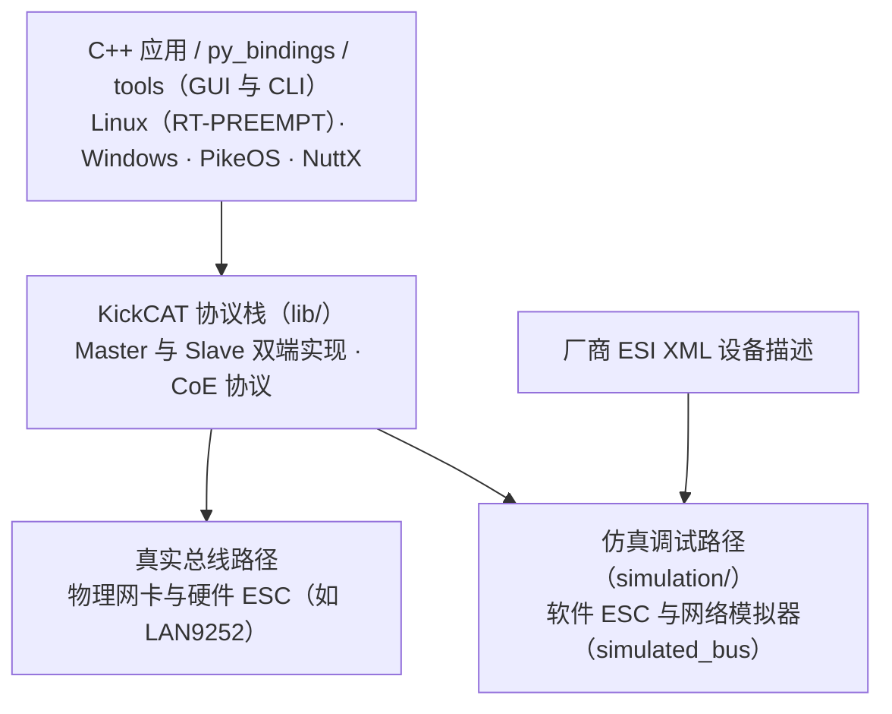

# KickCAT

## 一句话定义

C++ 面向对象的 EtherCAT 主站库，自带软件模拟从站，适合上位机开发调试。（分类：EtherCAT 主站；语言/形态：C++）

## 英文缩写速查

| 缩写 | 英文全称 | 简要说明 |
|------|----------|----------|
| EtherCAT | Ethernet for Control Automation Technology | 工业以太网现场总线 |
| ESC | EtherCAT Slave Controller | 从站硬件芯片（如 ET1100 / LAN9252 / ET1815） |
| CoE | CANopen over EtherCAT | 最常用的 EtherCAT 应用层协议 |

## 为什么重要

- 在 [EtherCAT 开源库清单](../overview/ethercat-opensource-libs-wechat.md) 中属于「主站」一栏，是机器人关节总线工具链的一环。
- C++ 上位机项目希望用现代 C++ 接口、并想脱离硬件做主站逻辑联调时的备选。

## 核心原理

文章对该项目的描述（以下均为文章声明，未独立核查）：

- 语言：C++，面向对象 API。
- 文章称自带软件模拟从站，便于在无硬件时调试上位机。
- 文章称项目活跃度一般。

### 架构流程图



## 工程实践

- 适用场景：C++ 上位机项目希望用现代 C++ 接口、并想脱离硬件做主站逻辑联调时的备选。
- 官方地址：<https://github.com/leducp/KickCAT>（文章给出，本次未独立打开核查）
- 协议背景见 [EtherCAT 协议基础](../concepts/ethercat-protocol.md)；主站实时调优见 [主站优化指南](../queries/ethercat-master-optimization.md)。

## 源码运行时序图

以下时序图基于仓库 `examples/master/ds402_drive/ds402_sinus.cc`、`lib/master/src/Bus.cc` 与 `lib/master/src/Link.cc` 源码整理，展示主站初始化、冗余链路检测与 1ms DS402 周期控制流程。

```mermaid
sequenceDiagram
  participant App as ds402_sinus.cc main
  participant Drive as CoE::CiA::DS402::Drive
  participant Bus as kickcat::Bus (Bus.cc)
  participant Link as kickcat::Link (Link.cc)
  participant Sock as AbstractSocket (nominal / redundancy)

  App->>Link: createSockets(nom_if, red_if) 与 make_shared<Link>
  App->>Link: setTimeout(2ms) 与 checkRedundancyNeeded()
  Link->>Sock: writeFrame(*socket_redundancy_, BRD) 与 readFrame 检查冗余环路

  App->>Bus: bus.init()
  Bus->>Bus: detectSlaves() -> resetSlaves() -> setAddresses()
  Bus->>Bus: fetchESC() -> fetchDL() -> requestState(State::INIT)
  Bus->>Bus: fetchEeprom() -> configureMailboxes() -> requestState(State::PRE_OP)
  Bus->>Link: broadcastRead / addDatagram / writeThenRead / processDatagrams()

  App->>Drive: drive.setUnits(...) 与 configure(POSITION_CYCLIC)
  App->>Bus: createMapping(io_buffer) -> requestState(SAFE_OP) -> waitForState
  App->>Drive: drive.attach()
  App->>Bus: requestState(OPERATIONAL) 与 waitForState(..., pump_pdo)
  App->>Drive: drive.enable()

  loop 1ms 周期循环 (Timer::wait_next_tick)
    App->>Bus: sendLogicalRead -> sendLogicalWrite -> finalizeDatagrams -> processAwaitingFrames
    Bus->>Link: addDatagram -> sendFrame -> read -> nextDatagram
    Link->>Sock: 经 socket_nominal_ 与 socket_redundancy_ 收发以太网帧
    App->>Drive: drive.update() 与 drive.setTargetPosition(initial_rad + delta)
  end

  App->>Drive: drive.disable() 并轮询总线直到退出使能
```

## 局限与风险

- **开源状态：** 文章声明为公开仓库；**本次会话无法访问该仓库，开源程度/许可证未独立核查**，待后续按 ingest 步骤 2.5 补查。
- **推测/待核查：** 文章中「EtherCAT Master Sim」被注明 KickCAT 自带，见 [EtherCAT 虚拟从站仿真](./ethercat-virtual-slave-sim.md)；二者关系以仓库为准（推测，未核查）。
- EtherCAT 协议本身不开源，协议栈代码开源，ESC 硬件芯片需单独购买（文章避坑提醒）。

## 关联页面

- [soem](./soem.md)
- [ethercat-virtual-slave-sim](./ethercat-virtual-slave-sim.md)
- [ethercat-protocol](../concepts/ethercat-protocol.md)
- [ethercat-opensource-libs-wechat](../overview/ethercat-opensource-libs-wechat.md)
- [Robot Control System Architecture · 机器人控制系统架构](../methods/robot-control-architecture.md)：提供机器人实时控制栈中的 C++ EtherCAT 主站通信层，连接上位控制器与关节执行器。
- [Robot Software System Integration · 机器人软件系统集成](../methods/robot-software-integration.md)：集成面向对象的 EtherCAT 主从协议栈与软件模拟从站，支持脱离硬件的上位机联调。

## 参考来源

- [sources/blogs/wechat_ethercat_opensource_libs_qt_adventure.md](../../sources/blogs/wechat_ethercat_opensource_libs_qt_adventure.md)
- [sources/raw/wechat_ethercat_opensource_libs_qt_adventure_2026-10-14.md](../../sources/raw/wechat_ethercat_opensource_libs_qt_adventure_2026-10-14.md)

## 推荐继续阅读

- EtherCAT Technology Group：<https://www.ethercat.org/>
- 文章原文：<https://mp.weixin.qq.com/s/C34QLsVb7Sd-GlvPvQlGKQ>
