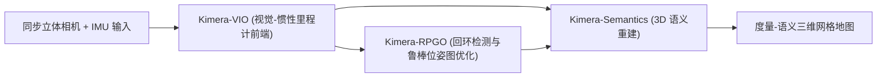

# Kimera

**Kimera** 将 **视觉-惯性里程计、鲁棒位姿图与语义网格** 组合为度量-语义地图。

## 英文缩写速查

| 缩写 | 英文全称 | 简要说明 |
|------|----------|----------|
| SLAM | Simultaneous Localization and Mapping | 同步定位与建图 |
| VIO | Visual-Inertial Odometry | 视觉-惯性里程计，融合相机与 IMU 估计位姿 |
| IMU | Inertial Measurement Unit | 惯性测量单元，提供加速度与角速度 |
| LiDAR | Light Detection and Ranging | 激光雷达，地形感知与建图主传感器 |
| LIO | LiDAR-Inertial Odometry | 激光-惯性里程计 |

## 为什么重要

- **语义 SLAM 代表**：同时输出几何与语义标签。
- **模块化**：各子仓可独立升级与替换。

## 核心结构/机制

| 子项目 | 说明 |
|--------|------|
| **Kimera-VIO** | 立体+IMU 前端 |
| **Kimera-RPGO** | 回环与鲁棒优化 |
| **Kimera-Semantics** | 3D 语义重建 |

## 机制与架构图

## 常见误区或局限

- **复杂度高**：集成与调参成本高于单一 VIO 库。
- **硬件**：立体+IMU 同步要求高。
- **上游维护状态（2026-11-25 复核）**：`MIT-SPARK/Kimera` 索引仓自 2021 年起冻结，仅 `Kimera-VIO`（2026-08）与 `Kimera-RPGO`（2026-10）仍有少量维护更新，`Kimera-Semantics` 自 2023-12 后无新提交。

## 参考来源

- [sources/repos/kimera.md](../../sources/repos/kimera.md)
- [MIT-SPARK/Kimera](https://github.com/MIT-SPARK/Kimera)

## 关联页面

- [ORB-SLAM3](../entities/orb-slam3.md)
- [LiDAR / LIO / VIO 选型](../comparisons/lidar-slam-lio-vio-selection.md)

## 推荐继续阅读

- [机器人论文阅读笔记：Kimera](https://imchong.github.io/Robot_Learning_Paper_Notebooks/papers/09_State_Estimation/Kimera__Open-Source_Library_for_Real-Time_Metric-Semantic_Localization_and_Mapping/Kimera__Open-Source_Library_for_Real-Time_Metric-Semantic_Localization_and_Mapping.html)
- https://arxiv.org/abs/1910.02490
