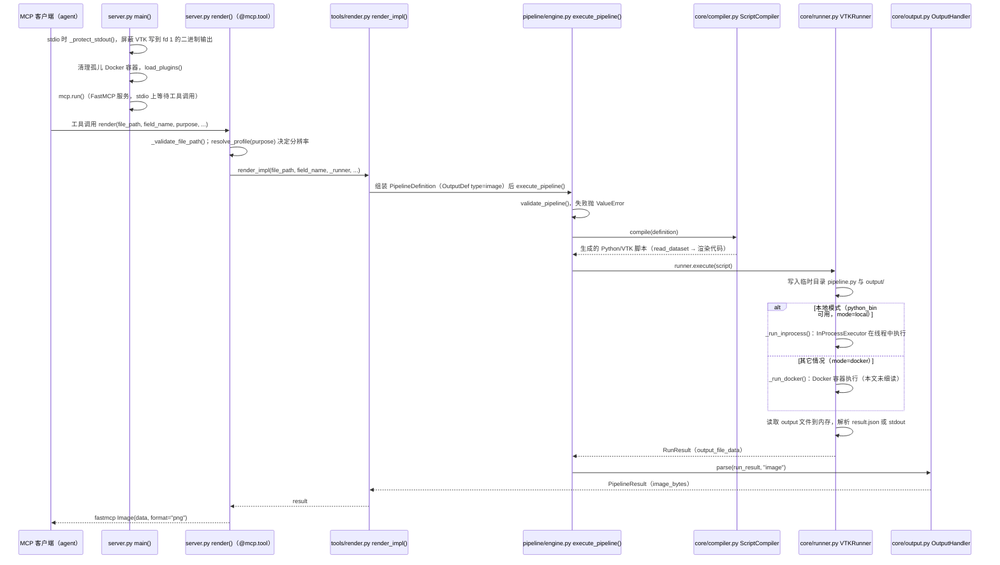

# viznoir（kimimgo/viznoir）

## 一句话定义

viznoir（kimimgo/viznoir）是面向 VTK 的 22 工具可视化 MCP，可做渲染、切片、等值面、体渲染及 OpenFOAM 动画。

## 英文缩写速查

| 缩写 | 英文全称 | 简要说明 |
|------|----------|----------|
| CAD | Computer-Aided Design | 计算机辅助设计与几何建模 |
| MCP | Model Context Protocol | 代理调用 CAD/可视化工具的协议 |
| FEM | Finite Element Method | 结构有限元分析方法 |

## 为什么重要

对 CAE 自动化而言，代理能否稳定完成任务，取决于工程步骤是否清楚、工具边界是否明确、结果是否保留可审查证据。面向 VTK 的 22 工具可视化 MCP，可做渲染、切片、等值面、体渲染及 OpenFOAM 动画；支持 EGL/OSMesa 无头渲染，适合自动报告流水线。

## 核心原理

**项目自身范围：** AI-ready VTK visualization for science and engineering.

**工作流：** 代理通过 MCP 选取 VTK 渲染操作和数据转换，在无头后端生成图像或动画，再将产物用于报告。

## 工程实践

1. 从目标问题识别所需的 Skill、MCP、CLI 或软件接口，不把指导文件当成求解器。
2. 依照仓库 README 检查安装前提、软件/许可证、输入文件和输出证据。
3. 小规模运行并逐项核对几何、网格、边界、求解状态和物理量，再决定是否扩大任务。

文章所述的项目特征：面向 VTK 的 22 工具可视化 MCP，可做渲染、切片、等值面、体渲染及 OpenFOAM 动画；支持 EGL/OSMesa 无头渲染，适合自动报告流水线。

## 局限与风险

无头渲染减少 GUI 依赖，但仍须核对色标、物理单位、相机和数据时间步；渲染可复现性受驱动影响。

源码状态核验：该 GitHub 仓库于 2026-10-07 可公开访问。仓库 API 报告许可证为 MIT。 

## 源码运行时序图

入口：`mcp-server-viznoir`（`pyproject.toml` 的 `[project.scripts]`）或 `python -m viznoir`（`__main__.py`），二者都进入 `viznoir.server:main()`，默认 stdio 传输。

图依据：kimimgo/viznoir@e3255c0，读过 `README.md`、`pyproject.toml`、`src/viznoir/__main__.py`、`src/viznoir/server.py`（`render`、`main`）、`src/viznoir/tools/render.py`、`src/viznoir/pipeline/engine.py`（`execute_pipeline`）、`src/viznoir/core/compiler.py`（`compile`）、`src/viznoir/core/runner.py`（`execute`、`_detect_mode`）；`core/output.py` 仅确认 `parse` 签名。未运行代码。

## 关联页面

- [CAE / CFD 代理工具项目总览](../overview/cae-cfd-agent-skills-landscape.md)
- [ParaView MCP](./llnl-paraview-mcp.md)

## 参考来源

- [公众号文章原始资料归档](../../sources/blogs/wechat_cae_cfd_agent_skills_2026-10-07.md)
- [GitHub 仓库资料归档](../../sources/repos/kimimgo-viznoir.md)
- [kimimgo/viznoir 官方仓库](<https://github.com/kimimgo/viznoir>)
- 源码核对（2026-11-02）：kimimgo/viznoir@e3255c0，读过 README.md、pyproject.toml、src/viznoir/__main__.py、src/viznoir/server.py、src/viznoir/tools/render.py、src/viznoir/pipeline/engine.py、src/viznoir/core/compiler.py、src/viznoir/core/runner.py；时序图依据以上文件，未运行代码。

## 推荐继续阅读

- [项目 README](<https://github.com/kimimgo/viznoir/blob/main/README.md>)