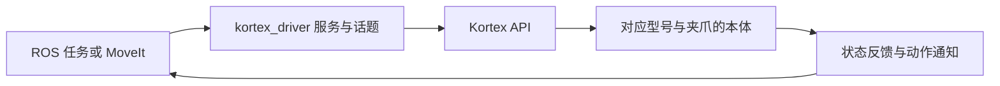
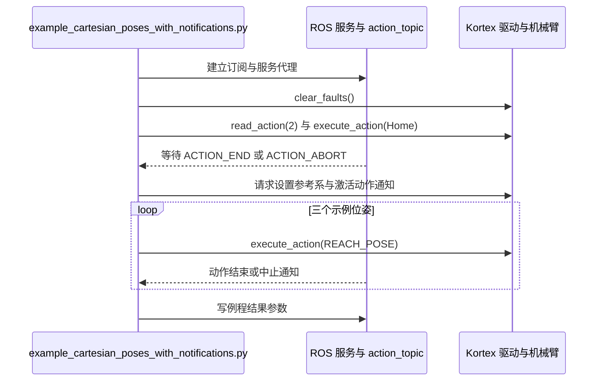

# Kinova Gen3

## 一句话定义

**Kinova Gen3** 是 **Kinova** 公司的 **轻型协作机械臂系列**：面向 **医疗、服务与科研**；产品介绍在 **[Gen3 产品页](https://www.kinovarobotics.com/product/gen3-robots)**，开源 SDK / ROS 接口等在 GitHub 组织 **[Kinovarobotics](https://github.com/Kinovarobotics)**。具体自由度与末端配置须核对型号，不能把 Gen3 与 Gen3 lite 混成单一六轴描述。

## 英文缩写速查

| 缩写 | 英文全称 | 简要说明 |
|------|----------|----------|
| SDK | Software Development Kit | 软件开发工具包 |
| ROS 2 | Robot Operating System 2 | 机器人系统集成与通信的常用中间件 |
| Manipulation | Robot Manipulation | 抓取、移动、操作物体的任务总称 |

## 为什么重要

- **协作安全与力控**：作为 **实验室常见工业臂对照组**，与 **Franka**、**UR** 等并列出现在仿真与真机管线讨论中。
- **ROS 生态成熟**：组织内多仓拆分 **驱动 / 示例 / Gen3 专用接口**，集成前需核对 **ROS1 vs ROS2** 支持矩阵。

## 开源入口（策展摘录）

| 类型 | 链接 |
|------|------|
| 产品页 | [kinovarobotics.com/product/gen3-robots](https://www.kinovarobotics.com/product/gen3-robots) |
| GitHub 组织 | [github.com/Kinovarobotics](https://github.com/Kinovarobotics) |

## 本体、夹爪与 ROS 分支

[官方 `ros_kortex` 文档复核](../../sources/repos/open-robot-hardware-entry-review-2026-11-15.md)区分 `gen3` / `gen3_lite` 与对应夹爪 xacro。所读 `noetic-devel` 是 ROS1 分支；应选与 ROS 发行版、本体及夹爪匹配的配置，不能由该分支的 Gazebo/MoveIt 示例推断 ROS2 或实机控制器均已支持。

## 核心原理

`kortex_driver` 把 ROS 服务与速度命令转成 Kortex API 调用，再将本体状态发布为反馈话题。Gen3 默认 **7 自由度**，也有显式 6 自由度配置；Gen3 lite 的默认值与夹爪不同。所读 Noetic 分支的高层命令按 **25 ms/40 Hz** 处理，不能据此声称提供千赫兹力矩回路。

## 源码运行时序图

## 工程实践

固定 ROS 发行版、本体、自由度、vision 与夹爪参数，再核对 `robot_name` 命名空间、网络连接和状态回读。通知话题需要激活服务，单有订阅不能保证会收到事件。使用动作结束/中止判据，不把服务返回当作轨迹已完成；MoveIt、RViz 与实际控制路径分别验证。

## 局限与风险

- `ros_kortex/noetic-devel` 是 ROS1 代码；其安装结果不能证明 ROS2 或其他发行版兼容。
- 所读例程在显式激活通知之前等待 Home 通知，且参考系函数构造请求后未传给服务代理；接入前应核对这两处行为，不能把示例视为本次已跑通。
- ROS/API 开源不代表本体加工图和全部固件开源；协作臂也需按工具、负载与工位评估实际工作边界。

## 关联页面

- [Manipulation](../tasks/manipulation.md)
- [ROS 2 基础](../concepts/ros2-basics.md)
- [机器人开源宝库（微信策展第02期）索引](../overview/robot-open-source-wechat-issue02-curator.md)

- [机器人操作系统与末端执行器](../methods/robotic-manipulation-systems.md)：了解机械臂、末端与控制接口。

## 推荐继续阅读

- Kinova 官方文档门户（以产品页导航为准）

## 参考来源

- [官方技术文档与运行入口通读](../../sources/repos/kinova-gen3-driver-reading-2026-11-15.md)。

- [官方硬件文档与入口复核](../../sources/repos/open-robot-hardware-entry-review-2026-11-15.md)

- [wechat_jixie_robot_open_source_treasury_issue02_10_robots.md](../../sources/blogs/wechat_jixie_robot_open_source_treasury_issue02_10_robots.md)
