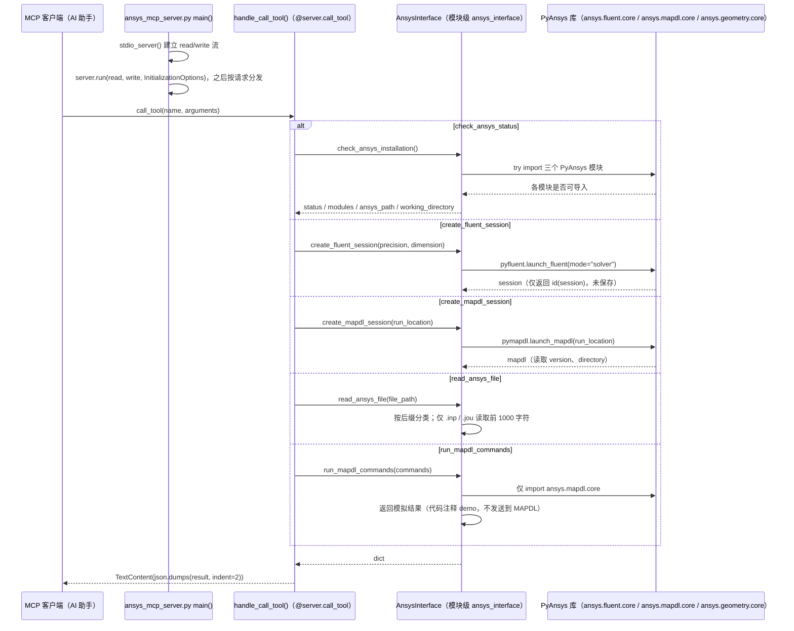

# Ansys MCP Server（多产品版）（knewnothing-git/ansys-mcp-server）

## 一句话定义

Ansys MCP Server（多产品版）（knewnothing-git/ansys-mcp-server）是与 vorobjewsen30-max 的同名项目是不同仓库。

## 英文缩写速查

| 缩写 | 英文全称 | 简要说明 |
|------|----------|----------|
| MCP | Model Context Protocol | 代理与工程软件工具的交互协议 |
| CAE | Computer-Aided Engineering | 计算机辅助工程软件与分析 |
| API | Application Programming Interface | 软件可供自动化调用的接口 |

## 为什么重要

对 CAE 自动化而言，代理能否稳定完成任务，取决于工程步骤是否清楚、工具边界是否明确、结果是否保留可审查证据。与 vorobjewsen30-max 的同名项目是不同仓库；文章称该版本产品面更宽，因此以仓库身份单独成节点，不把两者混为一谈。

## 核心原理

**项目自身范围：** MCP server interfacing with various Ansys products.

**工作流：** MCP 客户端把请求路由到可用 Ansys 产品接口；具体支持软件与工具表应以本仓库 README 为准。

## 工程实践

1. 从目标问题识别所需的 Skill、MCP、CLI 或软件接口，不把指导文件当成求解器。
2. 依照仓库 README 检查安装前提、软件/许可证、输入文件和输出证据。
3. 小规模运行并逐项核对几何、网格、边界、求解状态和物理量，再决定是否扩大任务。

文章所述的项目特征：与 vorobjewsen30-max 的同名项目是不同仓库；文章称该版本产品面更宽，因此以仓库身份单独成节点，不把两者混为一谈。

## 局限与风险

同名不代表同项目或同一代码基线；需单独核对产品覆盖、依赖、许可和工具安全。

源码状态核验：该 GitHub 仓库于 2026-10-07 可公开访问。仓库 API 报告许可证为 MIT。 涉及商业软件时，安装包和有效许可证需由使用者自行提供。

## 源码运行时序图

入口：`python ansys_mcp_server.py`（文件末尾 `asyncio.run(main())`）；README 中的 `ansys-mcp-server` 命令对应 `pyproject.toml` / `setup.py` 的 `ansys_mcp_server:main`，但该 `main` 为 `async` 函数，见下方说明。

图依据：knewnothing-git/ansys-mcp-server@2dd3b9a，读过 `ansys_mcp_server.py`（全文）、`README.md`（前 120 行）、`pyproject.toml` 与 `setup.py`（入口相关行）；时序图依据以上文件，未运行代码。

说明：`run_mapdl_commands` 为模拟实现（源码注释 "For demo purposes"），`create_*_session` 未保存返回的会话对象。`ansys_interface = AnsysInterface()` 在模块导入时即在当前目录创建 `ansys_work/`。

## 关联页面

- [CAE / CFD 代理工具项目总览](../overview/cae-cfd-agent-skills-landscape.md)
- [Ansys MCP Server（PyAnsys）](./vorobjewsen30-max-ansys-mcp-server.md)

## 参考来源

- [公众号文章原始资料归档](../../sources/blogs/wechat_cae_cfd_agent_skills_2026-10-07.md)
- [GitHub 仓库资料归档](../../sources/repos/knewnothing-git-ansys-mcp-server.md)
- [knewnothing-git/ansys-mcp-server 官方仓库](<https://github.com/knewnothing-git/ansys-mcp-server>)
- 源码核对（2026-11-02）：knewnothing-git/ansys-mcp-server@2dd3b9a，读过 ansys_mcp_server.py、README.md（前 120 行）、pyproject.toml、setup.py；时序图依据以上文件，未运行代码。

## 推荐继续阅读

- [项目 README](<https://github.com/knewnothing-git/ansys-mcp-server/blob/main/README.md>)