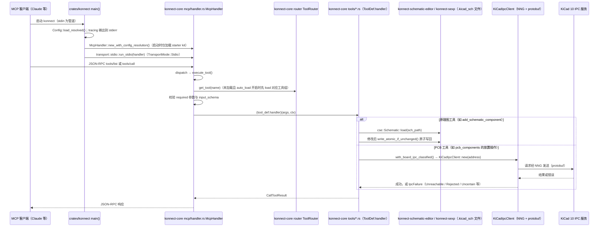

# Konnect（KiCad 的 AI/MCP 设计插件）

**Konnect** 是面向 KiCad 10 的开源原生插件及 MCP 服务端：AI 助手可通过 MCP 调用原理图编辑、PCB 布局与布线、设计检查及制造导出能力。它位于机器人硬件设计流程的 EDA 环节，与 [KiCad](./kicad.md) 配合完成驱动、电源、传感器和计算板卡的设计迭代。

## 英文缩写速查

| 缩写 | 英文全称 | 简要说明 |
|------|----------|----------|
| EDA | Electronic Design Automation | 原理图与 PCB 设计工具类别 |
| PCB | Printed Circuit Board | 印刷电路板 |
| MCP | Model Context Protocol | AI 客户端调用外部工具的协议 |
| IPC | Inter-Process Communication | Konnect 与 KiCad PCB 编辑器的通信接口 |
| ERC | Electrical Rules Check | 原理图电气规则检查 |
| DRC | Design Rules Check | PCB 设计规则检查 |

## 为什么重要

机器人驱动器、BMS、控制器和传感器接口最终都需要板级设计。Konnect 将 KiCad 工程操作暴露为 MCP 工具，可把自然语言需求接到可编辑的原理图、PCB 工程与制造输出，减少手工操作步骤。它补充 [KiCad](./kicad.md) 本体，侧重 AI 客户端集成；与 [HeyPCB](./heypcb.md) 的托管式设计服务、[tscircuit](./tscircuit.md) 的代码化电路描述形成不同工作方式。

## 核心机制

- **原理图路径：** 直接编辑 `.kicad_sch` S-expression 文件，README 描述了原子写入、UUID 保留和往返测试。
- **PCB 路径：** 通过 KiCad 10 IPC API 与 PCB Editor 通信，支持实时修改；部分操作可在没有活动编辑器时安全回退到文件模式。
- **工具发现：** MCP 服务按需加载工具组，避免每次把完整工具目录都放进模型上下文。
- **验证与交付：** 调用 `kicad-cli` 执行 ERC/DRC、导出 Gerber、BOM、贴装坐标等资料；具体能力取决于 KiCad 版本和是否打开目标板卡。

## 工程实践

1. 在 KiCad 10 中安装插件包或按仓库说明从源码构建，并在实际使用的 MCP 客户端中配置 Konnect。
2. 先让助手读取工程状态，再执行小范围修改；设计改动后运行 ERC/DRC 并审阅差异。
3. 将器件型号、引脚映射、保护电路、功率与热设计、板层和制造规则交由硬件工程师复核。
4. 对驱动板、电池与安全相关电路，完成实物上电、测量和验证后再进入机器人系统集成。

## 局限与风险

- **开源状态：已开源，许可证为 AGPL-3.0。** 仓库 README 将项目标为 Beta；企业使用或网络服务分发需先评估 AGPL 义务，项目方另提供商业许可。
- 当前定位是 KiCad 10 插件；安装与功能兼容性应按目标操作系统、KiCad 版本和发布包逐项确认。
- ERC/DRC 只能检查规则所覆盖的问题，不能证明板卡设计安全、稳定或可量产；AI 生成和修改的内容需独立审查与实测。
- README 所述功能和性能是项目方资料，尚未在本知识库中独立进行硬件验证。

## 源码运行时序图

入口：`konnect`（`crates/konnect/src/main.rs`）。stdin 为管道时启动 MCP 服务（默认 stdio，可配置 HTTP）；在终端中直接运行则进入安装向导。

图依据：mixelpixx/Konnect@676efce，读过 `crates/konnect/src/main.rs`（入口与 transport 分支）、`crates/konnect-core/src/mcp/handler.rs`（`handle_message`、`tools/call` 与 `execute_tool` 段）、`crates/konnect-core/src/router/registry.rs`（工具计数）、`crates/konnect-core/src/tools/sch_components.rs`（`handle_add_schematic_component` 段）、`crates/konnect-core/src/tools/pcb_components.rs`（`ipc!` 宏段）、`crates/konnect-core/src/tools/mod.rs`（`with_board_ipc_classified` 段）；`router/mod.rs` 仅读取 `ToolRouter` 相关函数。未运行代码。

说明：仓库 README 顶部声明本仓库将归档为只读，开发转至 Konnect-EDA；图描述的是本仓库当前源码。

## 关联页面

- [KiCad（开源 PCB 与原理图 EDA）](./kicad.md) — Konnect 操作的 EDA 工程与桌面环境
- [HeyPCB（AI PCB 设计）](./heypcb.md) — 自然语言到 KiCad 工程的托管式服务
- [tscircuit](./tscircuit.md) — 以代码描述电路并生成 PCB 设计文件
- [执行器驱动链选型闭环知识链](../queries/actuator-drive-chain-selection-loop.md) — 本页处于驱动链 **①层 EDA 电路设计**（AI/MCP 辅助编辑 KiCad 工程，输出仍需 ERC/DRC 与实测复核）

## 参考来源

- [Konnect 仓库归档](../../sources/repos/konnect.md)
- [Konnect 官方 GitHub 仓库](https://github.com/mixelpixx/Konnect)
- 源码核对（2026-11-02）：mixelpixx/Konnect@676efce，读过 crates/konnect/src/main.rs、crates/konnect-core/src/mcp/handler.rs、crates/konnect-core/src/router/mod.rs、crates/konnect-core/src/router/registry.rs、crates/konnect-core/src/tools/sch_components.rs、crates/konnect-core/src/tools/pcb_components.rs、crates/konnect-core/src/tools/mod.rs、README.md（前 150 行）；时序图依据以上文件，未运行代码。

## 推荐继续阅读

- [Konnect 官方 README](https://github.com/mixelpixx/Konnect#readme)
- [Konnect 官方文档目录](https://github.com/mixelpixx/Konnect/tree/main/docs)
- [KiCad 10 简体中文文档](https://docs.kicad.org/10.0/zh/)
