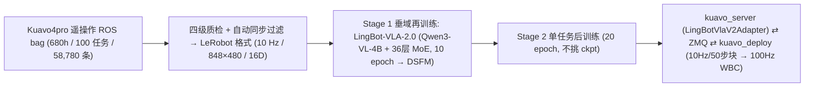
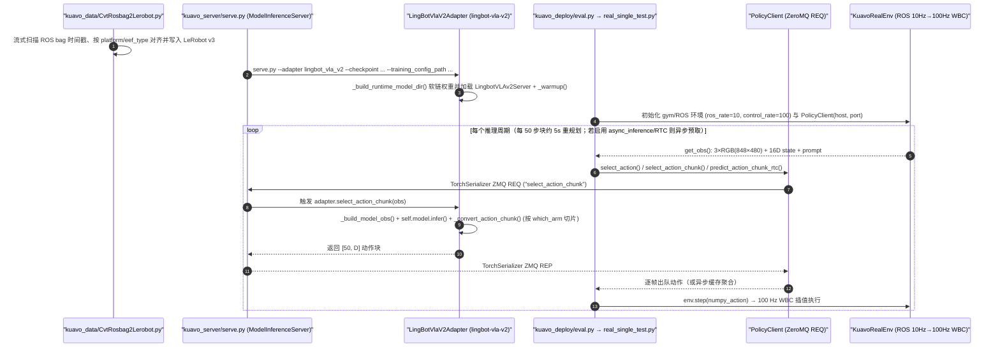

# KUAVO-VLA-1.0

## 一句话定义

**KUAVO-VLA-1.0** 是乐聚智能（Leju Robotics / Lejoin Intelligence）基于 **LingBot-VLA-2.0** 骨干，在 Kuavo4pro 双臂人形机器人自采的 **100 项工业操作任务、680 小时真机遥操作语料**上经两阶段适配得到的**工业垂域视觉-语言-动作基础模型（DSFM）**。

## 英文缩写速查

| 缩写 | 英文全称 | 简要说明 |
|------|----------|----------|
| DSFM | Domain-Specialized Foundation Model | 垂域基础模型：收窄至单一本体与单一场景，以换取域内多任务成功率 |
| VLA | Vision-Language-Action | 将视觉、语言指令与本体状态映射到机器人动作块的策略模型 |
| MoE | Mixture-of-Experts | LingBot-VLA-2.0 动作头采用的混合专家结构（36 层、每层 32 路由专家 top-4） |
| SR / PS | Success Rate / Progress Score | 端到端全流程成功率 / 分阶段打分的任务过程完成度均值 |
| WBC | Whole-Body Control | 全身控制插值层（推理端 10 Hz 输出插值到 100 Hz 机器人控制频率） |
| HF / OpenLET | Hugging Face / OpenLET | 分发 `LET-KUAVO-VLA-1.0-models` 与 `LET-KUAVO-VLA-1.0-Dataset` 的审核制托管平台 |

## 为什么重要

现有通用 VLA 往往同时追求「跨本体、跨场景、跨任务」三重广度，而在产线工业场景中，部署方真正稀缺的是窄公差装配、长程多阶段协同与可重复的端到端完成率。KUAVO-VLA-1.0 在机器人控制里显式验证了语言模型领域常用的**中间适配层（DSFM）**：放弃跨本体与跨居家域广度、锁定 Kuavo 双臂工业场景先做 680 小时垂域再训练，再对目标任务做 20 epoch 轻量后训练，直接用同一骨干（LingBot-VLA-2.0）作对照，定量检验「经由 DSFM 路由」相比「从通用骨干直接微调」在真机上的边际收益。

## 流程总览（架构、两阶段训练与真机评测）

KUAVO-VLA-1.0 不提出新骨干，而是将工业落地拆解为「数据质检转换 → Stage 1 垂域再训练 → Stage 2 单任务后训练 → ZMQ 异步客户端推理部署」四段链路：

| 维度 | 核心设计（摘自 `kuavo-vla.pdf` 与官网） |
|------|----------------------------------------|
| **骨干模型** | `LingBot-VLA-2.0`（约 **6B** 参数）：`Qwen3-VL-4B-Instruct` 视觉-语言理解骨干 + token 级 MoE 动作专家（36 MoE 层，每层 32 个路由专家取 top-4 + 1 个共享专家），10 步 flow matching 去噪输出 `50` 步动作块；输入图像缩至 `256×256`（patch 16、`2×2` merge），语言指令截断至 72 token |
| **传感与状态/动作** | 1 路头部 + 2 路手腕 RGB（`848×480`、10 Hz、AV1 编码）；`16D` 交错向量 `[q1..7^L, g^L, q1..7^R, g^R]`，在骨干侧零填充至固定 `55D` 槽位以通过 `which_arm` 与 `eef_type`（`leju_claw` / `qiangnao`）切换单双臂与末端，且与 Kuavo 5 / 5W 接口兼容（本报告全量数据与评测均在 Kuavo4pro 完成） |
| **语料规模** | **100** 个工业任务（抓放 38、分拣 21、装配插接 16、包装 15、工具 10），**58,780** 条示教、**24,471,172** 帧（约 24.5M）、**680 小时**；四级人工链（采集 → 标注 → 复核 → 验收，复核强约束无碰撞、物体在腕/头视角无遮挡、初始位置/轨迹/光照覆盖度）+ 自动过滤掉帧与时序异常 |
| **真机基准（25 任务）** | 20 项产线任务（已在 Stage 1 语料内）+ 5 项公开 **GM100** 域内未见任务（仅 Stage 2 适配，每任务 130 条 / 平均 2.0h）；统一在 `N=15` 次真机 rollout（最长 3 分钟，3 次连续子任务失败或碰撞终止）下对比 `π0.5`、`GR00T N1.7-3B` 与 `LingBot-VLA-2.0` |

### 25 任务真机基准汇总（Table 3 / Table 5，全部在 20 epoch 后训练预算下）

| 方法 | 20 工业已见 SR / PS (%) | 5 GM100 未见 SR / PS (%) | 全 25 任务 SR / PS (%) | 显著差异与结构性短板 |
|------|--------------------------|---------------------------|-------------------------|----------------------|
| **KUAVO-VLA-1.0** | **49.7 / 74.1** | **42.7 / 76.2** | **48.3 / 74.5** | 全 25 项 PS 均列第一（相对骨干中位差 `+31.7` pt）；装配/插接仅 **6.7 / 52.8** |
| **LingBot-VLA-2.0**（同源骨干） | 14.0 / 40.1 | 25.3 / 49.7 | 16.3 / 42.1 | 14/25 项 SR 为 0%；证明工业组 `3.5×` SR 增益来自 Stage 1（总体 Wilcoxon `p=2.2e-4`） |
| **π0.5** | 12.3 / 32.9 | 14.7 / 28.8 | 12.8 / 32.1 | 15/25 项 SR 为 0%；分拣/装配/包装全组 SR 0.0% |
| **GR00T N1.7 (3B)** | 8.3 / 22.5 | 0.0 / 16.2 | 6.7 / 21.2 | 20/25 项 SR 为 0%（注意其参数量为 3B，与 6B 模型容量未对齐） |

## 工程实践

- **Stage 1 & Stage 2 超参数（Table 6）：** Stage 1 在 `32 × NVIDIA H100`（FSDP2、开启 gradient checkpointing 与 `torch.compile`）上跑 10 epoch（238,970 步，每卡微批 32、全局批 1024），使用 **Muon** 优化器（momentum 0.95、Nesterov、5 步 Newton-Schulz）与恒定学习率 `5e-5`（无 warmup、weight decay 0）；**不冻结视觉编码器**但把其 LR 降为 `1e-6`（低 50 倍）以防止遗忘通用表征，保留深度与未来帧辅助损失（权重各 `0.004`）。Stage 2 继承全套配置，改用单任务数据跑 20 epoch；因作者实测离线 action MSE 最低点与真机闭环最优不一致，两阶段均**不做验证挑选**，直接取末轮 checkpoint。
- **推理运行时切分（Sec. 6 & `LeTools-Learning`）：** `LeTools-Learning` 将**模型侧**（`kuavo_server/serve.py` / `launch.py` + `LingBotVlaV2Adapter` 在 RTX 4090 `bf16` 上运行）与**机器人 ROS 侧**（`kuavo_deploy/eval.py` → `real_single_test.py` + `PolicyClient`）通过 ZeroMQ REQ/REP 与 `TorchSerializer` 解耦。模型每次推理输出 50 步动作块、在 `10 Hz` 策略环下开环执行（每 **5 s** 重规划一次），再由下层插值至 **100 Hz** WBC 控制频率；`which_arm`、`eef_type` 与单双臂切片均封装在 adapter 侧。
- **仓内与平台分发边界：**
  - `LeTools-Learning`（GPL-3.0）公开了完整数据转换、训练启动器（注：`kuavo_model/train.py` 内置支持 10 个 LeRobot 模型，KUAVO-VLA-1.0 / LingBot-VLA-v2 依托 `kuavo_model/external_models/lingbot-vla-v2` 与 `kuavo_server/adapters/lingbot_vla_v2.py` 接入）。
  - HF 模型卡 `LejuRobotics/LET-KUAVO-VLA-1.0-models`（约 `12.76 GB`，含 3 个 `.safetensors` 分片、`LET-KUAVO-VLA-1.0.json`/`.yaml`）与数据集 `LET-KUAVO-VLA-1.0-Dataset`（约 `1.39 TB`、9,650 个文件、元数据标 `apache-2.0`，含 `tasks/001..100` LeRobot 分目录）在 HF API 均显示 `gated: "auto"`，下载需登录提交审核，不可视作无门槛直接拉取；代码 GPL-3.0 亦不自动等同于权重商用许可。

## 源码运行时序图

以下时序图依据 `LeTools-Learning`（commit `8647bc58`）实际入口 `kuavo_data/CvtRosbag2Lerobot.py`、`kuavo_server/serve.py` / `runtime.py`、`kuavo_server/adapters/lingbot_vla_v2.py`、`kuavo_deploy/eval.py`、`kuavo_deploy/src/eval/real_single_test.py` 与 `kuavo_deploy/kuavo_service/client.py` 核对绘制：

## 局限与风险

- **工业组存在 1.5× 曝光不对称：** 20 个工业基准任务的 Stage 2 示教即来自 Stage 1 的 135.9h 数据子集，因此 KUAVO-VLA-1.0 对其共训练 30 epoch（10+20），基线仅 20 epoch；更干净的 5 个 GM100 未见任务上，虽全部 5 项 PS 均高于骨干，但 `n=5` SR 的 Wilcoxon 检验为 `p=0.63`（主要靠 BM-45 零食分拣拉开差距），不足以独立坐实未见任务的 SR 跃升。
- **未达到产线无人值守门槛与五类细粒度失效：** 全基准均值 SR 为 48.3%，装配/插接仅 6.7%（Task 16 圆柱装配全方法 0.0% SR）。报告归纳了 5 类典型失效：**终态视觉歧义**（BM-107 扫码前后 RGB 几乎不变导致重复或早停）、**重复动作时间混叠**（BM-96 捏尖叫鸡 `65.6% PS / 0.0% SR`）、**细微几何完成条件被遮挡**（Task 12 压锤封箱）、**接触与对准公差不足**（Task 16）、**双臂交接同步失误**。
- **50 步开环 chunk 与未知遗忘代价：** 每 5 秒才重规划一次，chunk 中段对工件滑动等扰动响应滞后（仓内 v2.1 新加 RTC 仍在推进）；且技术报告**未评测**垂域再训练后原有通用开放域能力的遗忘幅度。
- **宣传口径差异：** 早期外部发布截图曾称「算力与数据成本下降 50%+、周期数周缩至数天」，但官方项目页与 24 页技术报告正文**均未报告**该数字或对照实验，工程规划不应直接采信。
- **平台绑定与审核制门槛：** 全部真机数采与评测限定在 Kuavo4pro，未在 Kuavo 5/5W 实测；HF/OpenLET 权重与数据均为审核访问，复现完整 Stage 1 需 `32×H100`。

## 结论

**KUAVO-VLA-1.0 用同源骨干对照证明：先在目标本体与工业场景上做大规模（680h）垂域再训练构建 DSFM、再做轻量单任务微调，能把 20 项产线任务平均成功率从通用骨干直接微调的 14.0% 显著提升至 49.7%（总体 48.3% SR / 74.5% PS），但当前仍受限于装配公差、开环 chunk 响应与审核制权重分发。**

- **工业落地先判任务类型：** 抓放与部分分拣已接近可用（62.0% / 40.0% SR），但窄公差装配/插接（6.7% SR）和重复计数任务（BM-96 0.0% SR）仍需力觉/闭环终止判据或更高频控制（如 RTC）。
- **微调策略勿用离线 MSE 挑 ckpt：** 报告在两阶段中实测离线 action MSE 与真机成功率不单调一致，固定预算训练并结合真机闭环验证更稳妥。
- **部署直接复用 `LeTools-Learning` ZMQ 分层：** 机器人 ROS 控制端保持 `policy_type: client` 不变，通过 `kuavo_server/serve.py --adapter lingbot_vla_v2` 切换模型与 `which_arm`/`eef_type`。
- **评估资源获取成本：** 复现前须先通过 HF（`gated: "auto"`）或 OpenLET 审核获取 `LET-KUAVO-VLA-1.0-models`（12.76 GB）与分批发布的 `1.39 TB` 数据，并核对权重真实许可条款。

## 关联页面

- [LeTools](./letools.md) — 乐聚的训练与技能软件层（含 `LeTools-Learning` 实码分析）
- [LingBot-VLA](./lingbot-vla.md) — KUAVO-VLA-1.0 所基于的骨干模型谱系
- [乐聚机器人](./leju-robotics.md) — Kuavo 本体硬件与开发方
- [OpenLET](./openlet.md) — Kuavo 真机数据与模型审核分发平台
- [LET-Base-Dataset](./let-base-dataset.md) — 早期公开的 Kuavo 真机操作数据集
- [VLA](../methods/vla.md) — 视觉-语言-动作基础模型范式
- [Imitation Learning](../methods/imitation-learning.md) — 遥操作示教行为克隆基石
- [Manipulation](../tasks/manipulation.md) — 工业与桌面双臂操作任务族
- [unitree_lerobot](./unitree-lerobot.md) — 人形厂商 LeRobot 工具链横向对照

## 参考来源

- [KUAVO-VLA-1.0 官方项目页、技术报告与资源卡归档](../../sources/sites/kuavo-vla-1.md) — 基于 `model.lejurobot.com/kuavo-vla-1/`、`kuavo-vla.pdf` 与 HF Hub API 核对
- [LeTools-Learning 仓库归档](../../sources/repos/letools-learning.md) — 核对 `kuavo_data/`、`kuavo_model/`、`kuavo_server/`、`kuavo_deploy/` 实码入口（commit `8647bc58`）
- [官方技术报告 PDF（kuavo-vla.pdf，24 页）](https://model.lejurobot.com/kuavo-vla-1/kuavo-vla.pdf)
- [KUAVO-VLA-1.0 官方项目页](https://model.lejurobot.com/kuavo-vla-1/)
- [Hugging Face 模型卡（LET-KUAVO-VLA-1.0-models）](https://huggingface.co/LejuRobotics/LET-KUAVO-VLA-1.0-models) 与 [数据集卡（LET-KUAVO-VLA-1.0-Dataset）](https://huggingface.co/datasets/LejuRobotics/LET-KUAVO-VLA-1.0-Dataset)

## 推荐继续阅读

- [VLA 纵深路线](../../roadmap/depth-vla.md)
- [具身数据纵深路线](../../roadmap/depth-embodied-data.md)
- [LeTools-Learning GitHub 仓库](https://github.com/LejuRobotics/LeTools-Learning)
- [OpenLET KUAVO-VLA-1.0 资源页](https://openlet.openatom.tech/tools/KUAVO-VLA-1.0)
