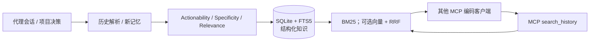
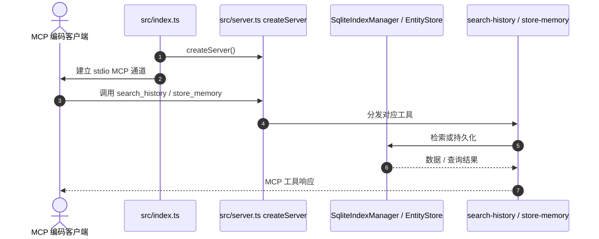

# Strata MCP：跨编码代理的质量门控持久记忆

官方开源仓库：[kytheros/strata](https://github.com/kytheros/strata)，npm 包 `strata-mcp`。它通过 MCP 将编码助手的跨会话知识分发给下一次任务。

## 一句话定义

让 Claude Code、Codex、Gemini CLI 等编码 Agent 通过共享 MCP 接口检索经过质量过滤的持久技术经验。
## 英文缩写速查

| 缩写 | 英文全称 | 简要说明 |
|---|---|---|
| MCP | Model Context Protocol | 跨工具通用的记忆接口 |
| FTS5 | Full-Text Search 5 | SQLite 全文索引 |
| BM25 | Best Matching 25 | 关键词检索排名算法 |
| RRF | Reciprocal Rank Fusion | 将语义与关键词检索结果融合 |

## 为什么重要

编码代理每次新会话都要重新找出曾经修好的错误和团队约定，跨 Claude/Codex/Gemini 使用时问题更明显。该项目把“保留哪些技术事实”“如何跨客户端取回”拆成统一记忆服务器，而非依赖单个聊天窗口的临时上下文。

## 核心结构

- **接入**：`strata init` 配置本地客户端，MCP stdio 服务提供 `search_history`、`store_memory` 等工具。
- **写入**：按可操作性、具体性与相关性筛选，再去重、归档为结构化记录。
- **检索**：离线使用 SQLite FTS5/BM25；配置嵌入能力后加入向量与 RRF 排序。
- **部署**：本地 SQLite 与 Cloudflare D1 是已实现路线；AWS/GCP 多租户部分主要是参考模板。

## 流程总览

## 源码运行时序图

已核对入口 `src/index.ts` 与 `src/server.ts`：

实际启动路径为 `npm install -g strata-mcp` → `strata init` → 在兼容 CLI 中触发 MCP 工具。图表示官方入口的模块关系，未在此执行端到端部署。

## 工程实践

- 先在本地以 `npm install -g strata-mcp`、`strata init` 建立 MCP 连接；通过 `store_memory` 写入有明确版本、错误码或复现步骤的技术决策，再用 `search_history` 交叉会话检索。
- 离线环境先测试 SQLite FTS5/BM25 路径，打开可选向量检索前应另外验证模型调用与数据外传边界。
- 复用记忆中的修复建议之后仍应运行编译、单测或集成测试；检索相关性和修复成功率是不同指标。

## 评测与局限

README **自报** LongMemEval-S 500 题、BM25/FTS5 检索前 20 条证据命中率 94.9%；另一个依赖 Gemini 2.5 Flash 回答和 GPT-4o 评判的端到端任务平均分约 79.4%。两项指标不同，不能混用或视为本次复测。项目标明 Beta。自建多租户场景须验证调用者身份，不能仅依赖自报用户 header。

## 关联页面

- [Coding Agent 验证闭环](../methods/coding-agent-verification-loops.md) — 检索到旧修复后，仍需通过独立验证再采纳。
- [Claude Code 动态工作流](../methods/claude-code-dynamic-workflows.md) — 对照外部持久记忆与任务执行时的多代理工作流编排。
- [STRATA 经验图论文](paper-strata-experience-graphs.md) — 学术结构化记忆机制。
- [Jeremy Strata 文件分层](jeremykamber-strata-tiered-memory.md) — 用冷热迁移控制记忆生命周期。
- [Agent 记忆与 dreaming](../concepts/agent-memory-and-dreaming.md) — 统一比较写入、检索、整理。

## 参考来源

- [GitHub README 与源代码核对归档](../../sources/repos/kytheros-strata-mcp.md)

## 推荐继续阅读

- [官方源码](https://github.com/kytheros/strata) · [MCP 官方规范](https://modelcontextprotocol.io/)。
