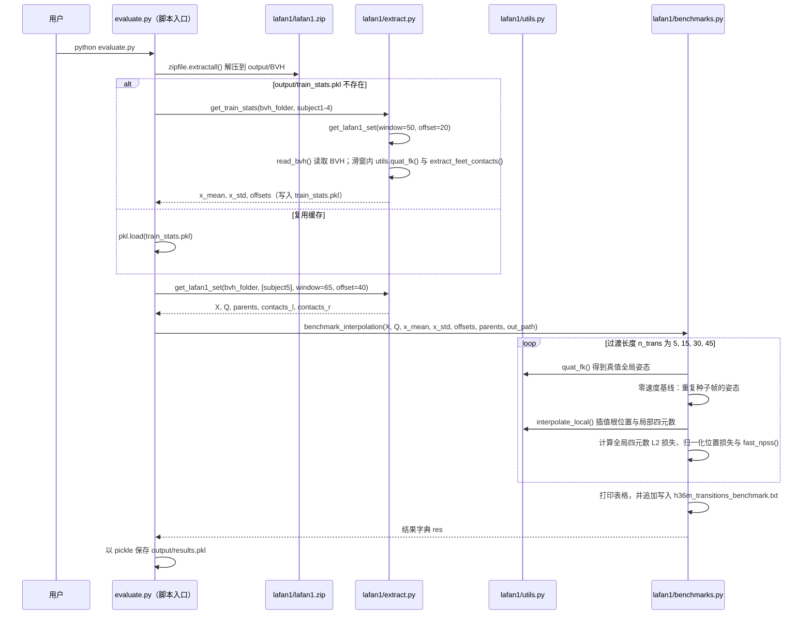

---

type: entity
title: LaFAN1（Ubisoft La Forge 动捕数据集）
tags: [dataset, mocap, bvh, locomotion, animation, ubisoft, siggraph-2020, sfu]
summary: "LaFAN1 是 Ubisoft La Forge 在 GitHub 发布的 BVH 动捕数据集（SIGGRAPH 2020 论文配套），覆盖行走、舞蹈、跌倒恢复等多主题；许可为 CC BY-NC-ND 4.0，工程上常被用作全身跟踪与重定向研究的基准动作源。"
updated: 2026-10-23
related:
  - ../concepts/motion-retargeting.md
  - ./wbc-fsm.md
  - ../tasks/locomotion.md
  - ../tasks/balance-recovery.md
  - ../methods/motion-retargeting-gmr.md
  - ../methods/amp-reward.md
  - ./paper-unified-walk-run-recovery-sdamp.md
  - ./amass.md
  - ./omomo-dataset.md
  - ../comparisons/humanoid-reference-motion-datasets.md
sources:
  - ../../sources/repos/ubisoft-laforge-animation-dataset.md
  - ../../sources/papers/unified_walk_run_recovery_sdamp_arxiv_2605_18611.md
  - ../../sources/papers/robust_motion_inbetweening_acm_tog_2020.md
---

# LaFAN1（Ubisoft La Forge Animation Dataset）

**LaFAN1** 指 Ubisoft 在仓库 [`ubisoft/ubisoft-laforge-animation-dataset`](https://github.com/ubisoft/ubisoft-laforge-animation-dataset) 中发布的 **La Forge 动捕动画数据集**：序列以 **BVH** 存储，README 给出 **5 名被试、77 条序列、约 49.6 万帧 @30Hz（约 4.6 小时）** 等统计，并配套 **Python 评估脚本** 与若干插值基线。

## 英文缩写速查

| 缩写 | 英文全称 | 简要说明 |
|------|----------|----------|
| ONNX | Open Neural Network Exchange | 跨框架神经网络模型交换格式 |
| AMP | Adversarial Motion Prior | 用对抗判别约束状态转移接近专家运动分布的先验 |
| G1 | Unitree G1 Humanoid | 宇树入门级教育科研人形平台 |
| Retargeting | Motion Retargeting | 将人体/动物动作映射到目标机器人骨架 |
| MoCap | Motion Capture | 动作捕捉，参考动作与演示数据的主要来源 |
| RL | Reinforcement Learning | 通过与环境交互最大化长期回报来学习策略的范式 |
| GMR | General Motion Retargeting | 把人体/视频动作重定向为机器人可执行参考 |
| AMASS | Archive of Motion Capture as Surface Shapes | 大规模统一人体动捕数据集 |
| SMPL | Skinned Multi-Person Linear Model | 常见人体参数化模型与重定向源 |
| Locomotion | Robot Locomotion | 足式/人形等无轮移动能力的总称 |

## 为什么重要？

- **动作语义覆盖**：除平地行走外，包含 **障碍地形、跌倒起身、爬行、瞄准移动** 等，对 **recovery / 多接触** 研究比单一行走库更有信息量。
- **社区可复现基准**：README 定义 **L2Q / L2P / NPSS** 等指标与 `evaluate_test.py` 期望区间，便于论文对比。
- **与部署案例衔接**：例如 **[wbc_fsm](./wbc-fsm.md)** 公开链路中采用 LAFAN1 子集经重定向训练 ONNX 跟踪策略，读者可把「数据形态」与「上机策略」对照阅读。
- **极简参考统一走/跑/起身**：[SD-AMP（arXiv:2605.18611）](./paper-unified-walk-run-recovery-sdamp.md) 仅用 **三条 LAFAN1 retarget 片段** 训练 **单一 G1 策略**，部署 **无运行时 FSM**。

## 配套论文：Robust Motion In-Betweening

Harvey、Yurick、Nowrouzezahrai 与 Pal 的论文发表于 ACM TOG 39(4), 2020（[DOI](https://doi.org/10.1145/3386569.3392480)）。论文将动作关键帧间的过渡生成作为研究问题，并在 Human3.6M 与新引入的 LaFAN1 数据上评测。LaFAN1 因而既是动作过渡基准，也是后续全身跟踪和重定向工作常用的数据源。

**复现边界：** Ubisoft 官方仓库公开 BVH 动作、评估脚本与插值基线；这不等于论文学习模型的完整训练实现也已发布。大文件需 Git LFS，数据采用 CC BY-NC-ND 4.0。

## 许可与合规（工程必读）

- 仓库声明采用 **CC BY-NC-ND 4.0**（见 `license.txt`）：**非商业**且对**衍生作品**限制严格。
- 若目标包含 **商业产品**、**再分发清洗后的子集**或与训练权重一并发布，必须在法务流程中单独评估；本页不构成法律意见。

## 工程要点

- **Git LFS**：大 zip 通过 LFS 存储；未安装 LFS 时克隆可能导致 zip 损坏与 `BadZipfile`（README 明确提示）。
- **文件命名**：`[theme][take]_[subjectID].bvh`；同主题同 take 号表示同期棚内录制，可做多被试对齐分析。

## 常见误区或局限

- **「BVH 可直接驱动任意人形」**：骨骼比例、根坐标与世界缩放仍须与 **[Motion Retargeting](../concepts/motion-retargeting.md)** 管线一致处理。
- **许可≠开源权重**：在 GitHub 上训练得到的模型权重是否可随项目分发，取决于你的训练数据使用场景与上层许可，不等同于「代码 MIT 即可商用」。

## 与其他页面的关系

- **[wbc_fsm](./wbc-fsm.md)**：以 LAFAN1 为 MoCap 源的重定向 + RL + ONNX 部署范例。
- **[GMR](../methods/motion-retargeting-gmr.md)**：讨论几何重定向时常与 BVH / 骨架比例问题一并出现。
- **[AMASS](./amass.md)**：另一条「SMPL 统一库」路线；LaFAN1 则是「单一棚拍、原始 BVH」路线，二者在表示与许可上均不同。
- **[OMOMO](./omomo-dataset.md)**：物体交互 MoCap；OmniRetarget 的 `robot-object/` 来自 OMOMO，LAFAN1 子集因许可需用户自行重定向。
- **[五集选型对比](../comparisons/humanoid-reference-motion-datasets.md)**

## 源码运行时序图

入口：`python evaluate.py`（仓库根目录，README「Evaluating baselines」；校验可再运行 `python evaluate_test.py`）。该脚本不是通用训练代码，而是对 Zero-Velocity 与 Interpolation 两个基线的评估流水线。

图依据：ubisoft/ubisoft-laforge-animation-dataset@9408460，读过 `README.md`（数据、代码与评估章节）、`evaluate.py`（全文）、`lafan1/benchmarks.py`（`benchmark_interpolation` 与 `fast_npss`）、`lafan1/extract.py`（`get_lafan1_set`、`get_train_stats` 段）；`lafan1/utils.py` 仅核对函数清单与被调用名。时序图依据以上文件，未运行代码。

说明：`lafan1/extract.py` 的 `get_lafan1_set` 中 `subjects.append(subjects)` 将列表自身追加到自身（未使用），图中未画。

## 参考来源

- [Ubisoft La Forge Animation Dataset 仓库归档](../../sources/repos/ubisoft-laforge-animation-dataset.md)
- [sources/papers/unified_walk_run_recovery_sdamp_arxiv_2605_18611.md](../../sources/papers/unified_walk_run_recovery_sdamp_arxiv_2605_18611.md) — SD-AMP 三条 LAFAN1 clip
- [sources/papers/sprint_arxiv_2605_28549.md](../../sources/papers/sprint_arxiv_2605_28549.md) — SPRINT 五条单周期步态 + GMR 重定向
- [Robust Motion In-Betweening 论文来源归档](../../sources/papers/robust_motion_inbetweening_acm_tog_2020.md) — ACM TOG 39(4), 2020；DOI: 10.1145/3386569.3392480
- GitHub 仓库：<https://github.com/ubisoft/ubisoft-laforge-animation-dataset>
- 源码核对（2026-11-02）：ubisoft/ubisoft-laforge-animation-dataset@9408460，读过 README.md（数据、代码与评估章节）、evaluate.py、lafan1/benchmarks.py、lafan1/extract.py（get_lafan1_set、get_train_stats 段），lafan1/utils.py（仅函数清单）；时序图依据以上文件，未运行代码。

## 关联页面

- [Motion Retargeting](../concepts/motion-retargeting.md)
- [wbc_fsm（G1 部署框架）](./wbc-fsm.md)
- [Locomotion](../tasks/locomotion.md)
- [GMR（通用动作重定向）](../methods/motion-retargeting-gmr.md)
- [SPRINT 竞技冲刺频谱先验](./paper-sprint-humanoid-athletic-sprints.md)
- [AMASS](./amass.md)

## 推荐继续阅读

- [Ubisoft La Forge 论文介绍页归档](../../sources/sites/ubisoft-laforge-robust-motion-inbetweening.md)
- README 中列出的后续使用该数据集的代表性论文（Learned Motion Matching、DReCon 等）
