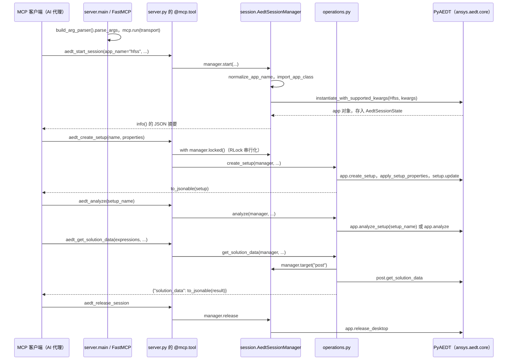

# Ansys AEDT MCP（LaplaceYoung/ansys-aedt-mcp）

## 一句话定义

Ansys AEDT MCP（LaplaceYoung/ansys-aedt-mcp）是通过 PyAEDT/MCP 自动化 Ansys Electronics Desktop，范围包括 HFSS、Maxwell、Q3D、Icepak 和报告/扫描流程。

## 英文缩写速查

| 缩写 | 英文全称 | 简要说明 |
|------|----------|----------|
| MCP | Model Context Protocol | 代理与工程软件工具的交互协议 |
| CAE | Computer-Aided Engineering | 计算机辅助工程软件与分析 |
| API | Application Programming Interface | 软件可供自动化调用的接口 |

## 为什么重要

对 CAE 自动化而言，代理能否稳定完成任务，取决于工程步骤是否清楚、工具边界是否明确、结果是否保留可审查证据。通过 PyAEDT/MCP 自动化 Ansys Electronics Desktop，范围包括 HFSS、Maxwell、Q3D、Icepak 和报告/扫描流程。

## 核心原理

**项目自身范围：** MCP server for Ansys Electronics Desktop automation via PyAEDT.

**工作流：** 代理调用 AEDT 产品专用工具完成电磁、热或电路仿真设置、运行和后处理。

**仓库映射说明：** 文章未给出该项目完整的 owner/repository URL；此处按文章中的项目名/描述与公开 GitHub 仓库匹配。引用时请以本页链接的仓库 README 为准。

## 工程实践

1. 从目标问题识别所需的 Skill、MCP、CLI 或软件接口，不把指导文件当成求解器。
2. 依照仓库 README 检查安装前提、软件/许可证、输入文件和输出证据。
3. 小规模运行并逐项核对几何、网格、边界、求解状态和物理量，再决定是否扩大任务。

文章所述的项目特征：通过 PyAEDT/MCP 自动化 Ansys Electronics Desktop，范围包括 HFSS、Maxwell、Q3D、Icepak 和报告/扫描流程。

## 局限与风险

Ansys Electronics Desktop 与相应产品许可必须由用户提供；不同应用工具的适用边界要按仓库能力表核对。

源码状态核验：该 GitHub 仓库于 2026-10-07 可公开访问。仓库 API 报告许可证为 NOASSERTION。 涉及商业软件时，安装包和有效许可证需由使用者自行提供。

## 源码运行时序图

入口：`uv run ansys-aedt-mcp`（即 `pyproject.toml` 的 `ansysmcp.server:main`，默认 stdio；可加 `--transport streamable-http`）。

图依据：ansys-aedt-mcp@65e7064，读过 `pyproject.toml`、`README.md`、`src/ansysmcp/__main__.py`、`server.py`（main、aedt_start_session、aedt_create_setup、aedt_analyze、aedt_get_solution_data 等工具包装）、`session.py`、`operations.py`（create_setup、analyze、get_solution_data）、`serialization.py`（头部）。

## 关联页面

- [CAE / CFD 代理工具项目总览](../overview/cae-cfd-agent-skills-landscape.md)
- [Ansys MCP Server（PyAnsys）](./vorobjewsen30-max-ansys-mcp-server.md)

## 参考来源

- [公众号文章原始资料归档](../../sources/blogs/wechat_cae_cfd_agent_skills_2026-10-07.md)
- [GitHub 仓库资料归档](../../sources/repos/laplaceyoung-ansys-aedt-mcp.md)
- [LaplaceYoung/ansys-aedt-mcp 官方仓库](<https://github.com/LaplaceYoung/ansys-aedt-mcp>)
- 源码核对（2026-11-02）：LaplaceYoung/ansys-aedt-mcp@65e7064，读过 pyproject.toml、README.md、src/ansysmcp/__main__.py、server.py、session.py、operations.py（create_setup/analyze/get_solution_data）、serialization.py；时序图依据以上文件，未运行代码。

## 推荐继续阅读

- [项目 README](<https://github.com/LaplaceYoung/ansys-aedt-mcp/blob/main/README.md>)