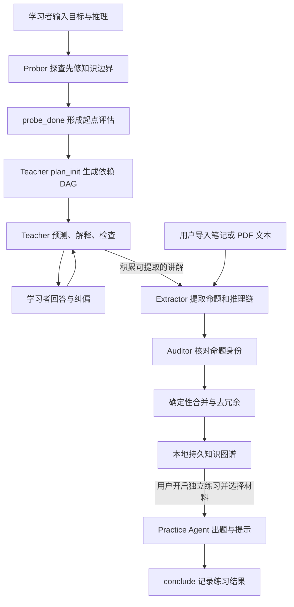
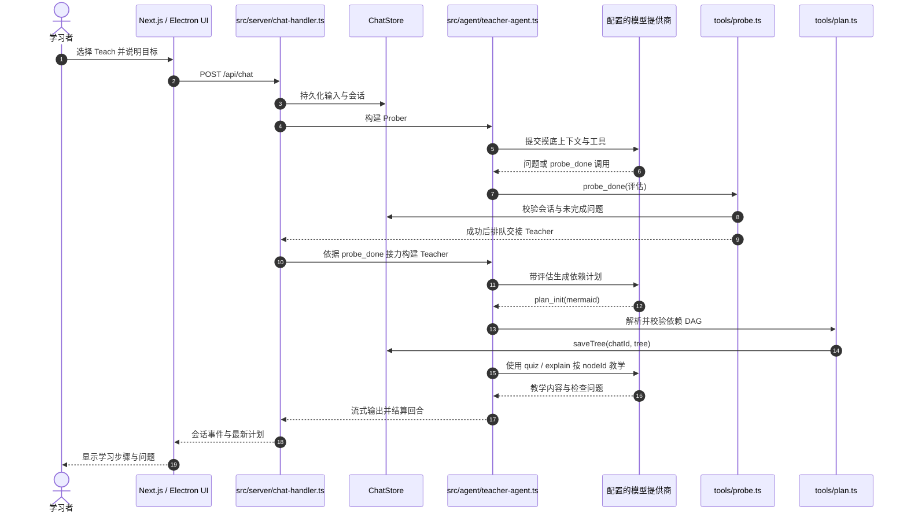

# LearnHarness：先摸底再教学的开源 AI 学习私教

## 一句话定义

**LearnHarness**（[amosblomqvist/learnharness](https://github.com/amosblomqvist/learnharness)）是一个面向复杂知识学习的 **agent harness**：通过摸底提问定位学习者的理解边界，规划先修依赖，按「预测—解释—检查」教学，再用独立练习和持久命题推理图支持跨会话接续。

## 英文缩写速查

| 缩写 | 英文全称 | 简要说明 |
|------|----------|----------|
| AI | Artificial Intelligence | 学习 Agent 通过配置的 AI 模型生成问题、解释和练习 |
| LLM | Large Language Model | Prober、Teacher、Practice 以及图谱抽取/审计调用的语言模型 |
| DAG | Directed Acyclic Graph | `plan_init` 校验的无环先修知识依赖图 |
| PDF | Portable Document Format | 教学会话可附加的学习材料；另有独立的图谱文件导入入口 |
| API | Application Programming Interface | 接入模型服务、可选听写与搜索的调用接口 |
| CLI | Command-Line Interface | 官方支持使用已安装的 Claude Code CLI；开发也有 npm 命令 |
| KG | Knowledge Graph | 命题 proposition 与推理链 reasoning chain 的跨会话知识图，而非能力评分表 |

## 为什么重要

- **回答“从哪里讲起”而非先倾倒答案：** Prober 根据作答、信心和自由推理描述识别已掌握前提与盲区；教学难度由此确定，而非默认所有人同一个起点。
- **把教学依赖显式化：** Teacher 调用 `plan_init` 生成先修关系图；随新证据可以重写计划，每个解释或检查使用节点 ID 标记位置。
- **理解与提取分开练：** Teach 引导预测、解释、纠偏；Practice 独立提出变式题，通过学习者的推理选择提示，而不是只复述刚学过的段落。
- **以推理关系保留知识：** 知识图谱整理被教过的主张及前提链，供之后会话取用；这与以“掌握分数”代表学习效果不同。

对 Robotics_Notebooks 读者，它可用于分步骤梳理机器人运动学、控制推导、强化学习与 Sim2Real 论文。**LearnHarness 是通用学习工具，不是机器人仿真、模型训练或真机控制框架。**

## 核心原理

| 阶段 | 输入 | 机制与输出 |
|------|------|------------|
| **Measure / Probe（摸底）** | 学习目标、问题答案、自述推理与信心 | Prober 追问关键先修链的理解边界，通过 `probe_done` 形成评估并交接 |
| **Plan（规划）** | 摸底评估和目标 | Teacher 用 `plan_init` 提交 Mermaid 先修 DAG；服务器解析、检查无环并保存 |
| **Teach（教学）** | 当前先修节点、学习者预测与作答 | `quiz` / `explain` 逐步解释和检验，发现理解断层时调整教学 |
| **Practice（练习）** | 用户发起的独立练习会话、可选图谱材料 | `problem` 提交一道题与隐藏解答；`conclude` 记录结果并揭示解答 |
| **Graph（知识记录）** | 教师讲解文本或用户导入的笔记 | Extractor 提取命题/链 → Auditor 做命题身份审计 → 确定性合并落盘 |

**关键区分：** `plan_init` 的 **lesson plan DAG** 是一节课的先修结构；**knowledge graph** 是从教师讲解或笔记中事后抽取的命题和推理链。二者不是同一个图，也不以图谱节点直接记录答对率或掌握度。

### 流程总览

图中 **Graph → Practice** 仅表示用户可以选择已有图谱材料发起练习，**不**意味着每次教学结束都自动生成练习，或将练习结果写成图谱掌握分数。

## 源码运行时序图

以下时序依据上游 `src/server/chat-handler.ts`、`src/agent/teacher-agent.ts`、`src/agent/tools/{probe,plan}.ts` 的真实执行边界绘制，表示 Teach 会话从摸底进入规划与教学的**代表路径**；每个用户回合都会基于已保存历史重新构建 Agent。

**图谱更新是独立后处理**：`src/agent/subagents/extraction.ts` 在触发条件满足或显式导入时，执行 extractor → identity auditor → `mergeFindings`；不是上述 Teach 回合里每题必运行的同步调用。源码与官方架构文档以固定版本 [cb25c8e](https://github.com/amosblomqvist/learnharness/tree/cb25c8e49b85eed9e78315584731cad73a0118a6) 核对，**本次未实际安装运行**。

## 工程实践

| 场景 | 操作或核查重点 |
|------|----------------|
| **桌面入门** | 从 [官网](https://learnharness.ai/) 或 [Releases](https://github.com/amosblomqvist/learnharness/releases) 安装；设置 Strong/Cheap/Vision 模型后启动 Teach |
| **模型连接** | 用户自备模型 API key、支持的订阅连接、Claude Code CLI，或 OpenAI-compatible endpoint（可接本地模型服务） |
| **读机器人论文** | 桌面会话附加论文 PDF 路径，围绕运动学推导或策略结构向 Prober 说明学习目标 |
| **真正导入图谱** | `Extract files` 是另一入口；支持 PDF、Markdown 和文本等，PDF 本地转文本但**不做 OCR**，每份限 25 MiB |
| **口述思路** | 可选 Deepgram 听写；音频服务请求需配置单独的 key，不属于默认离线功能 |
| **本地开发** | 上游 README：`npm ci` → `npm run plugins:setup` → `npm run dev`；`npm test` 为官方测试入口，未在本次执行 |
| **数据位置** | 会话、图谱和设置存本地文件；项目文件可读不代表模型端不接收内容，凭据为受文件权限保护的明文文件 |
| **开源状态** | **已开源**，AGPL-3.0；macOS Apple Silicon、Windows x64、Linux x64 提供桌面构建 |

### 与其他学习工具对比

| 工具 | 主流程差异 | 持久知识结构 |
|------|------------|--------------|
| **LearnHarness** | 先摸底与依赖规划，再预测式教学；独立 Practice | 跨会话命题与推理链，**不以掌握分数入图** |
| [Get It.](get-it-study-companion.md) | 从 PDF/Markdown 检测概念，可视化、卡片/测验/Feynman 复习 | 文档概念图与学习日志，有四轴评价 |
| [DeepTutor](deeptutor.md) | 更广的 Chat、Knowledge Center、多引擎 RAG、Book/Skills/Partner 工作区 | L1–L3 长期记忆与 Memory Graph |

## 局限与风险

- **学习效果没有在本次独立验证：** 官方演示和源码能说明设计机制，不能推导出对考试成绩、知识迁移的普遍提升。
- **知识图谱不是掌握度评估：** 节点被提取代表讲解或资料中出现了相应命题，**不证明**学习者已理解、会做题或已经记住。
- **模型输出仍需核验：** 解释、问题、命题抽取及同一性审计涉及 LLM；机器人控制、数学推导与论文结论应回到原始材料验证。
- **本地存储 ≠ 全程离线：** 云模型、订阅/CLI、检索和语音服务可能接触输入内容并计费；凭据以本地明文文件存放，注意访问权限。
- **文件处理边界：** 会话里拖入文件传递的是本地路径，并不等于把 PDF 全文上传到知识图谱；扫描件的图谱导入不含 OCR。
- **应用不是零成本的“内置模型”：** 项目不收取 LearnHarness 订阅费，但模型、搜索与听写服务的实际资费仍由供应方决定。

## 关联页面

- [Get It. Study Companion](get-it-study-companion.md)：对照文档可视化、复习日志与节点评分；LearnHarness 更强调摸底及推理链。
- [DeepTutor](deeptutor.md)：对照 RAG / Book / Skills 的综合学习平台与诊断式教学 harness。
- [Karpathy LLM Wiki](../references/llm-wiki-karpathy.md)：比较人工维护的结构化 wiki 与学习会话抽取的个人命题图。

## 参考来源

- [LearnHarness 官方仓库与源码归档（本站）](../../sources/repos/learnharness.md)
- [LearnHarness 官方站点归档（本站）](../../sources/sites/learnharness-ai.md)
- [官方 README（固定版本）](https://github.com/amosblomqvist/learnharness/blob/cb25c8e49b85eed9e78315584731cad73a0118a6/README.md)
- [Getting Started（固定版本）](https://github.com/amosblomqvist/learnharness/blob/cb25c8e49b85eed9e78315584731cad73a0118a6/docs/getting-started.md)
- [Architecture（固定版本）](https://github.com/amosblomqvist/learnharness/blob/cb25c8e49b85eed9e78315584731cad73a0118a6/docs/architecture.md)

## 推荐继续阅读

- [Teaching Methodology](https://github.com/amosblomqvist/learnharness/blob/cb25c8e49b85eed9e78315584731cad73a0118a6/docs/teaching-methodology.md) — 设计的教学方法论，适合区分产品愿景与实现。
- [Plan Tool 源码](https://github.com/amosblomqvist/learnharness/blob/cb25c8e49b85eed9e78315584731cad73a0118a6/src/agent/tools/plan.ts) — 依赖 DAG 校验及保存。
- [Extraction 源码](https://github.com/amosblomqvist/learnharness/blob/cb25c8e49b85eed9e78315584731cad73a0118a6/src/agent/subagents/extraction.ts) — 命题图谱的提取、审计与合并。
