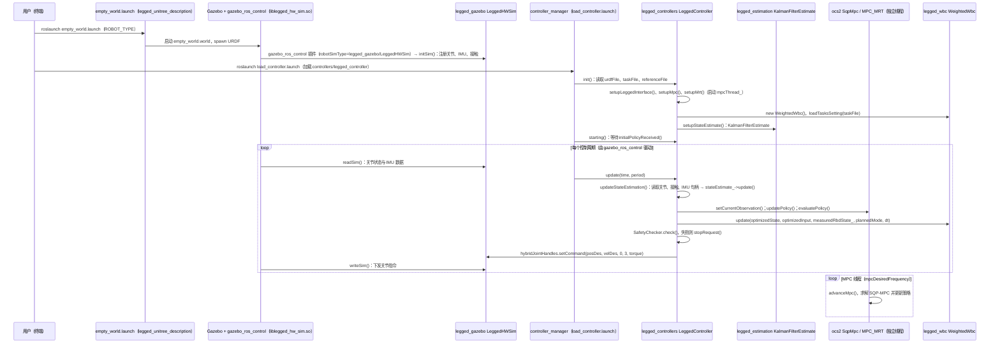

# legged_control

**legged_control**（[GitHub](https://github.com/qiayuanl/legged_control)）来自 [古月居转载的四足机器人开源项目综述](https://mp.weixin.qq.com/s/pRGoPm41qYCNyHPWR6Dl6A)，属「优化控制（MPC / WBC）」组。

## 一句话定义

**legged_control 是基于 OCS2 与 ros-control 的足式机器人 NMPC + WBC + 状态估计 + sim2real 框架（作者 Qiayuan Liao 等）。**

## 英文缩写速查

| 缩写 | 英文全称 | 简要说明 |
|------|----------|----------|
| OCS2 | Optimal Control for Switched Systems | ETH 切换系统最优控制库 |
| NMPC | Nonlinear Model Predictive Control | 非线性模型预测控制 |
| WBC | Whole-Body Control | 全身控制 |

## 为什么重要

- 综述把它放在「优化控制（MPC / WBC）」这条技术路线下，作为可读源码的参照项目；横向对比见 [四足机器人开源项目技术地图：从极简运动学到研究级硬件（36 个 GitHub 项目）](../overview/quadruped-open-source-projects-technology-map.md)。
- 文中星标：（文中未给）（文章表述，入库日未复核）。

## 核心信息

| 项 | 内容 |
|----|------|
| **仓库** | [qiayuanl/legged_control](https://github.com/qiayuanl/legged_control) |
| **最近提交** | 2025-02-13 |
| **可达性** | `git ls-remote` 可达（2026-11-01） |
| **文章归类** | 优化控制（MPC / WBC） |

## 文章说法核对

- **文章：** 文章称其在 Gazebo 中运行，包含 EKF/互补滤波状态估计、基于 SRBD 的 MPC、WBC 执行器与步态调度器；要求 ROS1 Noetic / Ubuntu 20.04。
- **README / 核查：** README 标题引用为「NMPC, WBC, state estimation, and sim2real framework for legged robots based on OCS2 and ros-controls」；顶部声明**软件已不再维护**，作者转向全新框架，并推荐带感知的 legged_perceptive。
- **差异与保留：** 文章未提「不再维护」；SRBD / SQP 等细节来自文章，未在 README 中逐项核对。

## 源码运行时序图

入口（仿真）：`roslaunch legged_unitree_description empty_world.launch`（先启动 Gazebo 并 spawn 机器人），再 `roslaunch legged_controllers load_controller.launch cheater:=false`（加载 `legged/LeggedController`）。README 同时给出实机入口 `legged_unitree_hw.launch`，本图不展开。

图依据：qiayuanl/legged_control@a7f381c，读过 `README.md`（Quick Start 段）、`legged_controllers/launch/load_controller.launch`、`legged_controllers/config/controllers.yaml`、`legged_controllers/src/LeggedController.cpp`（`init`、`starting`、`update`、`updateStateEstimation`、`setupMrt`、`setupStateEstimate` 段）、`legged_examples/legged_unitree/legged_unitree_description/launch/empty_world.launch`、`legged_examples/legged_unitree/legged_unitree_description/urdf/common/gazebo.xacro`（plugin 段）、`legged_gazebo/src/LeggedHWSim.cpp`（`initSim`、函数清单）、`legged_gazebo/legged_hw_sim_plugins.xml`、`legged_gazebo/config/default.yaml`。未运行代码。

说明：Gazebo 侧 `readSim`/`writeSim` 的调度循环位于外部包 gazebo_ros_control，未在本仓库中读取，图中的循环时序依据 `LeggedController` 的回调关系推断；`SqpMpc` 与 `WeightedWbc` 内部求解未读。仓库 README 声明该项目已不再维护。

## 关联页面

- [ocs2](../entities/ocs2.md)
- [model-predictive-control](../methods/model-predictive-control.md)
- [whole-body-control](../concepts/whole-body-control.md)
- [locomotion](../tasks/locomotion.md)
- [quadruped-open-source-projects-technology-map](../overview/quadruped-open-source-projects-technology-map.md)

## 参考来源

- [legged_control_ocs2.md](../../sources/repos/legged_control_ocs2.md)
- [wechat_guyueju_quadruped_opensource_deep_dive_2026-11-01.md](../../sources/blogs/wechat_guyueju_quadruped_opensource_deep_dive_2026-11-01.md)
- [原文（微信公众号）](https://mp.weixin.qq.com/s/pRGoPm41qYCNyHPWR6Dl6A)
- 源码核对（2026-11-02）：qiayuanl/legged_control@a7f381c，读过 README.md（Quick Start 段）、legged_controllers/launch/load_controller.launch、legged_controllers/config/controllers.yaml、legged_controllers/src/LeggedController.cpp（init/starting/update/updateStateEstimation/setupMrt/setupStateEstimate 段）、legged_examples/legged_unitree/legged_unitree_description/launch/empty_world.launch、legged_examples/legged_unitree/legged_unitree_description/urdf/common/gazebo.xacro（plugin 段）、legged_gazebo/src/LeggedHWSim.cpp（initSim 段及函数清单）、legged_gazebo/legged_hw_sim_plugins.xml、legged_gazebo/config/default.yaml；时序图依据以上文件，未运行代码。
