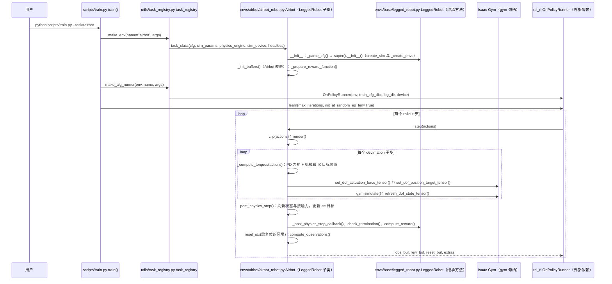

# legged-robots-manipulation

**legged-robots-manipulation**（[GitHub](https://github.com/aCodeDog/legged-robots-manipulation)）来自 [古月居转载的四足机器人开源项目综述](https://mp.weixin.qq.com/s/pRGoPm41qYCNyHPWR6Dl6A)，属「轮足机器人」组。

## 一句话定义

**legged-robots-manipulation 是 (轮)足机器人移动操作仓库（IROS 2024 Oral 项目的部分实现），基于 legged_gym，含 airbot、go2_arx、b2w_z1、aliengo_z1 与 b2w。**

## 英文缩写速查

| 缩写 | 英文全称 | 简要说明 |
|------|----------|----------|
| B2W | Unitree B2-W | 宇树轮足平台（文章称） |
| IROS | IEEE/RSJ International Conference on Intelligent Robots and Systems | 机器人会议 |

## 为什么重要

- 综述把它放在「轮足机器人」这条技术路线下，作为可读源码的参照项目；横向对比见 [四足机器人开源项目技术地图：从极简运动学到研究级硬件（36 个 GitHub 项目）](../overview/quadruped-open-source-projects-technology-map.md)。
- 文中星标：（文中未给）（文章表述，入库日未复核）。

## 核心信息

| 项 | 内容 |
|----|------|
| **仓库** | [aCodeDog/legged-robots-manipulation](https://github.com/aCodeDog/legged-robots-manipulation) |
| **最近提交** | 2025-07-10 |
| **可达性** | `git ls-remote` 可达（2026-11-01） |
| **文章归类** | 轮足机器人 |

## 文章说法核对

- **文章：** 文章把它描述为基于宇树 B2W 的轮足移动操作项目，在统一 RL 框架中整合腿部与机械臂控制。
- **README / 核查：** README 称当前仓库为论文的部分实现、仍在建设，Isaac Lab 版本与端到端视觉版本为待办；项目页为 wheel-legged-loco-manipulation。
- **差异与保留：** 仓库未声明 LICENSE 文件；内容是论文部分实现，不是完整复现。

## 源码运行时序图

入口：`python loco_manipulation_gym/scripts/train.py --task=airbot --rl_device=cuda:0`（先在 `loco_manipulation_gym/` 下 `pip install -e .`；依赖 Isaac Gym 与 rsl_rl）。图以 `airbot` 任务为例，其它任务共用 `LeggedRobot` 基类流程。

图依据：aCodeDog/legged-robots-manipulation@adf97d3，读过 `README.md`（Installation、Train 段）、`loco_manipulation_gym/scripts/train.py`（全文）、`loco_manipulation_gym/envs/__init__.py`（任务注册段）、`loco_manipulation_gym/utils/task_registry.py`（`make_env`、`make_alg_runner` 段）、`loco_manipulation_gym/envs/base/legged_robot.py`（`__init__`、`step`、`post_physics_step` 段）、`loco_manipulation_gym/envs/airbot/airbot_robot.py`（`step`、`post_physics_step`、`_compute_torques`、`compute_observations` 段）。`rsl_rl` 的 `OnPolicyRunner.learn` 为外部依赖，未读。未运行代码。

说明：README 的训练命令写作 `python tran.py`（拼写错误）且 `python train.py` 位于仓库根目录，但实际脚本位于 `loco_manipulation_gym/scripts/train.py`，以上以实际路径为准。

## 关联页面

- [loco-manipulation](../tasks/loco-manipulation.md)
- [legged-gym](../entities/legged-gym.md)
- [reinforcement-learning](../methods/reinforcement-learning.md)
- [locomotion](../tasks/locomotion.md)
- [quadruped-open-source-projects-technology-map](../overview/quadruped-open-source-projects-technology-map.md)

## 参考来源

- [legged_robots_manipulation.md](../../sources/repos/legged_robots_manipulation.md)
- [wechat_guyueju_quadruped_opensource_deep_dive_2026-11-01.md](../../sources/blogs/wechat_guyueju_quadruped_opensource_deep_dive_2026-11-01.md)
- [原文（微信公众号）](https://mp.weixin.qq.com/s/pRGoPm41qYCNyHPWR6Dl6A)
- 源码核对（2026-11-02）：aCodeDog/legged-robots-manipulation@adf97d3，读过 README.md（Installation、Train 段）、loco_manipulation_gym/scripts/train.py、loco_manipulation_gym/envs/__init__.py（任务注册段）、loco_manipulation_gym/utils/task_registry.py（make_env、make_alg_runner 段）、loco_manipulation_gym/envs/base/legged_robot.py（__init__、step、post_physics_step 段）、loco_manipulation_gym/envs/airbot/airbot_robot.py（step、post_physics_step、_compute_torques、compute_observations 段）；时序图依据以上文件，未运行代码。
